# Capítulo V: Product Implementation, Validation & Deployment

## 5.1. Software Configuration Management
 
Esta sección establece las herramientas, convenciones y configuraciones que el equipo utiliza para mantener la consistencia del proyecto VitalTrek a lo largo de su ciclo de vida. Se documentan el entorno de desarrollo, el esquema de control de versiones con GitFlow, las convenciones de codificación y la configuración de despliegue de cada producto. Estas decisiones permiten coordinar el trabajo de los cinco integrantes, mantener trazabilidad sobre cada cambio y reproducir el entorno en cualquier equipo.
 
### 5.1.1. Software Development Environment Configuration
 
La siguiente tabla especifica los productos de software que el equipo utiliza, agrupados por tipo de actividad del ciclo de vida. Para los productos basados en modelos SaaS se indica la ruta de referencia; para los que se ejecutan en el computador de cada integrante se indica la ruta de descarga.
 
| Actividad | Producto | Propósito de uso en el proyecto | Tipo | Ruta de referencia o descarga |
| --- | --- | --- | --- | --- |
| Project Management | Jira Software | Gestionar el Product Backlog, los Sprint Backlogs, las Engineering Tasks y las estimaciones en Story Points y horas. | SaaS | https://www.atlassian.com/software/jira |
| Project Management | Discord | Coordinar las ceremonias del Sprint y la comunicación diaria del equipo. | SaaS / aplicación de escritorio | https://discord.com/download |
| Requirements Management | UXPressia | Elaborar las fichas de User Persona, los Journey Maps, los Empathy Maps y el Impact Map. | SaaS | https://uxpressia.com/ |
| Requirements Management | Miro | Elaborar el Big Picture EventStorming y el Design-Level EventStorming. | SaaS | https://miro.com/ |
| Product UX/UI Design | Figma | Elaborar los wireframes, mock-ups y prototipos del Landing Page y de las Web Applications. | SaaS | https://www.figma.com/ |
| Software Development | Git | Controlar las versiones del código fuente en el computador de cada integrante y aplicar el flujo de ramas de GitFlow. | Instalación local | https://git-scm.com/downloads |
| Software Development | GitHub | Alojar los repositorios de la organización del equipo, gestionar los Pull Requests y registrar la colaboración. | SaaS | https://github.com/ |
| Software Development | Visual Studio Code | Editar el código del Landing Page, de las Web Applications y la documentación en Markdown. | Instalación local | https://code.visualstudio.com/download |
| Software Development | Google Chrome | Verificar la navegación, el comportamiento responsive y la accesibilidad del Landing Page y de las Web Applications mediante sus herramientas de desarrollo. | Instalación local | https://www.google.com/chrome/ |
| Software Development | Vue.js | Construir las Frontend Web Applications con Vue 3 y Vite, junto con Pinia, Vue Router, Axios, PrimeVue y vue-i18n. Implementado en el Sprint 2 (TB1). | Instalación local (vía npm) | https://vuejs.org/ |
| Software Development | json-server | Ejecutar la Fake API con recursos JSON de prueba que consumen las Web Applications. Implementado en el Sprint 2 (TB1). | Instalación local (vía npm) | https://github.com/typicode/json-server |
| Software Development | JetBrains Rider | Editar, compilar y depurar el RESTful Web Services en C#. Utilizado desde el Sprint 3 (AV2). | Instalación local | https://www.jetbrains.com/rider/download/ |
| Software Development | .NET SDK 10 y C# | Construir el RESTful Web Services con ASP.NET Core y Entity Framework Core. Implementado en el Sprint 3 (AV2). | Instalación local | https://dotnet.microsoft.com/download |
| Software Development | MySQL Server y MySQL Workbench | Persistir localmente la información del RESTful Web Services y revisar las tablas generadas por las migraciones de Entity Framework Core. Implementado en el Sprint 3 (AV2). | Instalación local | https://dev.mysql.com/downloads/ |
| Software Deployment | Vercel | Desplegar y publicar el Landing Page y las Web Applications a partir de sus repositorios de GitHub. | SaaS | https://vercel.com/ |
| Software Deployment | Docker | Empaquetar el RESTful Web Services en una imagen de contenedor a partir del `Dockerfile` del repositorio. La imagen se construye en Render. | Archivo de configuración en el repositorio | https://www.docker.com/ |
| Software Deployment | Render | Desplegar el RESTful Web Services como Web Service basado en Docker a partir de la rama `main`. | SaaS | https://render.com/ |
| Software Deployment | Railway MySQL | Alojar la base de datos MySQL administrada que utiliza el RESTful Web Services desplegado. | SaaS | https://railway.app/ |
| Software Documentation | Scalar (OpenAPI) | Publicar y probar la documentación OpenAPI de los endpoints del RESTful Web Services. Implementado en el Sprint 3 (AV2). | Paquete NuGet del proyecto | https://scalar.com/ |
| Software Documentation | Markdown | Redactar el informe del proyecto y los archivos README de cada repositorio. | Formato abierto | https://www.markdownguide.org/ |
| Software Documentation | dbdiagram.io | Elaborar el Database Diagram de la sección 4.8. | SaaS | https://dbdiagram.io/ |
| Software Documentation | PlantUML | Elaborar los Class Diagrams de la sección 4.7. | Instalación local / SaaS | https://plantuml.com/download |
| Software Documentation | Microsoft PowerPoint | Elaborar la presentación de exposición de cada entrega. | Instalación local | https://www.microsoft.com/microsoft-365/powerpoint |
| Software Documentation | Microsoft Stream | Publicar los videos de exposición y de navegación del producto. | SaaS | https://www.microsoft.com/microsoft-365/microsoft-stream |
 
### 5.1.2. Source Code Management
 
El código fuente de VitalTrek se administra con **Git** como sistema de control de versiones y **GitHub** como plataforma de alojamiento y colaboración. Cada producto de la solución mantiene su propio repositorio dentro de la organización del equipo, de modo que sus ciclos de vida y despliegues sean independientes.
 
| Producto | Repositorio | Rama por defecto | Estado en AV2 |
| --- | --- | --- | --- |
| Project Report | https://github.com/1ASI0729-2620-16712-G4-Nexatech/report | `develop` | En elaboración |
| Landing Page | https://github.com/1ASI0729-2620-16712-G4-Nexatech/landing-page | `main` | Implementado y desplegado |
| Frontend Web Applications | https://github.com/1ASI0729-2620-16712-G4-Nexatech/web-applications | `develop` | Implementado y desplegado (`v1.1.0`); consume el RESTful Web Services en IAM y Expedition Setup |
| RESTful Web Services | https://github.com/1ASI0729-2620-16712-G4-Nexatech/vitaltrek-backend | `develop` | Implementado y desplegado (`v1.0.0`) |
 
En el caso del RESTful Web Services, el repositorio contiene la solución `VitalTrek.Platform.sln` con el proyecto `VitalTrek.API`, organizado por bounded contexts, junto con sus migraciones de base de datos y el `Dockerfile` utilizado para el despliegue.
 
#### GitFlow como Workflow de branching y colaboración
 
El equipo aplica **GitFlow**, según el modelo descrito por Vincent Driessen en *A successful Git branching model*. El repositorio mantiene dos ramas de larga duración y tres tipos de ramas de apoyo.
 
**Ramas de larga duración**
 
| Rama | Propósito | Quién integra en ella |
| --- | --- | --- |
| `main` | Contiene únicamente versiones estables y publicadas. Cada integración en esta rama corresponde a una Release etiquetada. | Solo mediante Pull Request desde `release/*` o `hotfix/*`. |
| `develop` | Integra el trabajo aprobado de todas las funcionalidades en curso. Es la base desde la que nacen las ramas de funcionalidad. | Solo mediante Pull Request desde `feature/*`. |
 
**Ramas de apoyo y sus convenciones de nombre**
 
| Tipo | Convención de nombre | Nace de | Se integra en | Ejemplo real del proyecto |
| --- | --- | --- | --- | --- |
| Feature | `feature/<ámbito>-<descripción-breve>` en inglés y `kebab-case` | `develop` | `develop` | `feature/landing-seo-a11y` |
| Release | `release/vMAJOR.MINOR.PATCH` | `develop` | `main` y `develop` | `release/v1.0.0` |
| Hotfix | `hotfix/vMAJOR.MINOR.PATCH-<descripción-breve>` | `main` | `main` y `develop` | `hotfix/v1.0.1-contact-form-validation` |
 
Reglas aplicables a los nombres de rama:
 
1. Se escriben íntegramente en inglés y en minúsculas, con palabras separadas por guion.
2. El ámbito identifica el producto o el capítulo afectado: `landing`, `webapp`, `api`, `chapter-3`.
3. No se usan espacios, caracteres acentuados ni mayúsculas.
4. Una rama de funcionalidad corresponde a una sola User Story o Technical Story, y se elimina una vez integrada.

**Flujo de trabajo**
 
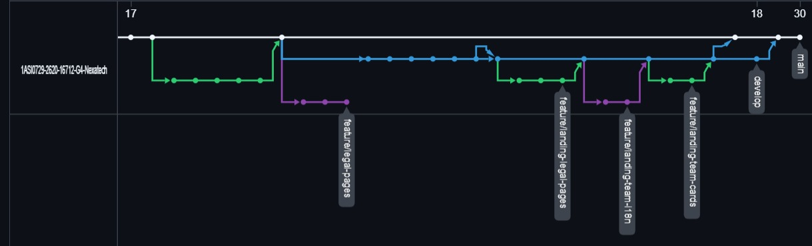
 
*Figura 5.0. Flujo de ramas aplicado en los repositorios de VitalTrek.*
 
**Política de Pull Requests**
 
1. Toda integración a `develop` y a `main` se realiza mediante Pull Request; no se permite empujar directamente a ninguna de las dos.
2. Cada Pull Request indica en su descripción la User Story o Technical Story que resuelve y los criterios de aceptación cubiertos.
3. Un Pull Request requiere la revisión y aprobación de al menos un integrante distinto de su autor.
4. La rama de funcionalidad se elimina después de la integración.
#### Semantic Versioning
 
Las Releases se nombran según **Semantic Versioning 2.0.0**, con el formato `vMAJOR.MINOR.PATCH`:
 
| Componente | Se incrementa cuando | Ejemplo |
| --- | --- | --- |
| `MAJOR` | Se introduce un cambio incompatible con la versión anterior. | `v2.0.0` |
| `MINOR` | Se agrega funcionalidad manteniendo la compatibilidad. | `v1.1.0` |
| `PATCH` | Se corrige un defecto sin agregar funcionalidad. | `v1.0.1` |
 
La versión publicada al cierre del Sprint 1 es **`v1.0.0`**, correspondiente a la primera versión funcional y desplegada del Landing Page. Cada Release se etiqueta en `main` con su número de versión.
 
#### Conventional Commits
 
Los mensajes de commit siguen la especificación **Conventional Commits 1.0.0**, con la estructura:
 
```
<tipo>(<alcance>): <descripción en imperativo y en inglés>
 
[cuerpo opcional]
```
 
| Tipo | Se usa para |
| --- | --- |
| `feat` | Agregar una funcionalidad nueva. |
| `fix` | Corregir un defecto. |
| `docs` | Cambios que solo afectan documentación. |
| `style` | Cambios de formato que no alteran el comportamiento. |
| `refactor` | Reestructurar código sin cambiar su comportamiento externo. |
| `test` | Agregar o corregir pruebas. |
| `chore` | Tareas de mantenimiento, configuración o dependencias. |
 
Ejemplos tomados del repositorio del proyecto:
 
```
feat(a11y): add skip to main content link
feat(seo): complete meta tags defined in report 4.2.3
docs(chapter5): add Jorge Mateo Leon commits to development evidence
style(a11y): add skip link styles
```
 
> **Nota sobre la adopción de las convenciones.** El equipo adoptó formalmente Conventional Commits y la convención de nombres de rama a partir del 7 de septiembre de 2026. Los commits y ramas anteriores a esa fecha, registrados en la sección 5.2.1.4, no siguen la convención, dado que corresponden al período de configuración inicial del repositorio. No se reescribió el historial para preservar la trazabilidad de los aportes individuales. A partir de esa fecha, la convención se verifica durante la revisión de cada Pull Request.
 
### 5.1.3. Source Code Style Guide & Conventions
 
El equipo adopta guías de estilo estándar para cada lenguaje de la solución. Todos los identificadores, nombres de archivo, clases, funciones y comentarios se redactan en inglés, conforme a lo indicado en el enunciado del trabajo final.
 
| Tecnología | Convenciones adoptadas | Referencia |
| --- | --- | --- |
| HTML5 | Elementos semánticos, etiquetas y atributos en minúscula, atributos entre comillas dobles, texto alternativo en toda imagen informativa, indentación de dos espacios. | [Google HTML/CSS Style Guide](https://google.github.io/styleguide/htmlcssguide.html) · [W3Schools HTML Style Guide](https://www.w3schools.com/html/html5_syntax.asp) |
| CSS3 | Clases e identificadores en `kebab-case`, variables centralizadas en `tokens.css`, enfoque mobile-first, una declaración por línea. | [Google HTML/CSS Style Guide](https://google.github.io/styleguide/htmlcssguide.html) |
| JavaScript | Variables y funciones en `camelCase`, constantes en `UPPER_SNAKE_CASE`, uso de `const` y `let` en lugar de `var`, funciones con una sola responsabilidad, punto y coma obligatorio. | [Google JavaScript Style Guide](https://google.github.io/styleguide/jsguide.html) · [MDN JavaScript Guidelines](https://developer.mozilla.org/en-US/docs/MDN/Writing_guidelines/Code_style_guide/JavaScript) |
| Vue.js | Componentes en `PascalCase` con nombre de varias palabras, props en `camelCase` dentro del script y en `kebab-case` en la plantilla, un componente por archivo. | [Vue Style Guide](https://vuejs.org/style-guide/) |
| C# | Clases, métodos y propiedades en `PascalCase`; parámetros y variables locales en `camelCase`; interfaces con prefijo `I`. Planificado para el RESTful Web Services. | [C# Coding Conventions](https://learn.microsoft.com/en-us/dotnet/csharp/fundamentals/coding-style/coding-conventions) · [ASP.NET Core Engineering Guidelines](https://github.com/dotnet/aspnetcore/wiki/Engineering-guidelines) |
| Gherkin | Un escenario por comportamiento, redacción en tiempo presente y tercera persona, sin referencias a elementos de interfaz. | [Gherkin Reference](https://cucumber.io/docs/gherkin/reference/) |
| Markdown | Encabezados jerárquicos sin saltar niveles, enlaces relativos entre capítulos, imágenes con texto alternativo, tablas con formato consistente. | [Markdown Guide](https://www.markdownguide.org/basic-syntax/) |
 
Ejemplos aplicados en el Landing Page:
 
```html
<section class="safety-features" aria-labelledby="safety-title">
  <h2 id="safety-title" data-i18n="safetyTitle">Checkpoint synchronization</h2>
</section>
```
 
```css
:root {
  --forest-green: #0f3d2e;
  --safety-amber: #f2a93b;
}
 
.request-demo-button {
  background-color: var(--safety-amber);
}
```
 
```javascript
const DEFAULT_LOCALE = 'en-US';
 
function setLanguage(selectedLocale) {
  document.documentElement.lang = selectedLocale;
  localStorage.setItem('vitaltrek-language', selectedLocale);
}
```
 
### 5.1.4. Software Deployment Configuration
 
El despliegue de cada producto parte de su repositorio de código fuente. En AV1 se desplegó el Landing Page y en TB1 se desplegaron las Web Applications, ambos en Vercel a partir de sus repositorios de GitHub. En AV2 se desplegó el RESTful Web Services en Render como contenedor Docker, conectado a una base de datos MySQL administrada en Railway.
 
| Producto | Plataforma | Rama de despliegue | Estado |
| --- | --- | --- | --- |
| Landing Page | Vercel | `main` | Desplegado (`v1.1.0`) |
| Frontend Web Applications | Vercel | `main` | Desplegado (`v1.1.0`) |
| RESTful Web Services | Render (Docker) y Railway MySQL | `main` | Desplegado (`v1.0.0`) |
 
#### Configuración del Landing Page
 
| Parámetro | Valor |
| --- | --- |
| Repositorio | https://github.com/1ASI0729-2620-16712-G4-Nexatech/landing-page |
| Plataforma | Vercel |
| Production Branch | `main` |
| Framework preset | Other (HTML, CSS y JavaScript estáticos) |
| Build command | No aplica |
| Output directory | Directorio raíz del repositorio |
| Variables de entorno | No requeridas |
| URL pública de producción | https://landing-page-mrca1.vercel.app/ |
| Versión desplegada | `v1.1.0` (Sprint 3); `v1.0.0` en el Sprint 1 |
 
#### Pasos para lograr el despliegue desde el repositorio
 
1. El integrante desarrolla la funcionalidad en su rama `feature/*` y abre un Pull Request hacia `develop`.
2. Otro integrante revisa el Pull Request y verifica que se cumplan los criterios de aceptación de la historia correspondiente.
3. Aprobado el Pull Request, la rama se integra en `develop` y se elimina.
4. Al cerrar el Sprint se crea la rama `release/vX.Y.Z` desde `develop`, donde se ejecutan las validaciones finales: marcado W3C, enlaces internos, comportamiento responsive, cambio de idioma y accesibilidad por teclado.
5. La rama de Release se integra en `main` mediante Pull Request y se etiqueta con su número de versión.
6. Vercel detecta el cambio en la Production Branch y ejecuta el despliegue automático.
7. Se verifica la URL pública de producción y se registra la evidencia en la sección 5.2.X.7 del Sprint correspondiente.

#### Configuración de las Web Applications

| Parámetro | Valor |
| --- | --- |
| Repositorio | https://github.com/1ASI0729-2620-16712-G4-Nexatech/web-applications |
| Plataforma | Vercel |
| Production Branch | `main` |
| Framework preset | Vite |
| Build command | `npm run build` |
| Output directory | `dist` |
| Rewrites | `vercel.json` redirige todas las rutas a `index.html` para la navegación de la SPA |
| Variable `VITE_VITALTREK_API_URL` | `https://vitaltrek-backend.onrender.com/api/v1`, URL base del RESTful Web Services |
| Variable `VITE_SIMULATED_OPERATIONS` | `false` (definida en `.env.production`); los contextos aún no implementados en el API muestran que estarán disponibles en un próximo sprint |
| URL pública de producción | https://web-applications-vert.vercel.app/ |
| Versión desplegada | `v1.1.0` |

#### Configuración del RESTful Web Services

| Parámetro | Valor |
| --- | --- |
| Repositorio | https://github.com/1ASI0729-2620-16712-G4-Nexatech/vitaltrek-backend |
| Plataforma del servicio | Render, Web Service en plan Free |
| Runtime | Docker: `Dockerfile` en la raíz del repositorio, con imágenes oficiales del SDK y del runtime de ASP.NET Core 10 |
| Production Branch | `main` |
| Región | Singapore (Southeast Asia) |
| Puerto | Variable `PORT` inyectada por Render; 8080 por defecto |
| Base de datos | Railway MySQL, plan Starter, conexión cifrada (`SslMode=Required`) |
| Configuración de producción | `appsettings.Production.json`, cuya cadena de conexión y clave de firma se completan con variables de entorno al iniciar la aplicación |
| Migraciones | Se aplican automáticamente al iniciar la aplicación mediante Entity Framework Core |
| Documentación | Scalar en `/scalar` y especificación OpenAPI en `/openapi/v1.json` |
| URL pública de producción | https://vitaltrek-backend.onrender.com |
| Versión desplegada | `v1.0.0` |

Las variables de entorno se registran únicamente en Render y no se versionan en el repositorio:

| Variable | Propósito |
| --- | --- |
| `ASPNETCORE_ENVIRONMENT` | Valor `Production`; carga `appsettings.Production.json`. |
| `ASPNETCORE_FORWARDEDHEADERS_ENABLED` | Valor `true`; permite reconocer el esquema HTTPS detrás del proxy de Render. |
| `DATABASE_URL` | Host del servicio MySQL en Railway. |
| `DATABASE_PORT` | Puerto del servicio MySQL en Railway. |
| `DATABASE_USER` | Usuario de la base de datos. |
| `DATABASE_PASSWORD` | Contraseña de la base de datos. |
| `DATABASE_SCHEMA` | Base de datos utilizada (`defaultdb`). |
| `TOKEN_SECRET` | Clave de firma de los tokens JWT (HS256). |

#### Pasos para lograr el despliegue del RESTful Web Services desde el repositorio

1. El integrante desarrolla la funcionalidad en su rama `feature/*` y abre un Pull Request hacia `develop`.
2. Al cerrar el Sprint se crea la rama `release/vX.Y.Z` desde `develop`, donde se incorporan los ajustes de configuración de producción.
3. La rama de Release se integra en `main` y en `develop` mediante Pull Requests, y `main` se etiqueta con su número de versión.
4. Render detecta el cambio en la Production Branch, construye la imagen Docker y reinicia el servicio.
5. Al iniciar, la aplicación aplica las migraciones pendientes sobre la base de datos de Railway y carga los datos de demostración si la base de datos está vacía.
6. Se verifica la documentación en `/scalar` ejecutando el inicio de sesión y una consulta autenticada, y se registra la evidencia en la sección 5.2.X.7 del Sprint correspondiente.

## 5.2. Landing Page, Services & Applications Implementation

Esta sección documenta la implementación, validación y despliegue de los productos incluidos en la solución VitalTrek. Para AV1, el alcance se concentra en la primera versión funcional y desplegada del Landing Page, desarrollado con HTML5, CSS3 y JavaScript. En TB1, el Sprint 2 amplía el producto con las Web Applications frontend para configurar expediciones y consultar su progreso mediante una Fake API y datos simulados. El RESTful Web Services productivo, la persistencia real y la integración con dispositivos permanecen fuera del alcance de esta entrega.

### 5.2.1. Sprint 1

El Sprint 1 tiene como objetivo implementar y publicar la primera versión del Landing Page de VitalTrek. El alcance comprende las User Stories US01 a US06 y US33, relacionadas con la navegación, la propuesta de valor, los planes, la información del equipo, la solicitud de información, el cambio de idioma y la publicación de los términos de servicio y la política de privacidad; y las Technical Stories TS01 a TS04, que habilitan la estructura técnica, la adaptación a distintos dispositivos, la internacionalización con accesibilidad y el despliegue. La estimación total del Sprint es de 30 Story Points.

| Campo | Valor |
| --- | --- |
| Sprint Velocity | 30 Story Points |
| Total de Story Points | 30 |

#### 5.2.1.1. Sprint Planning 1

La reunión de planificación permitió definir el objetivo, alcance, responsabilidades y tareas del primer Sprint. El trabajo se enfocó en entregar un Landing Page responsive, accesible y coherente con los wireframes, mock-ups, Style Guidelines e Information Architecture definidos en el capítulo IV.

| **Sprint #** | **Sprint 1** |
| --- | --- |
| **Sprint Planning Background**  |
| Date | 2026-09-05 |
| Time | 08:00 PM |
| Location | Reunión virtual en Discord |
| Prepared By | Rodriguez Rojas, Miler Alexander |
| Attendees (to planning meeting) | Cayanchi Avila, Milenko Rubén / Herrera Enriquez, Diego Fernando / León Naupari, Jorge Mateo / Mendoza Blanco, Ariel Roberto / Rodriguez Rojas, Miler Alexander |
| Sprint 0 Review Summary | No aplica. El Sprint 1 es el primer Sprint del proyecto; no existe un incremento previo que revisar. |
| Sprint 0 Retrospective Summary | No aplica. El Sprint 1 es el primer Sprint del proyecto; no existe un Sprint previo sobre el cual realizar una retrospectiva. |
| **Sprint Goal & User Stories**  |
| Sprint 1 Goal | **Our focus is on** publishing a bilingual and responsive Landing Page that presents the VitalTrek value proposition to adventure tourism agencies and adventure tourists.<br>**We believe it delivers** a clear understanding of the solution and a direct channel to request information or a demo **to** visitors from both target segments.<br>**This will be confirmed when** the Landing Page is deployed on a public URL and visitors can browse all its sections in Spanish and English, and submit an information request from desktop and mobile web browsers. |
| Sprint 1 Velocity | 30 Story Points |
| Sum of Story Points | 30 Story Points (US01, US02, US03, US04, US05, US06, US33, TS01, TS02, TS03 y TS04) |


#### 5.2.1.2. Aspect Leaders and Collaborators

La siguiente matriz organiza el liderazgo y la colaboración del equipo durante el Sprint 1, en correspondencia con las tareas registradas en el Sprint Backlog.

| Integrante | Usuario de GitHub | IAM y seguridad | Expedition Setup API | Persistencia y OpenAPI | Integración de Web Applications | Landing Page y despliegue |
| --- | --- | --- | --- | --- | --- | --- |
| Cayanchi Avila, Milenko Rubén | `MaxghZZ` | L | C | C | C | C |
| León Naupari, Jorge Mateo | `mateool10` | C | L | C | C | C |
| Rodriguez Rojas, Miler Alexander | `Miler2003` | C | C | L | C | C |
| Mendoza Blanco, Ariel Roberto | `Trepequiper` | C | C | C | L | C |
| Herrera Enriquez, Diego Fernando | `DerDFHE` | C | C | C | C | L |

**Leyenda:** L = Leader; C = Collaborator.

### 5.2.3. Sprint 3

El Sprint 3 tiene como objetivo implementar y desplegar la primera versión del RESTful Web Services de VitalTrek e integrarlo con las Web Applications. El alcance comprende las Technical Stories TS06, TS07 y TS09 y las User Stories US07 a US16, que habilitan la infraestructura de persistencia, la documentación OpenAPI, la seguridad con JWT y los endpoints de Expedition Setup. La estimación total del Sprint es de 57 Story Points.

| Campo | Valor |
| --- | --- |
| Sprint Velocity | 57 Story Points |
| Total de Story Points | 57 |

#### 5.2.3.1. Sprint Planning 3

La reunión de planificación permitió definir el objetivo, alcance, responsabilidades y tareas del tercer Sprint. El trabajo se enfocó en entregar el backend productivo del bounded context Expedition Setup con persistencia en MySQL, integrado con las Web Applications ya desplegadas en Vercel.

| **Sprint #** | **Sprint 3** |
| --- | --- |
| **Sprint Planning Background** |  |
| Date | <!-- COMPLETAR --> |
| Time | <!-- COMPLETAR --> |
| Location | Reunión virtual en Discord |
| Prepared By | Rodriguez Rojas, Miler Alexander |
| Attendees (to planning meeting) | Cayanchi Avila, Milenko Rubén / Herrera Enriquez, Diego Fernando / León Naupari, Jorge Mateo / Mendoza Blanco, Ariel Roberto / Rodriguez Rojas, Miler Alexander |
| Sprint 2 Review Summary | <!-- COMPLETAR --> |
| Sprint 2 Retrospective Summary | <!-- COMPLETAR --> |
| **Sprint Goal & User Stories** |  |
| Sprint 3 Goal | <!-- COMPLETAR --> |
| Sprint 3 Velocity | 57 Story Points |
| Sum of Story Points | 57 Story Points (TS06, TS07, TS09, US07, US08, US09, US10, US11, US12, US13, US14, US15, US16) |


#### 5.2.3.2. Aspect Leaders and Collaborators

La siguiente matriz organiza el liderazgo y la colaboración del equipo durante el Sprint 3, en correspondencia con las tareas registradas en el Sprint Backlog.

| Integrante | Usuario de GitHub | IAM y seguridad | Expedition Setup API | Persistencia y OpenAPI | Integración de Web Applications | Landing Page y despliegue |
| --- | --- | --- | --- | --- | --- | --- |
| Cayanchi Avila, Milenko Rubén | `MaxghZZ` | L | C | C | C | C |
| León Naupari, Jorge Mateo | `mateool10` | C | L | C | C | C |
| Rodriguez Rojas, Miler Alexander | `Miler2003` | C | C | L | C | C |
| Mendoza Blanco, Ariel Roberto | `Trepequiper` | C | C | C | L | C |
| Herrera Enriquez, Diego Fernando | `DerDFHE` | C | C | C | C | L |

**Leyenda:** L = Leader; C = Collaborator.

#### 5.2.3.3. Sprint Backlog 3

El Sprint Backlog 3 se enfoca en la primera versión del RESTful Web Services de VitalTrek y en su integración con las Web Applications. Las User Stories y Technical Stories seleccionadas se descompusieron en tasks estimadas entre 4 y 8 horas, cuyo avance se registró en Jira Software con los estados To-do, In-Process, To-Review y Done.

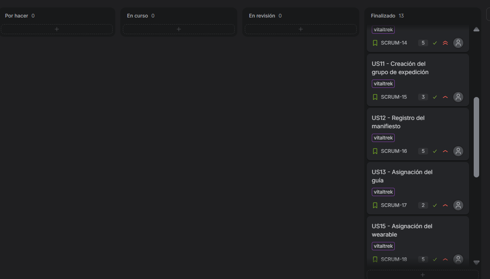

*Figura 5.X. Board del Sprint 3 en Jira Software con las 13 historias (57 Story Points) en estado Finalizado.*

**Enlace público del board:** [Jira — VitalTrek](https://milenkorvu.atlassian.net/jira/software/projects/SCRUM/boards/1/backlog)

| **Sprint #** | **Sprint 3** | | | | | | |
| --- | --- | --- | --- | --- | --- | --- | --- |
| **User Story Id** | **User Story Title** | **Work-Item / Task Id** | **Title** | **Description** | **Estimation (Hours)** | **Assigned To** | **Status (To-do / In-Process / To-Review / Done)** |
| TS07 | Persistencia y migraciones | T-42 | Infraestructura compartida y contexto de datos | Configurar el Shared kernel, el DbContext con MySQL, la convención snake_case y el acortamiento de nombres largos de claves e índices. | 6 | Cayanchi Avila, Milenko Rubén | Done |
| TS06 | Contratos del RESTful API | T-43 | OpenAPI, Scalar y localización | Configurar la generación de OpenAPI, la documentación con Scalar, las rutas kebab-case y los mensajes localizados en inglés y español. | 5 | Rodriguez Rojas, Miler Alexander | Done |
| TS07 | Persistencia y migraciones | T-44 | Migraciones y datos de demostración | Generar las migraciones de cada bounded context y cargar los datos de demostración de agencias, usuarios, rutas y grupos. | 5 | León Naupari, Jorge Mateo | Done |
| TS09 | Seguridad, autenticación y privacidad | T-45 | Registro de agencias e inicio de sesión con JWT | Implementar sign-up y sign-in con contraseñas cifradas mediante BCrypt y emisión de tokens JWT firmados con HS256. | 8 | Cayanchi Avila, Milenko Rubén | Done |
| TS09 | Seguridad, autenticación y privacidad | T-46 | Autorización por roles y gestión de usuarios | Implementar el middleware de autorización por rol y agencia, y los endpoints de consulta y creación de usuarios. | 6 | Mendoza Blanco, Ariel Roberto | Done |
| TS09 | Seguridad, autenticación y privacidad | T-47 | Sesión JWT en las Web Applications | Consumir el inicio de sesión del API, guardar el token con su expiración y enviarlo mediante un interceptor HTTP. | 6 | Herrera Enriquez, Diego Fernando | Done |
| US07 | Configuración de rutas | T-48 | Agregado Route y endpoints de rutas | Implementar el agregado Route y los endpoints de consulta, registro en `draft` y cambio de estado de rutas. | 6 | León Naupari, Jorge Mateo | Done |
| US08 | Definición de checkpoints | T-49 | Endpoints de checkpoints | Implementar el registro y la consulta de checkpoints con validación de orden, coordenadas e identificador Bluetooth únicos. | 5 | Mendoza Blanco, Ariel Roberto | Done |
| US09 | Ventanas de tiempo esperadas | T-50 | Endpoints de ventanas de tiempo | Implementar el registro y la consulta de ventanas esperadas por tramo con límites mínimo y máximo válidos. | 5 | Rodriguez Rojas, Miler Alexander | Done |
| US10 | Protocolo de seguridad | T-51 | Protocolos de seguridad y notas de ruta | Implementar los endpoints de protocolos de seguridad y notas de ruta, e integrarlos en la preparación del grupo. | 5 | Herrera Enriquez, Diego Fernando | Done |
| US11 | Creación del grupo de expedición | T-52 | Endpoints de grupos de expedición | Implementar la creación de grupos para rutas habilitadas con fecha de salida no pasada y capacidad máxima. | 5 | Rodriguez Rojas, Miler Alexander | Done |
| US13 | Asignación del guía | T-53 | Guías de campo y asignación con control de fechas | Implementar el registro de guías y la asignación al grupo con confirmación explícita ante cruces de fecha. | 5 | León Naupari, Jorge Mateo | Done |
| US12 | Registro del manifiesto | T-54 | Endpoints del manifiesto de turistas | Implementar el registro de participantes con validación de documento único, cruce de fechas y capacidad del grupo. | 5 | Mendoza Blanco, Ariel Roberto | Done |
| US15 | Asignación del wearable | T-55 | Inventario y asignación de wearables | Implementar el inventario de wearables y su asignación a la preparación de cada participante. | 6 | Cayanchi Avila, Milenko Rubén | Done |
| US14 | Registro de contacto de emergencia | T-56 | Endpoint de contacto de emergencia | Implementar el registro del contacto de emergencia por el propio Adventure Tourist. | 4 | Herrera Enriquez, Diego Fernando | Done |
| US16 | Activación del wearable | T-57 | Consentimiento y activación del wearable | Implementar el otorgamiento y la revocación del consentimiento de monitoreo, que activa o desactiva el wearable asignado. | 4 | Rodriguez Rojas, Miler Alexander | Done |
| US07 | Configuración de rutas | T-58 | Integración de Expedition Setup en las Web Applications | Adaptar los stores de rutas, checkpoints, ventanas, grupos, guías y manifiesto a los endpoints del API. | 6 | León Naupari, Jorge Mateo | Done |
| US15 | Asignación del wearable | T-59 | Integración de la preparación del participante | Adaptar la asignación de wearables, el contacto de emergencia y el consentimiento a los endpoints del API. | 5 | Mendoza Blanco, Ariel Roberto | Done |
| TS06 | Contratos del RESTful API | T-60 | Despliegue del API en Render y Railway | Configurar la base de datos MySQL en Railway, el Web Service con Docker en Render y sus variables de entorno. | 6 | Cayanchi Avila, Milenko Rubén | Done |
| TS06 | Contratos del RESTful API | T-61 | Despliegue de las Web Applications y del Landing Page | Publicar las versiones `v1.1.0` en Vercel y configurar la URL del API desplegado. | 4 | Herrera Enriquez, Diego Fernando | Done |
| — | Mejoras del Landing Page (feedback TB1) | T-62 | Responsive y contenido del hero | Corregir la grilla de características en móvil y el texto duplicado del hero. | 4 | Herrera Enriquez, Diego Fernando | Done |
| — | Mejoras del Landing Page (feedback TB1) | T-63 | Enlaces a la app y redes sociales | Centralizar la URL de las Web Applications en los CTA y agregar redes sociales y ubicación. | 4 | Rodriguez Rojas, Miler Alexander | Done |


**Resumen del Sprint Backlog 3**

| Concepto | Valor |
| --- | ---: |
| User Stories y Technical Stories asignadas | 13 |
| Work-items resultantes de la descomposición | 22 |
| Estimación mínima de una task | 4 horas |
| Estimación máxima de una task | 8 horas |
| Total de horas estimadas | 115 |
| Sum of Story Points | 57 |

**Distribución de la carga por integrante**

| Integrante | Tasks | Horas |
| --- | ---: | ---: |
| Cayanchi Avila, Milenko Rubén | 4 | 26 |
| León Naupari, Jorge Mateo | 4 | 22 |
| Mendoza Blanco, Ariel Roberto | 4 | 21 |
| Rodriguez Rojas, Miler Alexander | 5 | 23 |
| Herrera Enriquez, Diego Fernando | 5 | 23 |
| **Total** | **22** | **115** |

Las dos tasks de mejora del Landing Page responden a la retroalimentación de TB1 y no suman Story Points.

#### 5.2.3.4. Development Evidence for Sprint Review

En el Sprint 3 se implementó la primera versión del RESTful Web Services de VitalTrek en el repositorio [vitaltrek-backend](https://github.com/1ASI0729-2620-16712-G4-Nexatech/vitaltrek-backend), desarrollado con ASP.NET Core 10 y C# en JetBrains Rider. El proyecto se organiza en los módulos Shared, IAM y Expedition Setup, aplica las capas de dominio, aplicación, infraestructura e interfaces, implementa la persistencia en MySQL mediante Entity Framework Core con migraciones versionadas y documenta sus endpoints con OpenAPI. La versión `v1.0.0` se preparó en la rama `release/v1.0.0`, se integró en `main` y `develop` mediante Pull Requests y se etiquetó en `main`. Asimismo, se registran los cambios realizados en el Landing Page y en las Web Applications durante el Sprint. Todas las contribuciones siguieron GitFlow y Conventional Commits.

| Repository | Branch | Commit Id | Commit Message | Commit Message Body | Committed on (Date) |
| --- | --- | --- | --- | --- | --- |
| 1ASI0729-2620-16712-G4-Nexatech/vitaltrek-backend | `main` | `ee3c556` | chore: initial scaffold | — | 2026-10-28 |
| 1ASI0729-2620-16712-G4-Nexatech/vitaltrek-backend | `main` | `9345935` | fix: remove corrupted VitalRek.Apí folder | — | 2026-10-28 |
| 1ASI0729-2620-16712-G4-Nexatech/vitaltrek-backend | `feature/shared-infrastructure` | `def4ee0` | chore: rename solution to VitalTrek and add shared infrastructure | Add Shared kernel (Result, repositories, unit of work, DbContext, kebab-case routes), i18n resources, MySQL configuration, CORS, Scalar and Dockerfile. | 2026-10-28 |
| 1ASI0729-2620-16712-G4-Nexatech/vitaltrek-backend | `feature/iam-bounded-context` | `3a5c3f6` | feat(iam): add IAM bounded context with JWT authentication | Add agencies and users, sign-up and sign-in, role-based authorization middleware, users endpoints, localized OpenAPI metadata, demo data seeding and initial migration. | 2026-10-29 |
| 1ASI0729-2620-16712-G4-Nexatech/vitaltrek-backend | `feature/iam-bounded-context` | `cd32c5f` | feat(iam): add initial database migration | — | 2026-10-29 |
| 1ASI0729-2620-16712-G4-Nexatech/vitaltrek-backend | `feature/expedition-setup-routes` | `4514175` | feat(expedition-setup): add routes, checkpoints, expected time windows, route notes and safety protocols | — | 2026-10-29 |
| 1ASI0729-2620-16712-G4-Nexatech/vitaltrek-backend | `feature/expedition-setup-routes` | `d62e131` | fix(expedition-setup): shorten segment index name and add database migration | — | 2026-10-29 |
| 1ASI0729-2620-16712-G4-Nexatech/vitaltrek-backend | `feature/expedition-setup-groups` | `ebe5c10` | feat(expedition-setup): add expedition groups, field guides, tourist manifest, wearables and participant preparation | — | 2026-10-29 |
| 1ASI0729-2620-16712-G4-Nexatech/vitaltrek-backend | `release/v1.0.0` | `3df83d0` | chore(deploy): configure production database connection and container port | — | 2026-10-29 |
| 1ASI0729-2620-16712-G4-Nexatech/vitaltrek-backend | `main` | `8886380` | Release/v1.0.0 | Pull Request de `release/v1.0.0` hacia `main`; etiqueta `v1.0.0`. | 2026-10-31 |
| 1ASI0729-2620-16712-G4-Nexatech/web-applications | `feature/backend-integration` | `9e824d8` | feat(webapp): consume VitalTrek RESTful API for IAM and expedition setup | — | 2026-10-31 |
| 1ASI0729-2620-16712-G4-Nexatech/web-applications | `develop` | `9585e7b` | feat(webapp): consume VitalTrek RESTful API for IAM and expedition setup | Pull Request de `feature/backend-integration` hacia `develop`. | 2026-10-31 |
| 1ASI0729-2620-16712-G4-Nexatech/web-applications | `main` | `4166921` | Release/v1.1.0 | Pull Request de `release/v1.1.0` hacia `main`; etiqueta `v1.1.0`. | 2026-10-31 |
| 1ASI0729-2620-16712-G4-Nexatech/landing-page | `main` | `5b1d52c` | feat: redirige botones Get Started y Go to VitalTrek a la app | — | 2026-10-06 |
| 1ASI0729-2620-16712-G4-Nexatech/landing-page | `develop` | `69cf64e` | fix(responsive): use single-column features grid on mobile to remove horizontal scroll | — | 2026-10-28 |
| 1ASI0729-2620-16712-G4-Nexatech/landing-page | `develop` | `1ce678c` | feat(links): centralize Web App URL with data-app-path and point segment CTAs to the app | — | 2026-10-28 |
| 1ASI0729-2620-16712-G4-Nexatech/landing-page | `develop` | `4e88070` | feat(social): add social media links and location to contact and footer | — | 2026-10-28 |
| 1ASI0729-2620-16712-G4-Nexatech/landing-page | `develop` | `c96a3c3` | fix: remove duplicated hero text, dev comments and fix login placeholder i18n | — | 2026-10-28 |
| 1ASI0729-2620-16712-G4-Nexatech/landing-page | `main` | `4649e05` | Release/v1.1.0 | Pull Request de `release/v1.1.0` hacia `main`; etiqueta `v1.1.0`. | 2026-10-31 |

#### 5.2.3.5. Execution Evidence for Sprint Review

Al cierre del Sprint 3, las Web Applications de VitalTrek consumen el RESTful Web Services desplegado en Render para la autenticación y la gestión de cuentas (IAM) y para la configuración de expediciones (Expedition Setup). El inicio de sesión obtiene un token JWT que se envía en cada solicitud, y el API restringe cada operación según el rol y la agencia del usuario. Las funcionalidades de Field Tracking, Checkpoint Sync, Safety Monitoring, Incident Response y Tour Closure se muestran como disponibles en un próximo sprint, a la espera de su implementación en el backend. A continuación se presentan capturas del recorrido realizado con las cuentas de demostración de Operations Administrator, Field Guide y Adventure Tourist.

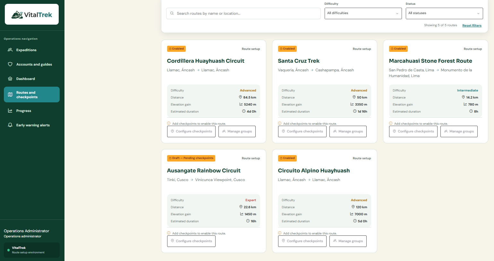

*Figura 5.X. Listado de rutas de la agencia obtenido con `GET /api/v1/routes`.*

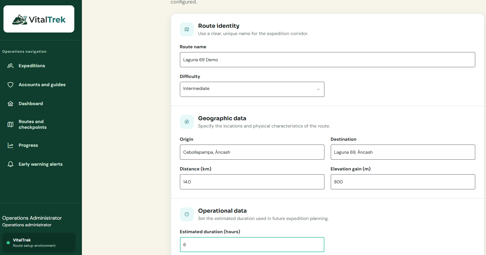

*Figura 5.X. Registro de la ruta `Laguna 69 Demo` (US07), enviado con `POST /api/v1/routes`.*

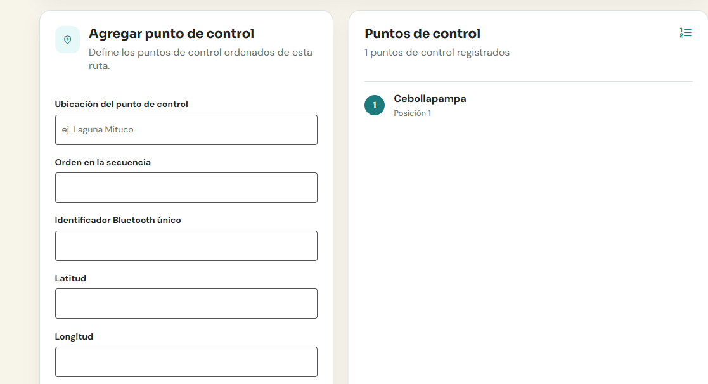

*Figura 5.X. Registro del checkpoint `Cebollapampa` con coordenadas e identificador Bluetooth (US08).*

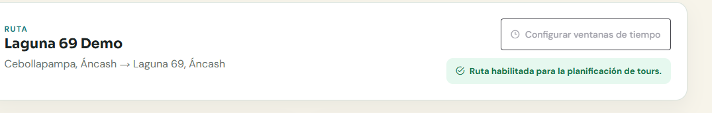

*Figura 5.X. Habilitación de la ruta mediante `PATCH /api/v1/routes/{id}/status`.*

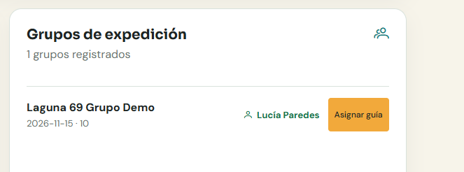

*Figura 5.X. Creación del grupo `Laguna 69 Grupo Demo` y asignación de la guía Lucía Paredes (US11 y US13).*

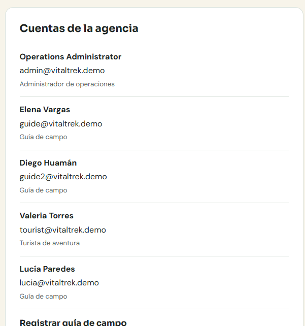

*Figura 5.X. Creación de la cuenta del Field Guide `lucia@vitaltrek.demo` mediante `POST /api/v1/users`.*

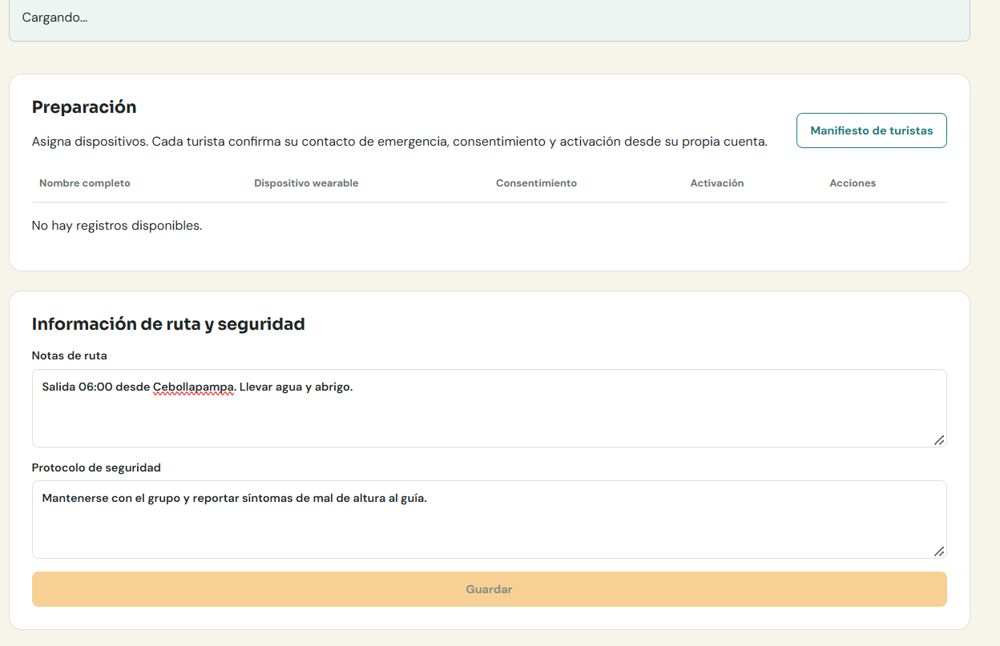

*Figura 5.X. Registro de las notas de ruta y del protocolo de seguridad del grupo (US10).*

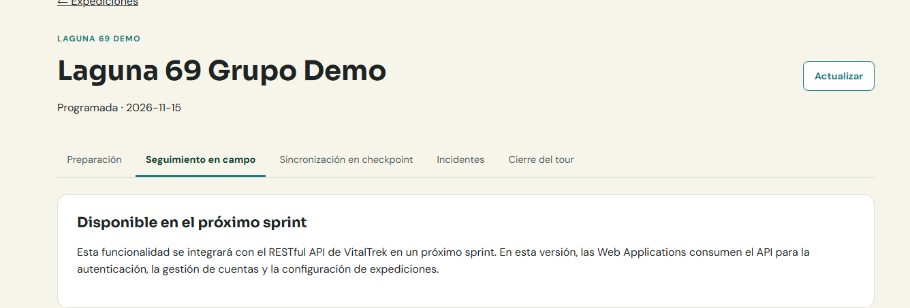

*Figura 5.X. Pestaña de seguimiento en campo, cuya integración con el RESTful API se realizará en un próximo sprint.*

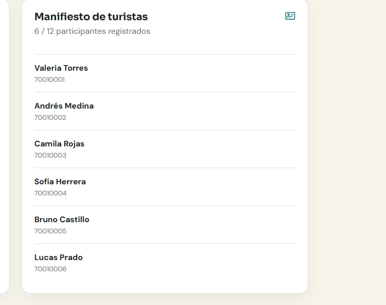

*Figura 5.X. Registro del participante `Lucas Prado` en el manifiesto por la guía asignada (US12).*

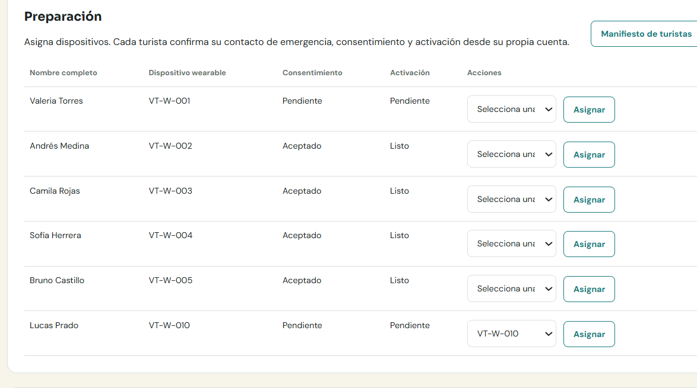

*Figura 5.X. Asignación del wearable `VT-W-010` mediante `PUT /api/v1/participant-preparations/{id}/wearable-assignment` (US15).*

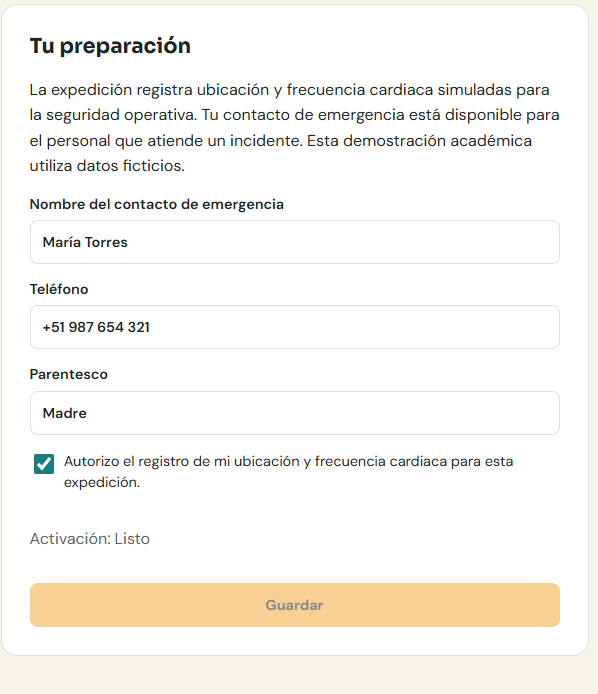

*Figura 5.X. Registro del contacto de emergencia y del consentimiento del turista; el wearable queda activado (US14 y US16).*

**Video de navegación del Sprint 3:** [upc-pre-202620-1asi0730-16712-nexatech-productnavigation-sprint-3](<!-- COMPLETAR: URL de Microsoft Stream -->)

#### 5.2.3.6. Services Documentation Evidence for Sprint Review

En el Sprint 3 se documentaron con OpenAPI Specification los 41 endpoints implementados en el RESTful Web Services. La especificación se genera a partir del proyecto ASP.NET Core con `Microsoft.AspNetCore.OpenApi` y se publica mediante **Scalar**, que permite explorar y ejecutar cada operación desde el navegador. Para cada endpoint se describen el verbo HTTP, la ruta, los parámetros, el cuerpo de la solicitud y los posibles responses; las descripciones de las operaciones se muestran en español mediante recursos localizados. Todos los endpoints, excepto los de autenticación, requieren el header `Authorization: Bearer <token>` con el token obtenido en el inicio de sesión, y cada operación se limita a los datos de la agencia del usuario autenticado.

**Repositorio:** [vitaltrek-backend](https://github.com/1ASI0729-2620-16712-G4-Nexatech/vitaltrek-backend)<br>
**Documentación desplegada (Scalar):** [https://vitaltrek-backend.onrender.com/scalar](https://vitaltrek-backend.onrender.com/scalar)<br>
**Especificación OpenAPI:** [https://vitaltrek-backend.onrender.com/openapi/v1.json](https://vitaltrek-backend.onrender.com/openapi/v1.json)

| Endpoint | HTTP Verb | Call Syntax | Parameters | Response Example | Response Explanation |
| --- | --- | --- | --- | --- | --- |
| `/api/v1/authentication/sign-up` | POST | `POST /api/v1/authentication/sign-up` | Body: `agencyName`, `name`, `username`, `password` | `201 Created` — `{ "id": 3, "username": "owner@agency.pe", "role": "operations_administrator", "agencyId": 2 }` | Registra una agencia y su Operations Administrator. 400 si los datos son inválidos y 409 si el usuario ya existe. No requiere token. |
| `/api/v1/authentication/sign-in` | POST | `POST /api/v1/authentication/sign-in` | Body: `username`, `password` | `200 OK` — `{ "id": 1, "username": "admin@vitaltrek.demo", "role": "operations_administrator", "agencyId": 1, "token": "eyJ..." }` | Autentica al usuario y devuelve un token bearer válido por 12 horas. 401 si las credenciales son inválidas. No requiere token. |
| `/api/v1/users` | GET | `GET /api/v1/users` | Header: `Authorization: Bearer <token>` | `200 OK` — lista de usuarios de la agencia | Lista los usuarios de la agencia. Solo Operations Administrator (403 para otros roles). |
| `/api/v1/users/{id}` | GET | `GET /api/v1/users/{id}` | Path: `id` | `200 OK` — usuario | Obtiene un usuario de la agencia. 404 si no existe. |
| `/api/v1/users` | POST | `POST /api/v1/users` | Body: `name`, `username`, `password`, `role`, `fieldGuideId`, `identityDocument` | `201 Created` — usuario creado | Crea un usuario Field Guide o Adventure Tourist en la agencia. Solo Operations Administrator; 409 si el usuario ya existe. |
| `/api/v1/routes` | GET | `GET /api/v1/routes` | — | `200 OK` — `[{ "id": 1, "name": "Cordillera Huayhuash Circuit", "difficulty": "Advanced", "status": "enabled" }]` | Lista las rutas de la agencia (US07). |
| `/api/v1/routes/{id}` | GET | `GET /api/v1/routes/{id}` | Path: `id` | `200 OK` — ruta | Obtiene una ruta de la agencia. 404 si no existe. |
| `/api/v1/routes` | POST | `POST /api/v1/routes` | Body: `name`, `origin`, `destination`, `distanceKm`, `elevationGainMeters`, `difficulty`, `estimatedDurationMinutes` | `201 Created` — ruta en estado `draft` | Registra una ruta en borrador (US07). Solo Operations Administrator. |
| `/api/v1/routes/{id}/status` | PATCH | `PATCH /api/v1/routes/{id}/status` | Path: `id`; Body: `status` | `200 OK` — ruta con el nuevo estado | Habilita o deshabilita una ruta. 409 si se intenta habilitar sin checkpoints. |
| `/api/v1/checkpoints` | GET | `GET /api/v1/checkpoints` | Query opcional: `routeId` | `200 OK` — lista de checkpoints | Lista los checkpoints de la agencia, opcionalmente por ruta (US08). |
| `/api/v1/checkpoints/{id}` | GET | `GET /api/v1/checkpoints/{id}` | Path: `id` | `200 OK` — checkpoint | Obtiene un checkpoint. 404 si no existe. |
| `/api/v1/checkpoints` | POST | `POST /api/v1/checkpoints` | Body: `routeId`, `location`, `sequenceOrder`, `bluetoothId`, `latitude`, `longitude` | `201 Created` — checkpoint creado | Registra un checkpoint Bluetooth en una ruta (US08). 409 ante orden o identificador duplicado. |
| `/api/v1/expected-time-windows` | GET | `GET /api/v1/expected-time-windows` | Query opcional: `routeId` | `200 OK` — lista de ventanas | Lista las ventanas de tiempo esperadas (US09). |
| `/api/v1/expected-time-windows/{id}` | GET | `GET /api/v1/expected-time-windows/{id}` | Path: `id` | `200 OK` — ventana | Obtiene una ventana de tiempo. 404 si no existe. |
| `/api/v1/expected-time-windows` | POST | `POST /api/v1/expected-time-windows` | Body: `routeId`, `fromCheckpointId`, `toCheckpointId`, `minimumMinutes`, `maximumMinutes` | `201 Created` — ventana creada | Registra el tiempo mínimo y máximo entre dos checkpoints (US09). |
| `/api/v1/route-notes` | GET | `GET /api/v1/route-notes` | Query opcional: `routeId` | `200 OK` — lista de notas | Lista las notas de ruta de la agencia. |
| `/api/v1/route-notes/{id}` | GET | `GET /api/v1/route-notes/{id}` | Path: `id` | `200 OK` — nota | Obtiene una nota de ruta. 404 si no existe. |
| `/api/v1/route-notes` | POST | `POST /api/v1/route-notes` | Body: `routeId`, `title`, `content`, `displayOrder` | `201 Created` — nota creada | Registra una nota de ruta consultable en campo. Solo Operations Administrator. |
| `/api/v1/route-notes/{id}` | PUT | `PUT /api/v1/route-notes/{id}` | Path: `id`; Body: `title`, `content`, `displayOrder` | `200 OK` — nota actualizada | Actualiza una nota de ruta. |
| `/api/v1/safety-protocols` | GET | `GET /api/v1/safety-protocols` | Query opcional: `routeId` | `200 OK` — lista de protocolos | Lista los protocolos de seguridad (US10). |
| `/api/v1/safety-protocols/{id}` | GET | `GET /api/v1/safety-protocols/{id}` | Path: `id` | `200 OK` — protocolo | Obtiene un protocolo. 404 si no existe. |
| `/api/v1/safety-protocols` | POST | `POST /api/v1/safety-protocols` | Body: `routeId`, `instructions` | `201 Created` — protocolo creado | Registra el protocolo de seguridad de una ruta (US10). |
| `/api/v1/safety-protocols/{id}` | PUT | `PUT /api/v1/safety-protocols/{id}` | Path: `id`; Body: `instructions`, `status` | `200 OK` — protocolo actualizado | Actualiza las instrucciones o el estado de un protocolo. |
| `/api/v1/field-guides` | GET | `GET /api/v1/field-guides` | — | `200 OK` — lista de guías | Lista los guías de la agencia. Solo Operations Administrator. |
| `/api/v1/field-guides/{id}` | GET | `GET /api/v1/field-guides/{id}` | Path: `id` | `200 OK` — guía | Obtiene un guía. 404 si no existe. |
| `/api/v1/field-guides` | POST | `POST /api/v1/field-guides` | Body: `name` | `201 Created` — guía creado | Registra un guía en la agencia. |
| `/api/v1/expedition-groups` | GET | `GET /api/v1/expedition-groups` | Query opcional: `routeId` | `200 OK` — lista de grupos | El administrador ve todos los grupos de la agencia; el guía, solo los asignados (US11). |
| `/api/v1/expedition-groups/{id}` | GET | `GET /api/v1/expedition-groups/{id}` | Path: `id` | `200 OK` — grupo | Obtiene un grupo visible para el usuario. 404 si no existe. |
| `/api/v1/expedition-groups` | POST | `POST /api/v1/expedition-groups` | Body: `routeId`, `name`, `departureDate`, `maximumCapacity` | `201 Created` — grupo en estado `scheduled` | Crea un grupo para una ruta habilitada (US11). Solo Operations Administrator. |
| `/api/v1/expedition-groups/{id}/field-guide` | PUT | `PUT /api/v1/expedition-groups/{id}/field-guide` | Path: `id`; Body: `fieldGuideId`, `confirmScheduleConflict` | `200 OK` — grupo con guía asignado | Asigna el guía responsable (US13). 409 si el guía tiene otro grupo en la misma fecha y no se confirmó el conflicto. |
| `/api/v1/manifest-entries` | GET | `GET /api/v1/manifest-entries` | Query opcional: `expeditionGroupId` | `200 OK` — lista de participantes | Lista los participantes visibles para el usuario (US12). |
| `/api/v1/manifest-entries/{id}` | GET | `GET /api/v1/manifest-entries/{id}` | Path: `id` | `200 OK` — participante | Obtiene un participante del manifiesto. 404 si no existe. |
| `/api/v1/manifest-entries` | POST | `POST /api/v1/manifest-entries` | Body: `expeditionGroupId`, `fullName`, `identityDocument` | `201 Created` — participante registrado | Registra un turista en el manifiesto y crea su preparación (US12). 409 si el grupo está lleno o el documento ya existe. |
| `/api/v1/wearable-devices` | GET | `GET /api/v1/wearable-devices` | — | `200 OK` — lista de wearables | Lista los wearables de la agencia. Solo Operations Administrator. |
| `/api/v1/wearable-devices/{id}` | GET | `GET /api/v1/wearable-devices/{id}` | Path: `id` | `200 OK` — wearable | Obtiene un wearable. 404 si no existe. |
| `/api/v1/wearable-devices` | POST | `POST /api/v1/wearable-devices` | Body: `code` | `201 Created` — wearable registrado | Registra un wearable disponible en la agencia. |
| `/api/v1/participant-preparations` | GET | `GET /api/v1/participant-preparations` | Query opcional: `expeditionGroupId` | `200 OK` — lista de preparaciones | Lista las preparaciones visibles para el usuario; el turista solo ve la suya. |
| `/api/v1/participant-preparations/{id}` | GET | `GET /api/v1/participant-preparations/{id}` | Path: `id` | `200 OK` — preparación | Obtiene una preparación. 404 si no existe. |
| `/api/v1/participant-preparations/{id}/wearable-assignment` | PUT | `PUT /api/v1/participant-preparations/{id}/wearable-assignment` | Path: `id`; Body: `wearableDeviceId` | `200 OK` — preparación con wearable asignado | Asigna un wearable a un participante (US15). 409 si el wearable no está disponible. |
| `/api/v1/participant-preparations/{id}/emergency-contact` | PUT | `PUT /api/v1/participant-preparations/{id}/emergency-contact` | Path: `id`; Body: `name`, `phone`, `relationship` | `200 OK` — preparación con contacto registrado | El turista registra su contacto de emergencia (US14). Solo Adventure Tourist. |
| `/api/v1/participant-preparations/{id}/consent` | PUT | `PUT /api/v1/participant-preparations/{id}/consent` | Path: `id`; Body: `granted` | `200 OK` — preparación con consentimiento y activación | El turista otorga o revoca el consentimiento de monitoreo; al otorgarlo se activa el wearable (US16). Solo Adventure Tourist. |

Los endpoints de creación responden `201 Created` y los de actualización `200 OK`. Ante datos inválidos responden `400 Bad Request`; sin token, `401 Unauthorized`; con un rol no autorizado, `403 Forbidden`; si el recurso no existe en la agencia, `404 Not Found`; y si se incumple una regla de negocio, `409 Conflict`.

A continuación se muestran capturas de la interacción con la documentación desplegada en Scalar usando los datos de demostración.

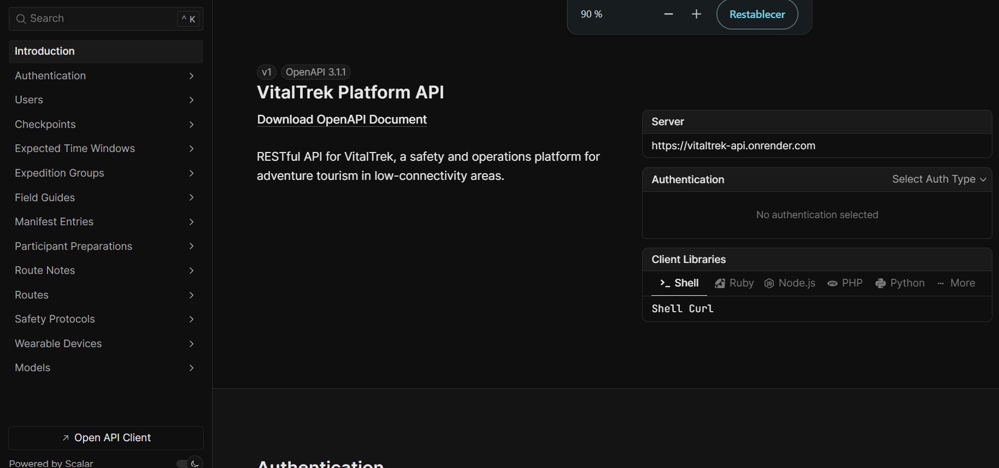

*Figura 5.X. Documentación del VitalTrek Platform API publicada con Scalar en Render.*

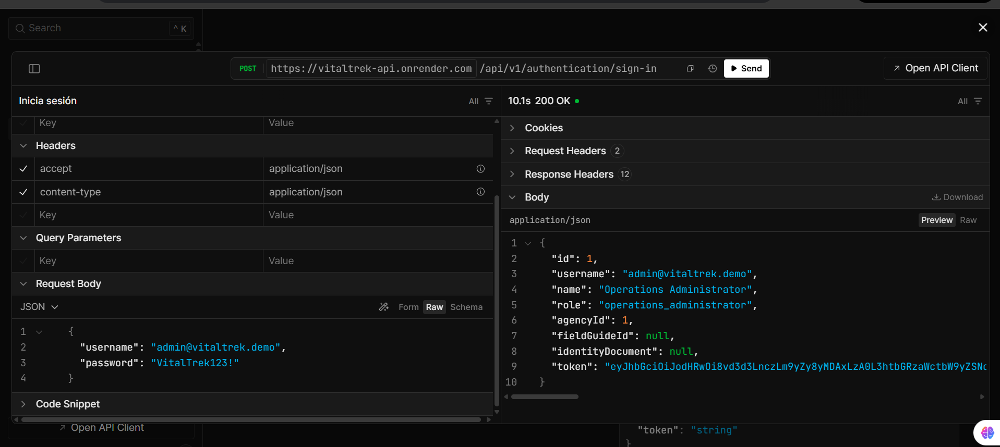

*Figura 5.X. Ejecución de `POST /api/v1/authentication/sign-in` con el usuario `admin@vitaltrek.demo`: respuesta `200 OK` con el token bearer.*

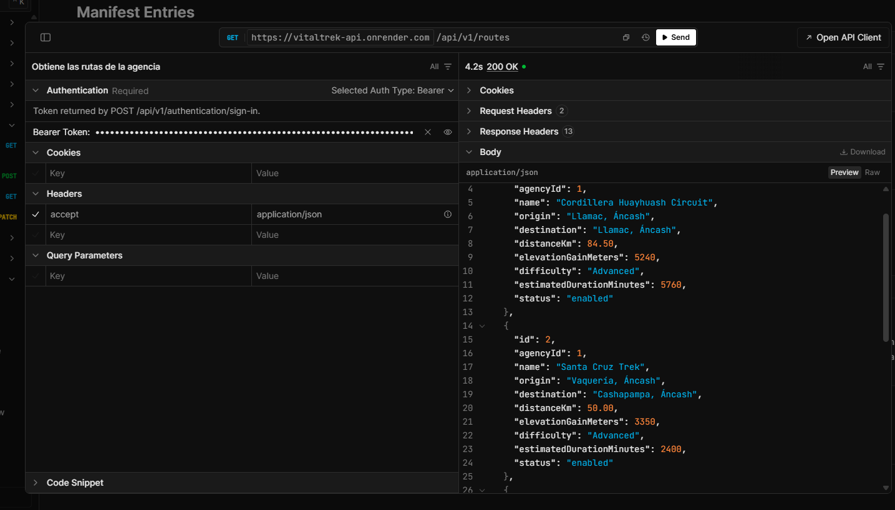

*Figura 5.X. Ejecución de `GET /api/v1/routes` con token bearer: respuesta `200 OK` con las cuatro rutas de la agencia.*

**Commits relacionados con la documentación de servicios:**

| Commit Id | Commit Message | Committed on (Date) |
| --- | --- | --- |
| `def4ee0` | chore: rename solution to VitalTrek and add shared infrastructure (configuración de OpenAPI y Scalar) | 2026-10-28 |
| `3a5c3f6` | feat(iam): add IAM bounded context with JWT authentication (metadatos OpenAPI localizados) | 2026-10-29 |
| `4514175` | feat(expedition-setup): add routes, checkpoints, expected time windows, route notes and safety protocols | 2026-10-29 |
| `ebe5c10` | feat(expedition-setup): add expedition groups, field guides, tourist manifest, wearables and participant preparation | 2026-10-29 |

#### 5.2.3.7. Software Deployment Evidence for Sprint Review

En el Sprint 3 se realizó el primer despliegue del RESTful Web Services de VitalTrek y se publicaron las versiones `v1.1.0` de las Web Applications, que consume dicho servicio, y del Landing Page. Las actividades comprendieron la creación de los servicios en Railway y Render, el aprovisionamiento de la base de datos MySQL administrada, la configuración del Web Service basado en Docker con sus variables de entorno, la publicación de la versión `v1.0.0` mediante GitFlow y la verificación del servicio desplegado a través de Scalar. La configuración detallada se describe en la sección 5.1.4. Para las Web Applications se actualizó en Vercel la variable `VITE_VITALTREK_API_URL` con la URL del API desplegado. La versión se numeró `v1.1.0` según Semantic Versioning, porque agrega funcionalidad compatible sobre la versión publicada en TB1.

| Producto | Plataforma | Repositorio | URL pública |
| --- | --- | --- | --- |
| Landing Page | Vercel | [landing-page](https://github.com/1ASI0729-2620-16712-G4-Nexatech/landing-page) | https://landing-page-mrca1.vercel.app/ |
| Web Applications | Vercel | [web-applications](https://github.com/1ASI0729-2620-16712-G4-Nexatech/web-applications) | https://web-applications-vert.vercel.app/ |
| RESTful Web Services | Render (Web Service con Docker) | [vitaltrek-backend](https://github.com/1ASI0729-2620-16712-G4-Nexatech/vitaltrek-backend) | https://vitaltrek-backend.onrender.com/scalar |
| Base de datos | Railway MySQL (plan Starter) | — | Acceso privado mediante credenciales |

**Pasos del despliegue del RESTful Web Services**

1. Creación del servicio MySQL en Railway con Public Networking habilitado, y obtención de los datos de conexión: host público (`centerbeam.proxy.rlwy.net`), puerto, usuario, nombre de base de datos y modo SSL `REQUIRED`.

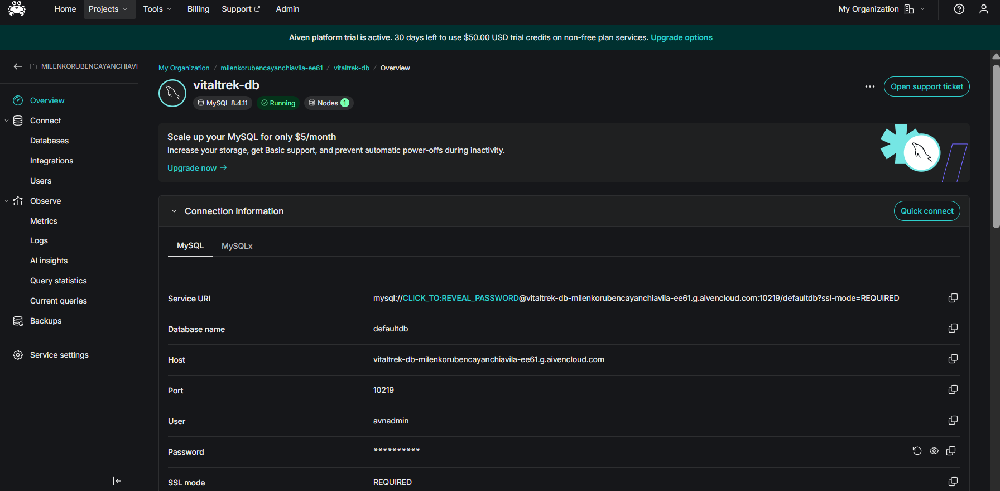

*Figura 5.X. Servicio MySQL en estado Online en Railway, con Public Networking habilitado y los datos de conexión.*

2. Preparación de la versión en la rama `release/v1.0.0`: cadena de conexión de producción con puerto y SSL, `Dockerfile` que escucha en el puerto asignado por la plataforma y `.dockerignore`. La rama se integró en `main` y `develop` mediante Pull Requests y `main` se etiquetó como `v1.0.0`.
3. Creación del Web Service `vitaltrek-api` en Render conectado al repositorio `vitaltrek-backend`, con runtime Docker, rama `main` y plan Free, y registro de las variables de entorno de la base de datos y de la clave de firma JWT.

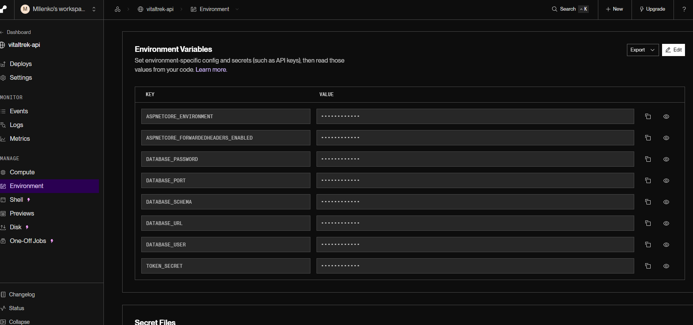

*Figura 5.X. Variables de entorno del Web Service `vitaltrek-api` en Render, con los valores ocultos.*

4. Construcción de la imagen Docker e inicio del contenedor: la aplicación leyó las variables de entorno de Railway, aplicó las migraciones sobre la base de datos, cargó los datos de demostración y quedó publicada en https://vitaltrek-backend.onrender.com.

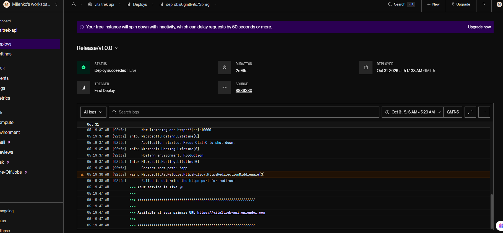

*Figura 5.X. Despliegue en estado Live en Render.*

5. Verificación del servicio en https://vitaltrek-backend.onrender.com/scalar: el inicio de sesión con `admin@vitaltrek.demo` respondió `200 OK` con el token bearer y `GET /api/v1/routes` respondió `200 OK` con las rutas de la agencia (sección 5.2.3.6).

**Pasos del despliegue de las Web Applications**

1. Integración de `feature/backend-integration` en `develop` mediante Pull Request, creación de la rama `release/v1.1.0` e integración en `main` y `develop`, con la etiqueta `v1.1.0` en `main`.
2. Actualización de la variable de entorno `VITE_VITALTREK_API_URL` en Vercel con la URL base del RESTful Web Services, para los entornos Production y Preview.

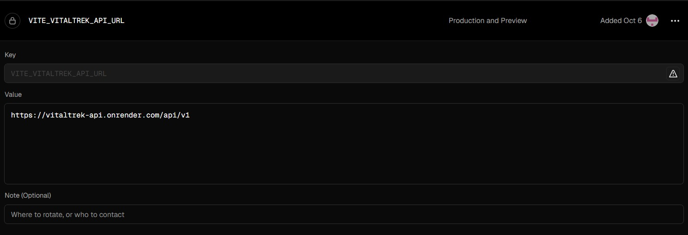

*Figura 5.X. Variable `VITE_VITALTREK_API_URL` configurada en Vercel con la URL del API desplegado.*

3. Verificación de `main` como Production Branch del proyecto en Vercel.

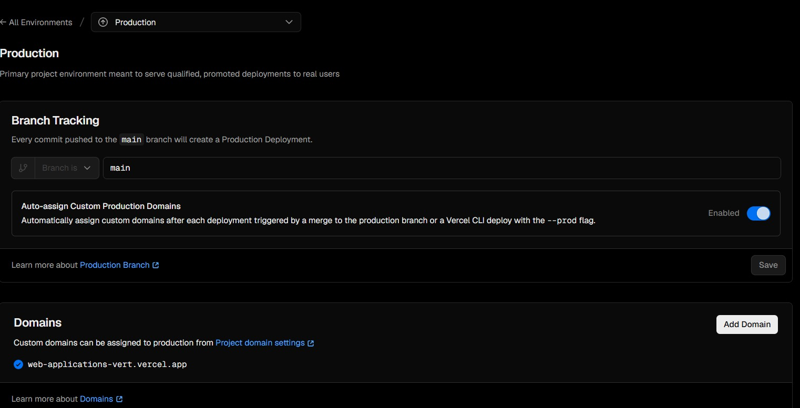

*Figura 5.X. Configuración de `main` como Production Branch y dominio `web-applications-vert.vercel.app`.*

4. Nuevo despliegue de producción a partir del commit `4166921` (`Release/v1.1.0`) de la rama `main`, en estado Ready.

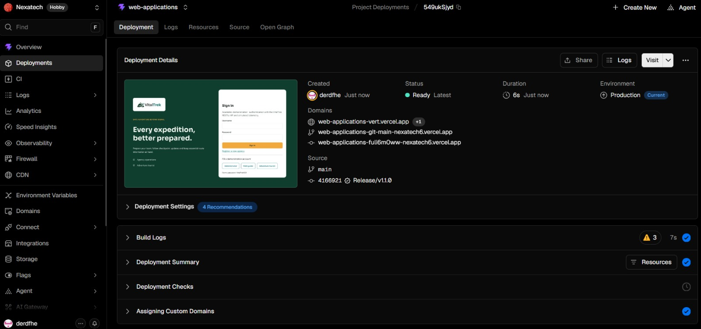

*Figura 5.X. Despliegue de producción de las Web Applications `v1.1.0` en Vercel.*

5. Verificación en https://web-applications-vert.vercel.app/: el inicio de sesión del Operations Administrator y el listado de rutas responden con datos del RESTful Web Services.

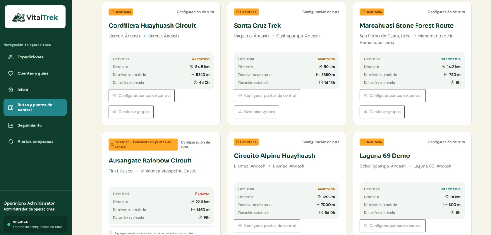

*Figura 5.X. Listado de rutas obtenido del RESTful Web Services desde las Web Applications desplegadas.*

**Pasos del despliegue del Landing Page**

1. Creación de la rama `release/v1.1.0` desde `develop` con los cambios del Sprint 3: enlaces a las Web Applications, grilla de una columna en móvil, redes sociales y ubicación en contacto y footer, y corrección del texto del hero y del i18n del login. La rama se integró en `main` mediante Pull Request y `main` se etiquetó como `v1.1.0`.
2. Despliegue automático de producción en Vercel a partir del commit `4649e05` (`Release/v1.1.0`) de la rama `main`.

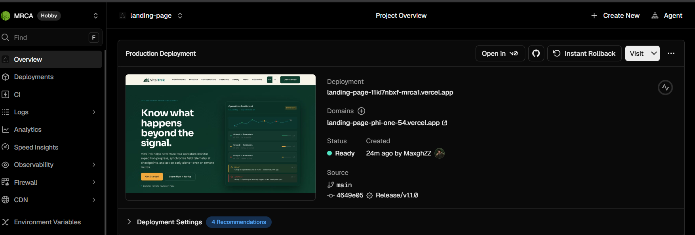

*Figura 5.X. Despliegue de producción del Landing Page `v1.1.0` en estado Ready en Vercel.*

3. Verificación del Landing Page publicado, con los enlaces a redes sociales incorporados en el footer.

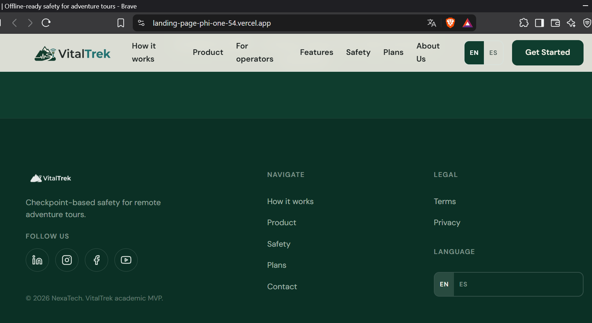

*Figura 5.X. Footer del Landing Page `v1.1.0` con los enlaces a redes sociales.*

#### 5.2.3.8. Team Collaboration Insights during Sprint

Durante el Sprint 3, el equipo trabajó sobre los repositorios [vitaltrek-backend](https://github.com/1ASI0729-2620-16712-G4-Nexatech/vitaltrek-backend), [web-applications](https://github.com/1ASI0729-2620-16712-G4-Nexatech/web-applications) y [landing-page](https://github.com/1ASI0729-2620-16712-G4-Nexatech/landing-page), aplicando GitFlow: `develop` como rama de integración, feature branches por funcionalidad y Pull Requests revisados por otro integrante antes de su integración. Todos los integrantes participaron en la implementación del RESTful Web Services. A continuación se resume la contribución de cada integrante y se presentan los analíticos de colaboración de GitHub.

| Integrante | Contribución en el Sprint 3 | Evidencia de GitHub |
| --- | --- | --- |
| Cayanchi Avila, Milenko Rubén (`MaxghZZ`) | Implementó el bounded context IAM (autenticación JWT, registro y login), el bounded context Expedition Setup (rutas, checkpoints, grupos de expedición, guías de campo, manifiesto turístico, wearables y preparación de participantes) y el bounded context Field Tracking. Configuró el contenedor Docker, las variables de entorno de producción y el despliegue en Render. Integró el frontend con el RESTful Web Services (IAM y Expedition Setup) y publicó la Release `v1.1.0` del frontend. Revisó y aprobó los PRs de los demás bounded contexts. Commits representativos: `8759081`, `4514175`, `b5331de`, `a6241c8`, `8886380`, `cab65a3`. | [vitaltrek-backend](https://github.com/1ASI0729-2620-16712-G4-Nexatech/vitaltrek-backend) · [web-applications](https://github.com/1ASI0729-2620-16712-G4-Nexatech/web-applications) |
| Herrera Enriquez, Diego Fernando (`DerDFHE`) | Implementó el bounded context Safety Monitoring (modelo de dominio EarlyWarningAlert, servicios de aplicación, fachada ACL con ExpectedTimeWindow, persistencia con EF Core, endpoints REST y migración de base de datos). En las Web Applications, configuró el entorno de desarrollo para apuntar al backend local y agregó pruebas unitarias para los flujos de sesión IAM, pantalla de errores y preparación de participantes. Commits representativos: `b4afa03`, `95dda1d`, `ef1b583`, `6e30a3a`, `9d74e83`. | [vitaltrek-backend](https://github.com/1ASI0729-2620-16712-G4-Nexatech/vitaltrek-backend) · [web-applications](https://github.com/1ASI0729-2620-16712-G4-Nexatech/web-applications) |
| León Naupari, Jorge Mateo (`mateool10`) | Implementó el bounded context Incident Response (modelo de dominio Incident y Notification, servicios de aplicación con validación de sesión de expedición, fachada ACL para contar incidentes, persistencia con EF Core, endpoints REST y migración de base de datos). Colaboró en la integración de los bounded contexts de Expedition Setup mediante pruebas unitarias de reglas de rutas y checkpoints. Commits representativos: `843ef1c`, `b7a9cd7`, `2937cdb`, `3b99692`, `b7318fd`. | [vitaltrek-backend](https://github.com/1ASI0729-2620-16712-G4-Nexatech/vitaltrek-backend) |
| Mendoza Blanco, Ariel Roberto (`Trepequiper`) | Implementó el bounded context Tour Closure completo: modelo de dominio TourSummary, comandos y queries, interfaces de repositorio y servicios, implementaciones de servicios de comando y consulta, repositorio EF Core, configuración de entidad, DTOs de recursos y assembler, endpoints REST en TourSummariesController, registro DI en Program.cs y migración de base de datos. Colaboró en pruebas unitarias de Expedition Setup. Commits representativos: `dd7b0d9`, `268f33f`, `0421678`, `1527d2e`, `4cd43e6`, `5fb3b48`. | [vitaltrek-backend](https://github.com/1ASI0729-2620-16712-G4-Nexatech/vitaltrek-backend) |
| Rodriguez Rojas, Miler Alexander (`Miler2003`) | Implementó el bounded context Checkpoint Sync (modelo de dominio CheckpointPassage, servicios de aplicación, fachada ACL, persistencia EF Core, endpoints REST y migración de base de datos). Actualizó las pruebas unitarias de Expedition Setup al API de dominio actual y agregó pruebas de paso por checkpoint. Protegió la configuración de desarrollo removiendo credenciales de los archivos versionados y documentó el README inicial del repositorio. Commits representativos: `0265254`, `864b3b9`, `6067764`, `fc16027`, `41f4bfd`. | [vitaltrek-backend](https://github.com/1ASI0729-2620-16712-G4-Nexatech/vitaltrek-backend) |

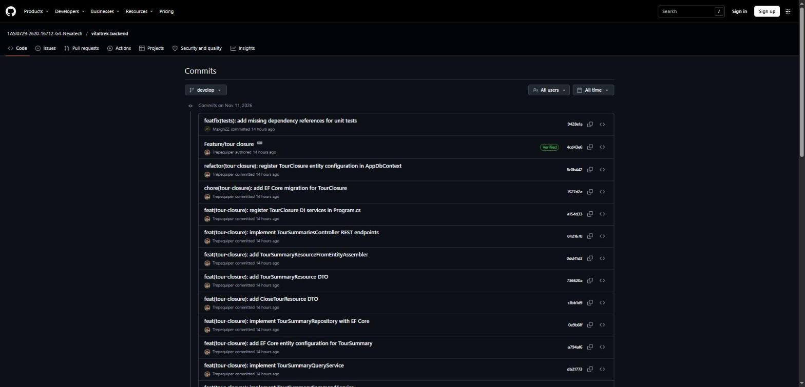

*Figura 5.X. Commits del repositorio vitaltrek-backend durante el Sprint 3.*

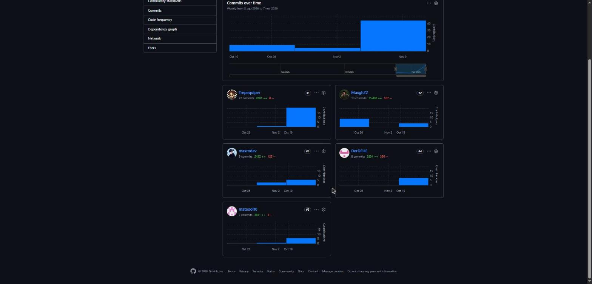

*Figura 5.X. GitHub Insights (Contributors) del repositorio vitaltrek-backend para el periodo del Sprint 3.*

## 5.3. Validation Interviews

En esta sección se registran y explican las entrevistas de validación realizadas con representantes de los dos segmentos objetivo de VitalTrek: los **dueños o responsables de agencias de turismo de aventura** y los **turistas de aventura**. A diferencia de las entrevistas de las entrevistas anteriores, que tuvieron un enfoque de descubrimiento, estas sesiones tienen un enfoque de **validación**: los participantes interactúan con el Landing Page y con las Web Applications desplegadas, realizan tareas concretas y manifiestan sus observaciones. Los resultados se evalúan según heurísticas de usabilidad, diseño inclusivo y arquitectura de información, con el formato indicado para el proyecto.

### 5.3.1. Diseño de Entrevistas

Las sesiones de validación buscan comprobar si la solución implementada resuelve los problemas identificados en el Needfinding y si los usuarios pueden completar los flujos principales sin ayuda. Para ello, cada participante recibe un conjunto de tareas sobre los productos desplegados y el entrevistador observa su comportamiento, registra las dificultades y, al finalizar, recoge sus apreciaciones.

### Objetivos Generales del Proceso de Validación

1. Verificar que los visitantes de cada segmento comprendan la propuesta de valor de VitalTrek a partir del Landing Page y encuentren la información y los Call-To-Action dirigidos a su segmento.
2. Comprobar que los usuarios puedan completar los user flows principales de las Web Applications definidos en la sección 4.4.4, sin asistencia del entrevistador.
3. Identificar problemas de usabilidad, diseño inclusivo y arquitectura de información, y clasificarlos según su severidad.
4. Contrastar los Lean UX Hypothesis Statements y los assumptions de la sección 1.2.2 con el comportamiento real observado en los usuarios.
5. Recoger testimonios de los participantes que sustenten la propuesta de valor y que puedan incluirse en el Video About-the-Product.

### Principios aplicados a la conducción de las sesiones

- Se pide al participante **pensar en voz alta** (think-aloud) mientras realiza cada tarea.
- El entrevistador **no explica la interfaz ni indica dónde hacer clic**; solo lee la tarea y observa.
- Las tareas se formulan como **objetivos del usuario**, no como instrucciones de interfaz: "registre a los participantes de su grupo" en lugar de "haga clic en el botón Manifiesto".
- Ante una dificultad, se repregunta de forma neutra: "¿qué esperaba encontrar?", "¿qué haría ahora?".
- Las preguntas de opinión se realizan **al finalizar todas las tareas**, para no influir en el comportamiento observado.

---

### Segmento 1: Dueños o Responsables de Agencias de Turismo de Aventura

**Perfil del participante:** propietarios, jefes de operaciones o guías principales de agencias de turismo de aventura que operen rutas en zonas con conectividad limitada.

**Elementos incluidos en la sesión:** Landing Page y Web Application (espacios de trabajo de Operations Administrator y Field Guide).

**Tareas en el Landing Page**

1. Identifique qué problema resuelve VitalTrek para una agencia como la suya.
2. Encuentre los planes disponibles para agencias y su precio.
3. Cambie el idioma del sitio a inglés y luego regrese a español.
4. Solicite información o una demostración del producto.
5. Acceda a la aplicación desde la sección dirigida a agencias.

**Tareas en la Web Application (user flows de la sección 4.4.4)**

6. Inicia sesión con tu cuenta de administrador de operaciones.
7. Registra una nueva ruta con sus datos principales (nombre, origen, destino, distancia, dificultad y duración estimada).
8. Agrega los checkpoints de la ruta en el orden del recorrido y define los tiempos esperados entre cada tramo.
9. Crea un grupo de expedición para esa ruta y asígnale un guía de campo.
10. Con el rol de guía, registra a los participantes del grupo en el manifiesto.
11. Consulta el progreso en tiempo real de un grupo que se encuentra actualmente en ruta.

**Preguntas posteriores a las tareas**

1. ¿Qué tarea le resultó más difícil? ¿Por qué?
2. ¿Hubo algún momento en que no supo qué hacer a continuación?
3. ¿Qué información esperaba ver sobre sus grupos que no encontró?
4. ¿Cómo se compara esta forma de preparar un tour con la forma en que lo hace hoy?
5. ¿Qué cambiaría o agregaría para usarlo en su operación?
6. ¿Recomendaría VitalTrek a otra agencia? ¿Por qué?

---

### Segmento 2: Turistas de Aventura

**Perfil del participante:** personas que practican trekking, caminatas o rutas de montaña y que contratan agencias para recorridos de mayor dificultad, duración o riesgo, preferentemente en zonas sin cobertura móvil.

**Elementos incluidos en la sesión:** Landing Page y Web Application.

**Tareas en el Landing Page**

1. Identifique cómo VitalTrek protege a un turista durante un recorrido sin señal.
2. Encuentre qué beneficios ofrece VitalTrek a los turistas.
3. Consulte cómo se tratan sus datos personales y de salud.
4. Cambie el idioma del sitio a inglés y luego regrese a español.
5. Acceda a la aplicación desde la sección dirigida a turistas.

**Tareas en la Web Application**

6. Inicia sesión con tu cuenta de turista.
7. Busca el grupo de expedición al que estás inscrito.
8. Registra tu contacto de emergencia (nombre, teléfono y parentesco).
9. Da tu consentimiento para participar en el tour.
10. Descarga la información del tour para acceder sin señal.
11. Consulta la ruta y los checkpoints de tu expedición.

**Preguntas posteriores a las tareas**

1. ¿Qué tarea le resultó más difícil? ¿Por qué?
2. ¿Entendió qué datos suyos registra VitalTrek y para qué los usa?
3. ¿Se sentiría más tranquilo si la agencia con la que viaja utilizara VitalTrek? ¿Por qué?
4. ¿Qué información esperaba encontrar que no encontró?
5. ¿Recomendaría a una agencia que utilice VitalTrek?

---

### Consideraciones de las Sesiones de Validación

**Cantidad de entrevistas:** mínimo 3 y máximo 5 por segmento, conforme al enunciado del proyecto.

**Entorno:** las sesiones se realizan sobre las versiones desplegadas del Landing Page y de las Web Applications, en desktop o mobile web browser según el dispositivo habitual del participante. Se registra el dispositivo y el navegador utilizados.

**Registro:** las sesiones se graban en video con consentimiento previo del participante, incluyendo la pantalla y la voz. Las grabaciones se consolidan en un único video de validación.

**Evaluación:** los problemas observados se clasifican según la escala de severidad y las heurísticas de usabilidad, diseño inclusivo y arquitectura de información de la sección 5.3.3.

**Ética:** antes de cada sesión se informa al participante sobre el propósito de la validación, la confidencialidad de sus respuestas y su derecho a retirarse en cualquier momento. Los datos utilizados en las tareas son ficticios.

### 5.3.2. Registro de Entrevistas

En esta sección se presentan los registros de las entrevistas de validación realizadas para cada segmento objetivo. Todas las sesiones se consolidan en el video [upc-pre-202620-1asi0730-16712-nexatech-validation-sprint-3](<!-- COMPLETAR: URL de Microsoft Stream -->).

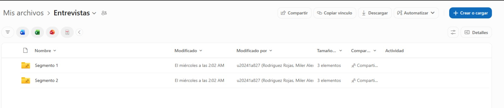
<!-- COMPLETAR: captura representativa del video -->

#### Segmento 1: Dueños o Responsables de Agencias de Turismo de Aventura

| **Entrevista #1** | |
| --- | --- |
| **Nombre** | <!-- COMPLETAR --> |
| **Apellidos** | <!-- COMPLETAR --> |
| **Edad** | <!-- COMPLETAR --> |
| **Distrito** | <!-- COMPLETAR --> |
| **Rol** | <!-- COMPLETAR --> |
| **Dispositivo y navegador** | <!-- COMPLETAR --> |
| **Evidencias** | 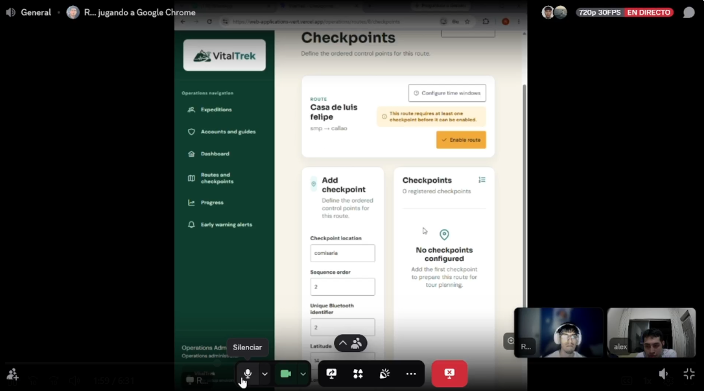 |
| **Link** | [Ver Video](<!-- COMPLETAR -->) |
| **Timing donde inicia la entrevista** | <!-- COMPLETAR: mm:ss min --> |
| **Duración de la entrevista** | <!-- COMPLETAR: mm:ss min --> |
| **Resumen** | <!-- COMPLETAR: qué tareas completó sin ayuda, en cuáles tuvo dificultades y por qué, qué comentó al finalizar y cuál fue su apreciación general --> |

<!-- COMPLETAR: repetir la tabla para las entrevistas #2 y #3 (hasta #5) -->

#### Segmento 2: Turistas de Aventura

| **Entrevista #1** | |
| --- | --- |
| **Nombre** | Alejandro Manuel |
| **Apellidos** | Molina Vasquez |
| **Edad** | 25 años |
| **Distrito** | San Miguel, Lima |
| **Rol** | Turista de aventura |
| **Dispositivo y navegador** | Samsung S24, Google Chrome |
| **Evidencias** | 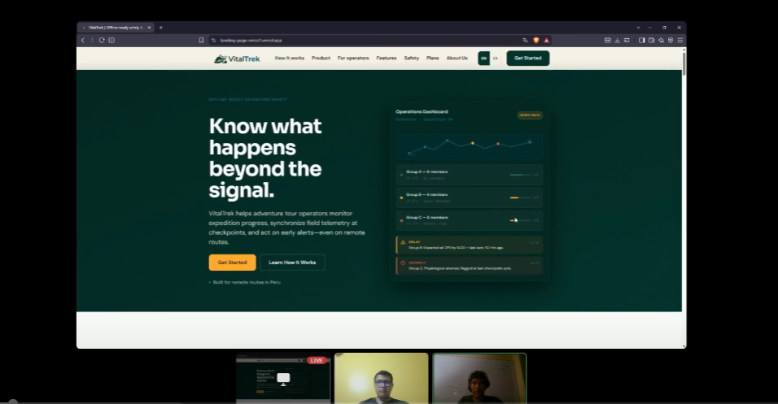 |
| **Link** | [Ver Video](https://upcedupe-my.sharepoint.com/:v:/g/personal/u20241a827_upc_edu_pe/IQC3hudLgmLgQ6F1w5X9UWWAAe0BWKtMND8Eg8Zj-wCulDc?e=MsBi7v) |
| **Timing donde inicia la entrevista** | 00:00 min |
| **Duración de la entrevista** | 09:36 min |
| **Resumen** | Manuel Alejandro revisó la landing page, comprendió la propuesta de monitoreo sin conexión y verificó el funcionamiento del cambio de idioma. En la aplicación, ingresó con su cuenta de turista, registró un contacto de emergencia, otorgó su consentimiento y descargó la información de la ruta para uso offline; completó todas las tareas sin dificultades y describió la interfaz como intuitiva. Valoró especialmente el acceso offline, la sincronización de puntos de control y la visualización del mapa con sus checkpoints, aunque señaló como mejora prioritaria mostrar su ubicación exacta y el progreso por tramos ya recorridos. Indicó que recomendaría la aplicación a su agencia una vez incorporadas esas mejoras de seguimiento. |

| **Entrevista #2** | |
| --- | --- |
| **Nombre** | Fernando |
| **Apellidos** | Flores Pinchi |
| **Edad** | 22 años |
| **Distrito** | Callao, Lima |
| **Rol** | Turista de aventura |
| **Dispositivo y navegador** | Google Chrome |
| **Evidencias** |  |
| **Link** | [Ver Video](https://upcedupe-my.sharepoint.com/personal/u20241a827_upc_edu_pe/_layouts/15/stream.aspx?id=%2Fpersonal%2Fu20241a827_upc_edu_pe%2FDocuments%2FEntrevistas%2FSegmento%202%2F2026-11-12%2000-02-06%2Emp4&referrer=StreamWebApp%2EWeb&referrerScenario=AddressBarCopied%2Eview%2E60f04891-a616-4409-bba7-4db012ed4cef) |
| **Timing donde inicia la entrevista** | 00:00 min |
| **Duración de la entrevista** | 06:06 min |
| **Resumen** | Fernando (22 años), quien cuenta con experiencia en rutas de trekking sin cobertura móvil, revisó la landing page de Vital Trek y la describió como visualmente atractiva, intuitiva y bien organizada por secciones, sin encontrar dificultades para navegarla; comprendió claramente la propuesta de expediciones sincronizadas y la generación de puntos de control (checkpoints) para resguardar su ubicación y evitar extravíos al perder la señal. En la aplicación, ingresó bajo el perfil de aventurero (con datos precargados de prueba), revisó el resumen del recorrido, la configuración del contacto de emergencia (nombre, teléfono y parentesco) y el mapa con las coordenadas exactas de parada y alojamiento, entendiendo qué información registra el sistema y con qué finalidad. Valoró especialmente la seguridad de conservar sus coordenadas exactas sin conexión y afirmó que viajaría más tranquilo si su agencia usara la plataforma, aunque señaló como mejora la posibilidad de ingresar manualmente sus propios datos personales (como nombre y edad) y registrar por sí mismo la ruta que va a recorrer. Finalmente, indicó que sí recomendaría a una agencia implementar la versión final de la aplicación para garantizar la seguridad de los turistas de aventura. |

<!-- COMPLETAR: repetir la tabla para las entrevistas #2 y #3 (hasta #5) -->

#### Resultados de las tareas por segmento

Para cada segmento se consolida cuántos participantes completaron cada tarea sin ayuda, siguiendo el mismo criterio de la sección 2.2.3.

| Tarea | Segmento 1: completada sin ayuda | Segmento 2: completada sin ayuda | Observación principal |
| --- | --- | --- | --- |
| <!-- COMPLETAR: p. ej. Solicitar información desde el Landing Page --> | <!-- X de 3 (%) --> | <!-- X de 3 (%) --> | <!-- COMPLETAR --> |

<!-- COMPLETAR: 2-3 párrafos que contrasten los resultados con los problemas de la sección 2.2.3 y con las Hypothesis Statements de la sección 1.2.2.3: qué se confirmó, qué no y qué se debe cambiar. -->

> Los porcentajes corresponden a la muestra de participantes de las sesiones de validación y no representan a todas las agencias o turistas del Perú.

### 5.3.3. Evaluaciones según heurísticas

En esta sección se evalúan las sesiones de validación según heurísticas de usabilidad, diseño inclusivo y arquitectura de información, con el formato UX Heuristics & Principles Evaluation indicado para el proyecto. Cada problema se registra con su severidad, la heurística o principio que viola y una recomendación de corrección, que se incorpora al Product Backlog para los siguientes Sprints.

Las heurísticas aplicadas son:

- **Usability:** las 10 heurísticas de usabilidad de Jakob Nielsen.
- **Inclusive Design:** los Inclusive Design Principles (proporciona experiencias comparables, considera la situación, sé consistente, da el control, ofrece opciones, prioriza el contenido y agrega valor).
- **Information Architecture:** las heurísticas de arquitectura de información de Abby Covert (findable, accessible, clear, communicative, useful, credible, controllable, valuable, learnable y delightful).

**UX Heuristics & Principles Evaluation**
**Usability – Inclusive Design – Information Architecture**

| | |
| --- | --- |
| **CARRERA** | Ingeniería de Software |
| **CURSO** | Aplicaciones Web |
| **SECCIÓN** | 16712 |
| **PROFESORES** | Sánchez Seña, Alberto Wilmer |
| **AUDITOR** | NexaTech |
| **CLIENTE(S)** | <!-- COMPLETAR: nombres de los participantes de las sesiones --> |

**SITE o APP A EVALUAR:** VitalTrek: Landing Page y Web Applications.

**TAREAS A EVALUAR:**

El alcance de esta evaluación incluye la revisión de la usabilidad de las siguientes tareas:

1. Consulta de la propuesta de valor y de los planes en el Landing Page.
2. Cambio de idioma en el Landing Page y en la Web Application.
3. Solicitud de información o demostración desde el Landing Page.
4. Acceso a la Web Application desde los Call-To-Action de cada segmento.
5. Registro de una ruta con sus checkpoints y ventanas de tiempo esperadas.
6. Creación de un grupo de expedición y asignación de un guía.
7. Registro del manifiesto de turistas.
8. Consulta del progreso estimado de un grupo.

<!-- COMPLETAR: ajustar a las tareas realmente evaluadas (agregar las del turista si las hay). -->

No están incluidas en esta versión de la evaluación las siguientes tareas:

1. Asignación y activación de wearables.
2. Captura offline y sincronización de telemetría en checkpoints.
3. Evaluación de riesgo y generación de alertas.
4. Gestión de incidentes, emergencias y evacuaciones.
5. Cierre del tour y generación del Tour Summary.

<!-- COMPLETAR: quitar de esta lista lo que sí se haya implementado y evaluado. -->

**ESCALA DE SEVERIDAD:**

Los errores serán puntuados tomando en cuenta la siguiente escala de severidad:

| Nivel | Descripción |
| :---: | --- |
| 1 | Problema superficial: puede ser fácilmente superado por el usuario u ocurre con muy poca frecuencia. No necesita ser arreglado a no ser que exista disponibilidad de tiempo. |
| 2 | Problema menor: puede ocurrir un poco más frecuentemente o es un poco más difícil de superar para el usuario. Se le debería asignar una prioridad baja para resolverlo de cara al siguiente release. |
| 3 | Problema mayor: ocurre frecuentemente o los usuarios no son capaces de resolverlo. Es importante que sea corregido y se le debe asignar una prioridad alta. |
| 4 | Problema muy grave: un error de gran impacto que impide al usuario continuar con el uso de la herramienta. Es imperativo que sea corregido antes del lanzamiento. |

**TABLA RESUMEN:**

| # | Problema | Escala de severidad | Heurística/Principio violada(o) |
| :---: | --- | :---: | --- |
| 1 | <!-- COMPLETAR --> | <!-- 1-4 --> | <!-- p. ej. Usability: Visibilidad del estado del sistema --> |

**DESCRIPCIÓN DE PROBLEMAS:**

**PROBLEMA #1:** <!-- COMPLETAR: título del problema -->

**Severidad:** <!-- COMPLETAR -->
**Heurística violada:** <!-- COMPLETAR -->

**Problema:**

<!-- COMPLETAR: qué ocurrió, en qué tarea, cuántos participantes lo experimentaron -->

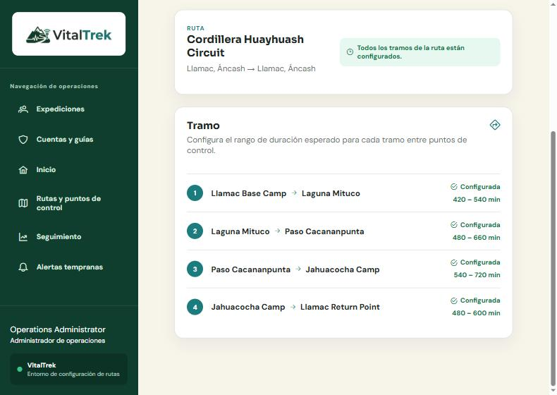

**Recomendación:**

<!-- COMPLETAR: corrección propuesta y User Story o task del Product Backlog donde se registra -->

<!-- COMPLETAR: repetir el bloque por cada problema de la tabla resumen -->

## 5.4. Video About-the-Product

El Video About-the-Product presenta VitalTrek a los visitantes del Landing Page que desean conocer el modelo de negocio y las características principales de la solución, así como a los usuarios de las Web Applications que desean conocer cómo realizar las tareas soportadas por el producto. El video resume el problema de supervisión de grupos en zonas sin cobertura, la propuesta de valor de VitalTrek para agencias y turistas, y muestra escenas de interacción con el Landing Page y la Web Application. Incluye al menos una opinión de un participante de cada segmento objetivo obtenida en las entrevistas de validación. El tono es serio, cercano y sereno, consistente con el tono de comunicación definido en las Style Guidelines de la sección 4.1.1.

| Elemento | Información |
| --- | --- |
| Nombre del video | upc-pre-202620-1asi0730-16712-nexatech-about-the-product-sprint-3 |
| Duración | <!-- COMPLETAR: mm:ss (entre 1 y 3 minutos) --> |
| Microsoft Stream | [Ver video](<!-- COMPLETAR -->) |
| YouTube (incrustado en el Landing Page) | [Ver video](<!-- COMPLETAR -->) |

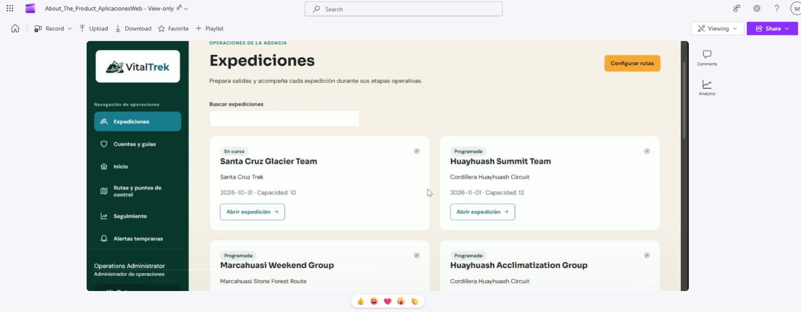
<!-- COMPLETAR: captura representativa -->

*Figura 5.X. Video About-the-Product de VitalTrek.*

**Secuencia de contenido**

| Inicio (hh:mm:ss) | Sección | Contenido |
| --- | --- | --- |
| | Problema | Situación de las agencias y turistas cuando un grupo pierde la cobertura durante el recorrido. |
|  | Propuesta de valor | Presentación de VitalTrek: supervisión por checkpoints, telemetría offline y alertas. |
|  | Producto | Escenas de interacción con el Landing Page y la Web Application. |
|  | Testimonios | Opinión de un participante de cada segmento obtenida en las entrevistas de validación. |
|  | Call-To-Action | Invitación a solicitar una demostración o acceder a la aplicación. |