# Capítulo V: Product Implementation, Validation & Deployment

## 5.1. Software Configuration Management
 
Esta sección establece las herramientas, convenciones y configuraciones que el equipo utiliza para mantener la consistencia del proyecto VitalTrek a lo largo de su ciclo de vida. Se documentan el entorno de desarrollo, el esquema de control de versiones con GitFlow, las convenciones de codificación y la configuración de despliegue de cada producto. Estas decisiones permiten coordinar el trabajo de los cinco integrantes, mantener trazabilidad sobre cada cambio y reproducir el entorno en cualquier equipo.
 
### 5.1.1. Software Development Environment Configuration
 
La siguiente tabla especifica los productos de software que el equipo utiliza, agrupados por tipo de actividad del ciclo de vida. Para los productos basados en modelos SaaS se indica la ruta de referencia; para los que se ejecutan en el computador de cada integrante se indica la ruta de descarga.
 
| Actividad | Producto | Propósito de uso en el proyecto | Tipo | Ruta de referencia o descarga |
| --- | --- | --- | --- | --- |
| Project Management | Jira Software | Gestionar el Product Backlog, los Sprint Backlogs, las Engineering Tasks y las estimaciones en Story Points y horas. | SaaS | https://www.atlassian.com/software/jira |
| Project Management | Discord | Coordinar las ceremonias del Sprint y la comunicación diaria del equipo. | SaaS / aplicación de escritorio | https://discord.com/download |
| Requirements Management | UXPressia | Elaborar las fichas de User Persona, los Journey Maps, los Empathy Maps y el Impact Map. | SaaS | https://uxpressia.com/ |
| Requirements Management | Miro | Elaborar el Big Picture EventStorming y el Design-Level EventStorming. | SaaS | https://miro.com/ |
| Product UX/UI Design | Figma | Elaborar los wireframes, mock-ups y prototipos del Landing Page y de las Web Applications. | SaaS | https://www.figma.com/ |
| Software Development | Git | Controlar las versiones del código fuente en el computador de cada integrante y aplicar el flujo de ramas de GitFlow. | Instalación local | https://git-scm.com/downloads |
| Software Development | GitHub | Alojar los repositorios de la organización del equipo, gestionar los Pull Requests y registrar la colaboración. | SaaS | https://github.com/ |
| Software Development | Visual Studio Code | Editar el código del Landing Page, de las Web Applications y la documentación en Markdown. | Instalación local | https://code.visualstudio.com/download |
| Software Development | Google Chrome | Verificar la navegación, el comportamiento responsive y la accesibilidad del Landing Page y de las Web Applications mediante sus herramientas de desarrollo. | Instalación local | https://www.google.com/chrome/ |
| Software Development | Vue.js | Construir las Frontend Web Applications con Vue 3 y Vite, junto con Pinia, Vue Router, Axios, PrimeVue y vue-i18n. Implementado en el Sprint 2 (TB1). | Instalación local (vía npm) | https://vuejs.org/ |
| Software Development | json-server | Ejecutar la Fake API con recursos JSON de prueba que consumen las Web Applications. Implementado en el Sprint 2 (TB1). | Instalación local (vía npm) | https://github.com/typicode/json-server |
| Software Development | .NET SDK y C# | Construir el RESTful Web Services. Planificado para Sprints posteriores. | Instalación local | https://dotnet.microsoft.com/download |
| Software Development | PostgreSQL | Persistir la información operativa y de seguridad de las expediciones. Planificado para Sprints posteriores. | Instalación local | https://www.postgresql.org/download/ |
| Software Deployment | Vercel | Desplegar y publicar el Landing Page y las Web Applications a partir de sus repositorios de GitHub. | SaaS | https://vercel.com/ |
| Software Documentation | Markdown | Redactar el informe del proyecto y los archivos README de cada repositorio. | Formato abierto | https://www.markdownguide.org/ |
| Software Documentation | dbdiagram.io | Elaborar el Database Diagram de la sección 4.8. | SaaS | https://dbdiagram.io/ |
| Software Documentation | PlantUML | Elaborar los Class Diagrams de la sección 4.7. | Instalación local / SaaS | https://plantuml.com/download |
| Software Documentation | Microsoft PowerPoint | Elaborar la presentación de exposición de cada entrega. | Instalación local | https://www.microsoft.com/microsoft-365/powerpoint |
| Software Documentation | Microsoft Stream | Publicar los videos de exposición y de navegación del producto. | SaaS | https://www.microsoft.com/microsoft-365/microsoft-stream |
 
### 5.1.2. Source Code Management
 
El código fuente de VitalTrek se administra con **Git** como sistema de control de versiones y **GitHub** como plataforma de alojamiento y colaboración. Cada producto de la solución mantiene su propio repositorio dentro de la organización del equipo, de modo que sus ciclos de vida y despliegues sean independientes.
 
| Producto | Repositorio | Rama por defecto | Estado en TB1 |
| --- | --- | --- | --- |
| Project Report | https://github.com/1ASI0729-2620-16712-G4-Nexatech/report | `develop` | En elaboración |
| Landing Page | https://github.com/1ASI0729-2620-16712-G4-Nexatech/landing-page | `main` | Implementado y desplegado |
| Frontend Web Applications | https://github.com/1ASI0729-2620-16712-G4-Nexatech/web-applications | `develop` | Implementado y desplegado (frontend con Fake API) |
| RESTful Web Services | https://github.com/1ASI0729-2620-16712-G4-Nexatech/web-services | `develop` | Repositorio creado, implementación planificada |
 
En el caso del RESTful Web Services, el repositorio incluye tanto el proyecto como los archivos de pruebas unitarias y de integración, conforme a lo indicado en el enunciado del trabajo final.
 
#### GitFlow como Workflow de branching y colaboración
 
El equipo aplica **GitFlow**, según el modelo descrito por Vincent Driessen en *A successful Git branching model*. El repositorio mantiene dos ramas de larga duración y tres tipos de ramas de apoyo.
 
**Ramas de larga duración**
 
| Rama | Propósito | Quién integra en ella |
| --- | --- | --- |
| `main` | Contiene únicamente versiones estables y publicadas. Cada integración en esta rama corresponde a una Release etiquetada. | Solo mediante Pull Request desde `release/*` o `hotfix/*`. |
| `develop` | Integra el trabajo aprobado de todas las funcionalidades en curso. Es la base desde la que nacen las ramas de funcionalidad. | Solo mediante Pull Request desde `feature/*`. |
 
**Ramas de apoyo y sus convenciones de nombre**
 
| Tipo | Convención de nombre | Nace de | Se integra en | Ejemplo real del proyecto |
| --- | --- | --- | --- | --- |
| Feature | `feature/<ámbito>-<descripción-breve>` en inglés y `kebab-case` | `develop` | `develop` | `feature/landing-seo-a11y` |
| Release | `release/vMAJOR.MINOR.PATCH` | `develop` | `main` y `develop` | `release/v1.0.0` |
| Hotfix | `hotfix/vMAJOR.MINOR.PATCH-<descripción-breve>` | `main` | `main` y `develop` | `hotfix/v1.0.1-contact-form-validation` |
 
Reglas aplicables a los nombres de rama:
 
1. Se escriben íntegramente en inglés y en minúsculas, con palabras separadas por guion.
2. El ámbito identifica el producto o el capítulo afectado: `landing`, `webapp`, `api`, `chapter-3`.
3. No se usan espacios, caracteres acentuados ni mayúsculas.
4. Una rama de funcionalidad corresponde a una sola User Story o Technical Story, y se elimina una vez integrada.

**Flujo de trabajo**
 
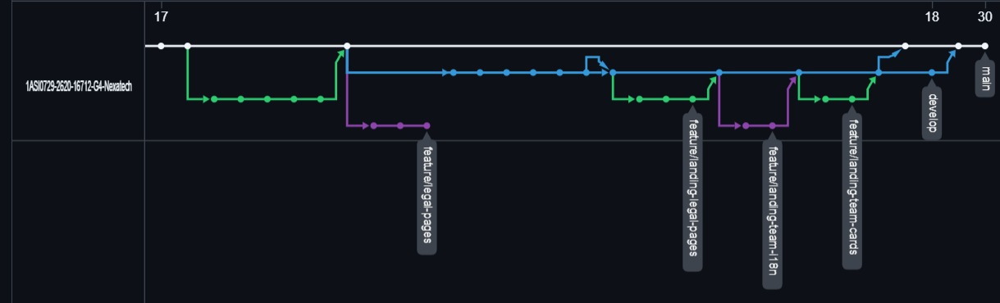
 
*Figura 5.0. Flujo de ramas aplicado en los repositorios de VitalTrek.*
 
**Política de Pull Requests**
 
1. Toda integración a `develop` y a `main` se realiza mediante Pull Request; no se permite empujar directamente a ninguna de las dos.
2. Cada Pull Request indica en su descripción la User Story o Technical Story que resuelve y los criterios de aceptación cubiertos.
3. Un Pull Request requiere la revisión y aprobación de al menos un integrante distinto de su autor.
4. La rama de funcionalidad se elimina después de la integración.
#### Semantic Versioning
 
Las Releases se nombran según **Semantic Versioning 2.0.0**, con el formato `vMAJOR.MINOR.PATCH`:
 
| Componente | Se incrementa cuando | Ejemplo |
| --- | --- | --- |
| `MAJOR` | Se introduce un cambio incompatible con la versión anterior. | `v2.0.0` |
| `MINOR` | Se agrega funcionalidad manteniendo la compatibilidad. | `v1.1.0` |
| `PATCH` | Se corrige un defecto sin agregar funcionalidad. | `v1.0.1` |
 
La versión publicada al cierre del Sprint 1 es **`v1.0.0`**, correspondiente a la primera versión funcional y desplegada del Landing Page. Cada Release se etiqueta en `main` con su número de versión.
 
#### Conventional Commits
 
Los mensajes de commit siguen la especificación **Conventional Commits 1.0.0**, con la estructura:
 
```
<tipo>(<alcance>): <descripción en imperativo y en inglés>
 
[cuerpo opcional]
```
 
| Tipo | Se usa para |
| --- | --- |
| `feat` | Agregar una funcionalidad nueva. |
| `fix` | Corregir un defecto. |
| `docs` | Cambios que solo afectan documentación. |
| `style` | Cambios de formato que no alteran el comportamiento. |
| `refactor` | Reestructurar código sin cambiar su comportamiento externo. |
| `test` | Agregar o corregir pruebas. |
| `chore` | Tareas de mantenimiento, configuración o dependencias. |
 
Ejemplos tomados del repositorio del proyecto:
 
```
feat(a11y): add skip to main content link
feat(seo): complete meta tags defined in report 4.2.3
docs(chapter5): add Jorge Mateo Leon commits to development evidence
style(a11y): add skip link styles
```
 
> **Nota sobre la adopción de las convenciones.** El equipo adoptó formalmente Conventional Commits y la convención de nombres de rama a partir del 7 de septiembre de 2026. Los commits y ramas anteriores a esa fecha, registrados en la sección 5.2.1.4, no siguen la convención, dado que corresponden al período de configuración inicial del repositorio. No se reescribió el historial para preservar la trazabilidad de los aportes individuales. A partir de esa fecha, la convención se verifica durante la revisión de cada Pull Request.
 
### 5.1.3. Source Code Style Guide & Conventions
 
El equipo adopta guías de estilo estándar para cada lenguaje de la solución. Todos los identificadores, nombres de archivo, clases, funciones y comentarios se redactan en inglés, conforme a lo indicado en el enunciado del trabajo final.
 
| Tecnología | Convenciones adoptadas | Referencia |
| --- | --- | --- |
| HTML5 | Elementos semánticos, etiquetas y atributos en minúscula, atributos entre comillas dobles, texto alternativo en toda imagen informativa, indentación de dos espacios. | [Google HTML/CSS Style Guide](https://google.github.io/styleguide/htmlcssguide.html) · [W3Schools HTML Style Guide](https://www.w3schools.com/html/html5_syntax.asp) |
| CSS3 | Clases e identificadores en `kebab-case`, variables centralizadas en `tokens.css`, enfoque mobile-first, una declaración por línea. | [Google HTML/CSS Style Guide](https://google.github.io/styleguide/htmlcssguide.html) |
| JavaScript | Variables y funciones en `camelCase`, constantes en `UPPER_SNAKE_CASE`, uso de `const` y `let` en lugar de `var`, funciones con una sola responsabilidad, punto y coma obligatorio. | [Google JavaScript Style Guide](https://google.github.io/styleguide/jsguide.html) · [MDN JavaScript Guidelines](https://developer.mozilla.org/en-US/docs/MDN/Writing_guidelines/Code_style_guide/JavaScript) |
| Vue.js | Componentes en `PascalCase` con nombre de varias palabras, props en `camelCase` dentro del script y en `kebab-case` en la plantilla, un componente por archivo. | [Vue Style Guide](https://vuejs.org/style-guide/) |
| C# | Clases, métodos y propiedades en `PascalCase`; parámetros y variables locales en `camelCase`; interfaces con prefijo `I`. Planificado para el RESTful Web Services. | [C# Coding Conventions](https://learn.microsoft.com/en-us/dotnet/csharp/fundamentals/coding-style/coding-conventions) · [ASP.NET Core Engineering Guidelines](https://github.com/dotnet/aspnetcore/wiki/Engineering-guidelines) |
| Gherkin | Un escenario por comportamiento, redacción en tiempo presente y tercera persona, sin referencias a elementos de interfaz. | [Gherkin Reference](https://cucumber.io/docs/gherkin/reference/) |
| Markdown | Encabezados jerárquicos sin saltar niveles, enlaces relativos entre capítulos, imágenes con texto alternativo, tablas con formato consistente. | [Markdown Guide](https://www.markdownguide.org/basic-syntax/) |
 
Ejemplos aplicados en el Landing Page:
 
```html
<section class="safety-features" aria-labelledby="safety-title">
  <h2 id="safety-title" data-i18n="safetyTitle">Checkpoint synchronization</h2>
</section>
```
 
```css
:root {
  --forest-green: #0f3d2e;
  --safety-amber: #f2a93b;
}
 
.request-demo-button {
  background-color: var(--safety-amber);
}
```
 
```javascript
const DEFAULT_LOCALE = 'en-US';
 
function setLanguage(selectedLocale) {
  document.documentElement.lang = selectedLocale;
  localStorage.setItem('vitaltrek-language', selectedLocale);
}
```
 
### 5.1.4. Software Deployment Configuration
 
El despliegue de cada producto parte de su repositorio de código fuente. En AV1 se desplegó el Landing Page y en TB1 se desplegaron las Web Applications; ambos productos se publican en Vercel a partir de sus repositorios de GitHub.
 
| Producto | Plataforma | Rama de despliegue | Estado |
| --- | --- | --- | --- |
| Landing Page | Vercel | `main` | Desplegado |
| Frontend Web Applications | Vercel | `main` | Desplegado |
| RESTful Web Services | Azure App Service | `main` | Planificado |
 
#### Configuración del Landing Page
 
| Parámetro | Valor |
| --- | --- |
| Repositorio | https://github.com/1ASI0729-2620-16712-G4-Nexatech/landing-page |
| Plataforma | Vercel |
| Production Branch | `main` |
| Framework preset | Other (HTML, CSS y JavaScript estáticos) |
| Build command | No aplica |
| Output directory | Directorio raíz del repositorio |
| Variables de entorno | No requeridas |
| URL pública de producción | https://landing-page-mrca1.vercel.app/ |
| Versión desplegada | `v1.0.0` |
 
#### Pasos para lograr el despliegue desde el repositorio
 
1. El integrante desarrolla la funcionalidad en su rama `feature/*` y abre un Pull Request hacia `develop`.
2. Otro integrante revisa el Pull Request y verifica que se cumplan los criterios de aceptación de la historia correspondiente.
3. Aprobado el Pull Request, la rama se integra en `develop` y se elimina.
4. Al cerrar el Sprint se crea la rama `release/vX.Y.Z` desde `develop`, donde se ejecutan las validaciones finales: marcado W3C, enlaces internos, comportamiento responsive, cambio de idioma y accesibilidad por teclado.
5. La rama de Release se integra en `main` mediante Pull Request y se etiqueta con su número de versión.
6. Vercel detecta el cambio en la Production Branch y ejecuta el despliegue automático.
7. Se verifica la URL pública de producción y se registra la evidencia en la sección 5.2.X.7 del Sprint correspondiente.

## 5.2. Landing Page, Services & Applications Implementation

Esta sección documenta la implementación, validación y despliegue de los productos incluidos en la solución VitalTrek. Para AV1, el alcance se concentra en la primera versión funcional y desplegada del Landing Page, desarrollado con HTML5, CSS3 y JavaScript. En TB1, el Sprint 2 amplía el producto con las Web Applications frontend para configurar expediciones y consultar su progreso mediante una Fake API y datos simulados. El RESTful Web Services productivo, la persistencia real y la integración con dispositivos permanecen fuera del alcance de esta entrega.

### 5.2.1. Sprint 1

El Sprint 1 tiene como objetivo implementar y publicar la primera versión del Landing Page de VitalTrek. El alcance comprende las User Stories US01 a US06 y US33, relacionadas con la navegación, la propuesta de valor, los planes, la información del equipo, la solicitud de información, el cambio de idioma y la publicación de los términos de servicio y la política de privacidad; y las Technical Stories TS01 a TS04, que habilitan la estructura técnica, la adaptación a distintos dispositivos, la internacionalización con accesibilidad y el despliegue. La estimación total del Sprint es de 30 Story Points.

| Campo | Valor |
| --- | --- |
| Sprint Velocity | 30 Story Points |
| Total de Story Points | 30 |

#### 5.2.1.1. Sprint Planning 1

La reunión de planificación permitió definir el objetivo, alcance, responsabilidades y tareas del primer Sprint. El trabajo se enfocó en entregar un Landing Page responsive, accesible y coherente con los wireframes, mock-ups, Style Guidelines e Information Architecture definidos en el capítulo IV.

| **Sprint #** | **Sprint 1** |
| --- | --- |
| **Sprint Planning Background**  |
| Date | 2026-09-05 |
| Time | 08:00 PM |
| Location | Reunión virtual en Discord |
| Prepared By | Rodriguez Rojas, Miler Alexander |
| Attendees (to planning meeting) | Cayanchi Avila, Milenko Rubén / Herrera Enriquez, Diego Fernando / León Naupari, Jorge Mateo / Mendoza Blanco, Ariel Roberto / Rodriguez Rojas, Miler Alexander |
| Sprint 0 Review Summary | No aplica. El Sprint 1 es el primer Sprint del proyecto; no existe un incremento previo que revisar. |
| Sprint 0 Retrospective Summary | No aplica. El Sprint 1 es el primer Sprint del proyecto; no existe un Sprint previo sobre el cual realizar una retrospectiva. |
| **Sprint Goal & User Stories**  |
| Sprint 1 Goal | **Our focus is on** publishing a bilingual and responsive Landing Page that presents the VitalTrek value proposition to adventure tourism agencies and adventure tourists.<br>**We believe it delivers** a clear understanding of the solution and a direct channel to request information or a demo **to** visitors from both target segments.<br>**This will be confirmed when** the Landing Page is deployed on a public URL and visitors can browse all its sections in Spanish and English, and submit an information request from desktop and mobile web browsers. |
| Sprint 1 Velocity | 30 Story Points |
| Sum of Story Points | 30 Story Points (US01, US02, US03, US04, US05, US06, US33, TS01, TS02, TS03 y TS04) |


#### 5.2.1.2. Aspect Leaders and Collaborators

La siguiente matriz organiza el liderazgo y la colaboración del equipo durante el Sprint 1, en correspondencia con las tareas registradas en el Sprint Backlog.

| Integrante                       | Usuario de GitHub | Landing Page structure | Responsive UI | i18n y a11y | QA y deployment | Documentación |
| -------------------------------- | ----------------- | ---------------------- | ------------- | ----------- | --------------- | ------------- |
| Cayanchi Avila, Milenko Rubén    | `MaxghZZ`         | L                      | C             | C           | C               | L             |
| León Naupari, Jorge Mateo        | `mateool10`       | C                      | L             | C           | C               | C             |
| Mendoza Blanco, Ariel Roberto    | `Trepequiper`     | C                      | C             | L           | C               | C             |
| Rodriguez Rojas, Miler Alexander | `Miler2003`       | C                      | C             | C           | L               | L             |
| Herrera Enriquez, Diego Fernando | `DerDFHE`         | C                      | C             | C           | C               | C             |

#### 5.2.1.3. Sprint Backlog 1

El Sprint Backlog 1 agrupa las siete User Stories de la Landing Page y las cuatro Technical Stories que la habilitan, seleccionadas desde el Product Backlog de la sección 3.3. La descomposición produjo veintiún Work-items, estimados individualmente entre 4 y 8 horas, con un total de 105 horas. Las tareas se repartieron según la matriz de líderes y colaboradores de la sección 5.2.1.2: cada integrante asume las tareas del aspecto que lidera y colabora en los aspectos restantes.
 
**Evidencia del Board del Sprint**

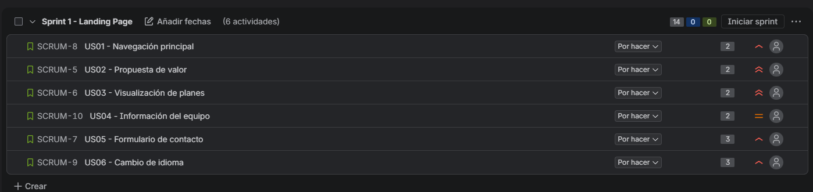
 
*Figura 5.1. Board del Sprint 1 en Jira.*
 
**Enlace público del board Jira:** [Ver Product Backlog](https://milenkorvu.atlassian.net/jira/software/projects/SCRUM/boards/1/backlog)
 
| Sprint # | Story Id | Story Title | Task Id | Task Title | Task Description | Estimation (Hours) | Assigned To | Status |
| --- | --- | --- | --- | --- | --- | ---: | --- | --- |
| Sprint 1 | US01 | Navegación principal | T-01 | Estructura del header y de las secciones principales | Construir el encabezado y el esqueleto de las secciones del sitio con elementos semánticos, de modo que cada sección sea alcanzable desde la navegación. | 5 | Cayanchi Avila, Milenko Rubén | Done |
| Sprint 1 | US01 | Navegación principal | T-02 | Navegación para pantallas reducidas | Implementar el comportamiento de la navegación por debajo de 768 px conservando las mismas opciones que la vista de escritorio. | 4 | Herrera Enriquez, Diego Fernando | Done |
| Sprint 1 | US02 | Propuesta de valor | T-03 | Sección inicial con problema, solución y beneficios | Maquetar la sección inicial que presenta el problema de las zonas sin cobertura, la solución por checkpoints y los beneficios principales. | 6 | Cayanchi Avila, Milenko Rubén | Done |
| Sprint 1 | US02 | Propuesta de valor | T-04 | Contenido de beneficios por segmento | Redactar e integrar el contenido que diferencia los beneficios para agencias y para turistas, a partir de los insights del capítulo II. | 4 | Mendoza Blanco, Ariel Roberto | Done |
| Sprint 1 | US03 | Consulta de planes y precios | T-05 | Sección comparativa de planes | Construir la presentación de los planes con su precio, alcance y características, de forma que puedan compararse entre sí. | 5 | Rodriguez Rojas, Miler Alexander | Done |
| Sprint 1 | US03 | Consulta de planes y precios | T-06 | Continuidad desde el plan hacia el contacto | Enlazar cada plan con el formulario de contacto de modo que el plan de interés quede identificado en la solicitud. | 4 | Rodriguez Rojas, Miler Alexander | Done |
| Sprint 1 | US04 | Información del equipo | T-07 | Sección de equipo con los perfiles de NexaTech | Construir la sección de equipo con el nombre, el rol y la descripción de cada integrante, y sus fotografías. | 5 | Mendoza Blanco, Ariel Roberto | Done |
| Sprint 1 | US05 | Solicitud de información o demostración | T-08 | Formulario de contacto y estructura de campos | Construir el formulario con los campos requeridos para registrar una solicitud de información o demostración. | 5 | Mendoza Blanco, Ariel Roberto | Done |
| Sprint 1 | US05 | Solicitud de información o demostración | T-09 | Validación de campos obligatorios y formato de correo | Implementar la validación que impide el envío con campos obligatorios vacíos o con correo de formato inválido, e informa qué corregir. | 4 | Herrera Enriquez, Diego Fernando | Done |
| Sprint 1 | US06 | Consulta del contenido en el idioma del visitante | T-10 | Mecanismo de cambio de idioma y diccionario de claves | Implementar la función que recorre las cadenas marcadas y las sustituye por el bloque de idioma seleccionado. | 6 | León Naupari, Jorge Mateo | Done |
| Sprint 1 | US06 | Consulta del contenido en el idioma del visitante | T-11 | Persistencia de la preferencia de idioma | Conservar el idioma seleccionado entre visitas y actualizar el idioma declarado del documento al cambiarlo. | 4 | Mendoza Blanco, Ariel Roberto | Done |
| Sprint 1 | US33 | Consulta del tratamiento de datos personales | T-12 | Páginas de términos de servicio y política de privacidad | Construir ambas páginas con las categorías de datos registrados, su finalidad, el plazo de conservación y los derechos del titular. | 6 | León Naupari, Jorge Mateo | Done |
| Sprint 1 | US33 | Consulta del tratamiento de datos personales | T-13 | Contenido legal bilingüe y acceso desde el pie de página | Traducir el contenido legal a ambos idiomas y habilitar su acceso desde el pie de página de todas las vistas. | 5 | León Naupari, Jorge Mateo | Done |
| Sprint 1 | TS01 | Estructura técnica del Landing Page | T-14 | Estructura de directorios, tokens de estilo y README | Separar marcado, estilos y scripts en directorios propios, centralizar color y tipografía como variables, y documentar la estructura y la ejecución local. | 6 | Cayanchi Avila, Milenko Rubén | Done |
| Sprint 1 | TS02 | Adaptación del Landing Page a distintos dispositivos | T-15 | Adaptación a los anchos de referencia | Ajustar la presentación en 360, 768, 1024 y 1440 px verificando que no se produzca desplazamiento horizontal ni recorte de texto. | 8 | Herrera Enriquez, Diego Fernando | Done |
| Sprint 1 | TS02 | Adaptación del Landing Page a distintos dispositivos | T-16 | Áreas táctiles y escala tipográfica móvil | Verificar el área mínima de los controles interactivos y aplicar la escala tipográfica móvil por debajo de 768 px. | 4 | Herrera Enriquez, Diego Fernando | Done |
| Sprint 1 | TS03 | Internacionalización y accesibilidad del Landing Page | T-17 | Acceso al contenido principal, elementos semánticos y orden de tabulación | Incorporar el acceso directo al contenido principal como primer elemento enfocable, aplicar los elementos semánticos de referencia y verificar el orden de tabulación. | 6 | León Naupari, Jorge Mateo | Done |
| Sprint 1 | TS03 | Internacionalización y accesibilidad del Landing Page | T-18 | Verificación de contraste y textos alternativos | Comprobar que el contraste cumple WCAG 2.1 AA y que las imágenes informativas declaran texto alternativo descriptivo. | 5 | Rodriguez Rojas, Miler Alexander | Done |
| Sprint 1 | TS03 | Internacionalización y accesibilidad del Landing Page | T-19 | Paridad de claves entre los bloques de idioma | Verificar que ambos bloques de idioma contienen el mismo conjunto de claves y corregir las ausencias detectadas. | 4 | Mendoza Blanco, Ariel Roberto | Done |
| Sprint 1 | TS04 | Validación y despliegue del Landing Page | T-20 | Metadatos de identificación e indexación | Declarar en cada página el título, la descripción, la URL canónica, las alternativas de idioma y los metadatos de previsualización social. | 5 | León Naupari, Jorge Mateo | Done |
| Sprint 1 | TS04 | Validación y despliegue del Landing Page | T-21 | Validación del marcado, de los enlaces y despliegue | Ejecutar la validación del W3C, comprobar que ningún enlace interno responde 404 y publicar la versión aprobada desde la rama estable. | 4 | Rodriguez Rojas, Miler Alexander | Done |
 
**Resumen del Sprint Backlog 1**
 
| Concepto | Valor |
| --- | ---: |
| User Stories y Technical Stories asignadas | 11 |
| Work-items resultantes de la descomposición | 21 |
| Estimación mínima de una task | 4 horas |
| Estimación máxima de una task | 8 horas |
| Total de horas estimadas | 105 |
| Sum of Story Points | 30 |
 
**Distribución de la carga por integrante**
 
| Integrante | Tasks | Horas |
| --- | ---: | ---: |
| León Naupari, Jorge Mateo | 5 | 28 |
| Mendoza Blanco, Ariel Roberto | 5 | 22 |
| Herrera Enriquez, Diego Fernando | 4 | 20 |
| Rodriguez Rojas, Miler Alexander | 4 | 18 |
| Cayanchi Avila, Milenko Rubén | 3 | 17 |
| **Total** | **21** | **105** |
 
---

#### 5.2.1.4. Development Evidence for Sprint Review

##### Report Development Evidence
Durante el Sprint 1 se implementaron los componentes correspondientes al Report. La siguiente tabla relaciona cada cambio con su repositorio, rama, commit y fecha de realización.

| Repositorio                                                          | Rama                                           | Commit ID | Mensaje del commit                                                                                                            | Fecha      | Sección / Capítulo relacionada |
| -------------------------------------------------------------------- | ---------------------------------------------- | --------- | ----------------------------------------------------------------------------------------------------------------------------- | ---------- | ------------------------------ |
| [Reporte](https://github.com/1ASI0729-2620-16712-G4-Nexatech/report) | `develop`                                      | `dd2827f` | `Merge pull request #29 from 1ASI0729-2620-16712-G4-Nexatech/feature/chapter-5-development-evidence`                          | 2026-09-17 | Capítulo 5                     |
| [Reporte](https://github.com/1ASI0729-2620-16712-G4-Nexatech/report) | `feature/chapter-5-development-evidence`       | `f410575` | `docs(chapter5): add Jorge Mateo Leon commits to 5.2.1.4 development evidence`                                                | 2026-09-17 | Capítulo 5                     |
| [Reporte](https://github.com/1ASI0729-2620-16712-G4-Nexatech/report) | `develop`                                      | `842b4a3` | `Merge pull request #28 from 1ASI0729-2620-16712-G4-Nexatech/feature/chapter-5-collaboration-insights`                        | 2026-09-17 | Capítulo 5                     |
| [Reporte](https://github.com/1ASI0729-2620-16712-G4-Nexatech/report) | `feature/chapter-5-collaboration-insights`     | `e9ae4cc` | `docs(chapter5): complete 5.2.1.8 collaboration insights for Jorge Mateo Leon`                                                | 2026-09-17 | Capítulo 5                     |
| [Reporte](https://github.com/1ASI0729-2620-16712-G4-Nexatech/report) | `feature/chapter-5-collaboration-insights`     | `410f207` | `docs(chapter5): add collaboration evidence screenshots`                                                                      | 2026-09-17 | Capítulo 5                     |
| [Reporte](https://github.com/1ASI0729-2620-16712-G4-Nexatech/report) | `develop`                                      | `398d3e2` | `docs(chapter3): add epics table.`                                                                                            | 2026-09-17 | Capítulo 3                     |
| [Reporte](https://github.com/1ASI0729-2620-16712-G4-Nexatech/report) | `develop`                                      | `ed4bec2` | `docs(chapter3): update user stories:`                                                                                        | 2026-09-17 | Capítulo 3                     |
| [Reporte](https://github.com/1ASI0729-2620-16712-G4-Nexatech/report) | `main`                                         | `374dd07` | `chore: update readme.`                                                                                                       | 2026-09-17 | Documentación                  |
| [Reporte](https://github.com/1ASI0729-2620-16712-G4-Nexatech/report) | `main`                                         | `bfee799` | `chore: update readme.`                                                                                                       | 2026-09-17 | Documentación                  |
| [Reporte](https://github.com/1ASI0729-2620-16712-G4-Nexatech/report) | `feature/chapter-5`                            | `8b648e3` | `docs(chapter5): add chapter 5.`                                                                                              | 2026-09-17 | Capítulo 5                     |
| [Reporte](https://github.com/1ASI0729-2620-16712-G4-Nexatech/report) | `feature/chapter-5`                            | `abfcbf3` | `docs(chapter5): add chapter 5.`                                                                                              | 2026-09-17 | Capítulo 5                     |
| [Reporte](https://github.com/1ASI0729-2620-16712-G4-Nexatech/report) | `develop`                                      | `a5a3931` | `Merge branch 'feature/documentation-profile' into develop`                                                                   | 2026-09-16 | Documentación                  |
| [Reporte](https://github.com/1ASI0729-2620-16712-G4-Nexatech/report) | `feature/documentation-profile`                | `8519f14` | `docs: add Student Outcome section with communication criteria and actions`                                                   | 2026-09-16 | Documentación                  |
| [Reporte](https://github.com/1ASI0729-2620-16712-G4-Nexatech/report) | `feature/documentation-profile`                | `2856a3e` | `docs: add collaboration insights for project report`                                                                         | 2026-09-16 | Documentación                  |
| [Reporte](https://github.com/1ASI0729-2620-16712-G4-Nexatech/report) | `feature/documentation-profile`                | `7a1cc16` | `docs: add version history for project report`                                                                                | 2026-09-16 | Documentación                  |
| [Reporte](https://github.com/1ASI0729-2620-16712-G4-Nexatech/report) | `develop`                                      | `2196ad8` | `docs(chapter4): update section headings for consistency and clarity`                                                         | 2026-09-16 | Capítulo 4                     |
| [Reporte](https://github.com/1ASI0729-2620-16712-G4-Nexatech/report) | `feature/documentation-profile`                | `a460900` | `docs: add cover page for final project report`                                                                               | 2026-09-16 | Documentación                  |
| [Reporte](https://github.com/1ASI0729-2620-16712-G4-Nexatech/report) | `feature/chapter-4-wireframes`                 | `027a2a1` | `docs(chapter4): add login wireframes and mockups.`                                                                           | 2026-09-15 | Capítulo 4                     |
| [Reporte](https://github.com/1ASI0729-2620-16712-G4-Nexatech/report) | `feature/chapter-4-wireframes`                 | `737470f` | `docs(chapter4): add wireframes and mockups descriptions.`                                                                    | 2026-09-15 | Capítulo 4                     |
| [Reporte](https://github.com/1ASI0729-2620-16712-G4-Nexatech/report) | `feature/chapter-4-wireframes`                 | `0f63dd3` | `docs(chapter4): add wireframes and mockups web.`                                                                             | 2026-09-15 | Capítulo 4                     |
| [Reporte](https://github.com/1ASI0729-2620-16712-G4-Nexatech/report) | `feature/chapter-4-wireframes`                 | `0bd53a1` | `docs(chapter4): add assets`                                                                                                  | 2026-09-15 | Capítulo 4                     |
| [Reporte](https://github.com/1ASI0729-2620-16712-G4-Nexatech/report) | `feature/chapter-4-wireframes`                 | `f7a00a6` | `docs(chapter4): add wireframes and mockups web.`                                                                             | 2026-09-14 | Capítulo 4                     |
| [Reporte](https://github.com/1ASI0729-2620-16712-G4-Nexatech/report) | `feature/chapter-4-wireframes`                 | `4f39ddb` | `docs(chapter4): add wireframes and mockups web.`                                                                             | 2026-09-14 | Capítulo 4                     |
| [Reporte](https://github.com/1ASI0729-2620-16712-G4-Nexatech/report) | `feature/chapter4-architecture`                | `b5ec32a` | `docs(chapter4): add class diagrams.`                                                                                         | 2026-09-13 | Capítulo 4                     |
| [Reporte](https://github.com/1ASI0729-2620-16712-G4-Nexatech/report) | `develop`                                      | `06a7842` | `Merge pull request #24 from 1ASI0729-2620-16712-G4-Nexatech/feature/chapter-4-event-storming`                                | 2026-09-13 | Capítulo 4                     |
| [Reporte](https://github.com/1ASI0729-2620-16712-G4-Nexatech/report) | `feature/chapter-4-event-storming`             | `5525c8b` | `docs(chapter4): add 4.6.1 design-level event storming`                                                                       | 2026-09-13 | Capítulo 4                     |
| [Reporte](https://github.com/1ASI0729-2620-16712-G4-Nexatech/report) | `feature/chapter-4-event-storming`             | `cdf9343` | `docs(chapter4): add event storming board screenshots`                                                                        | 2026-09-13 | Capítulo 4                     |
| [Reporte](https://github.com/1ASI0729-2620-16712-G4-Nexatech/report) | `develop`                                      | `a114277` | `Merge remote-tracking branch 'origin/develop' into develop`                                                                  | 2026-09-13 | Documentación                  |
| [Reporte](https://github.com/1ASI0729-2620-16712-G4-Nexatech/report) | `feature/chapter-4-database`                   | `ba5ba04` | `docs(chapter4): add database diagram`                                                                                        | 2026-09-13 | Capítulo 4                     |
| [Reporte](https://github.com/1ASI0729-2620-16712-G4-Nexatech/report) | `feature/chapter-4-database`                   | `50d57b4` | `docs(chapter4): add database diagram`                                                                                        | 2026-09-13 | Capítulo 4                     |
| [Reporte](https://github.com/1ASI0729-2620-16712-G4-Nexatech/report) | `feature/chapter4-architecture`                | `dabdd80` | `docs(chapter4): add software achitecture diagrams.`                                                                          | 2026-09-13 | Capítulo 4                     |
| [Reporte](https://github.com/1ASI0729-2620-16712-G4-Nexatech/report) | `feature/chapter4-architecture`                | `2384479` | `docs(chapter4): add software achitecture diagrams.`                                                                          | 2026-09-13 | Capítulo 4                     |
| [Reporte](https://github.com/1ASI0729-2620-16712-G4-Nexatech/report) | `develop`                                      | `df04fcb` | `Merge pull request #20 from 1ASI0729-2620-16712-G4-Nexatech/feature/chapter4-architecture`                                   | 2026-09-12 | Capítulo 4                     |
| [Reporte](https://github.com/1ASI0729-2620-16712-G4-Nexatech/report) | `feature/chapter4-architecture`                | `792c63c` | `docs(chapter4): add sections 4.6.2 context and 4.6.3 container diagrams`                                                     | 2026-09-12 | Capítulo 4                     |
| [Reporte](https://github.com/1ASI0729-2620-16712-G4-Nexatech/report) | `develop`                                      | `727277d` | `Merge branch 'feature/chapter-4-information-architecture' into develop`                                                      | 2026-09-10 | Capítulo 4                     |
| [Reporte](https://github.com/1ASI0729-2620-16712-G4-Nexatech/report) | `feature/chapter-4-information-architecture`   | `d798a57` | `docs(chapter4): add section on information architecture and organization systems`                                            | 2026-09-10 | Capítulo 4                     |
| [Reporte](https://github.com/1ASI0729-2620-16712-G4-Nexatech/report) | `feature/chapter-4-style-guidelines`           | `ba24361` | `Feature/chapter 4 style guidelines`                                                                                          | 2026-09-10 | Capítulo 4                     |
| [Reporte](https://github.com/1ASI0729-2620-16712-G4-Nexatech/report) | `feature/chapter-4-style-guidelines`           | `708d7cc` | `docs(chapter4): add chapter 4.1 Style Guidelines`                                                                            | 2026-09-10 | Capítulo 4                     |
| [Reporte](https://github.com/1ASI0729-2620-16712-G4-Nexatech/report) | `feature/chapter-4-style-guidelines`           | `4f0a81d` | `docs(chapter4): add chapter 4`                                                                                               | 2026-09-10 | Capítulo 4                     |
| [Reporte](https://github.com/1ASI0729-2620-16712-G4-Nexatech/report) | `feature/chapter-3-product-backlog`            | `14fc8b5` | `docs: add point 3.3 product backlog`                                                                                         | 2026-09-09 | Capítulo 3                     |
| [Reporte](https://github.com/1ASI0729-2620-16712-G4-Nexatech/report) | `feature/chapter-3-product-backlog`            | `de00def` | `docs: add point 3.3 product backlog`                                                                                         | 2026-09-09 | Capítulo 3                     |
| [Reporte](https://github.com/1ASI0729-2620-16712-G4-Nexatech/report) | `develop`                                      | `3f61ff8` | `Merge branch 'feature/chapter3-impact-mapping' into develop`                                                                 | 2026-09-09 | Capítulo 3                     |
| [Reporte](https://github.com/1ASI0729-2620-16712-G4-Nexatech/report) | `feature/chapter3-impact-mapping`              | `4744c54` | `docs(chapter3): add impact mapping diagram`                                                                                  | 2026-09-09 | Capítulo 3                     |
| [Reporte](https://github.com/1ASI0729-2620-16712-G4-Nexatech/report) | `feature/chapter3-impact-mapping`              | `9610c3d` | `docs(chapter3): add impact mapping section with user personas and business goals`                                            | 2026-09-09 | Capítulo 3                     |
| [Reporte](https://github.com/1ASI0729-2620-16712-G4-Nexatech/report) | `develop`                                      | `256b027` | `docs(chapter2): update section headings and improve structure for clarity`                                                   | 2026-09-09 | Capítulo 2                     |
| [Reporte](https://github.com/1ASI0729-2620-16712-G4-Nexatech/report) | `feature/chapter-3-user-stories`               | `82de5d3` | `docs: add chapter 3.1 user stories`                                                                                          | 2026-09-08 | Capítulo 3                     |
| [Reporte](https://github.com/1ASI0729-2620-16712-G4-Nexatech/report) | `feature/chapter-3-user-stories`               | `85f00c5` | `docs: add chapter 3.1 user stories`                                                                                          | 2026-09-08 | Capítulo 3                     |
| [Reporte](https://github.com/1ASI0729-2620-16712-G4-Nexatech/report) | `feature/chapter-3-event-storming`             | `d5e5cc2` | `docs: update event storming`                                                                                                 | 2026-09-08 | Capítulo 3                     |
| [Reporte](https://github.com/1ASI0729-2620-16712-G4-Nexatech/report) | `feature/chapter-3-user-journey`               | `fa74dfa` | `docs: add user journey maping`                                                                                               | 2026-09-08 | Capítulo 3                     |
| [Reporte](https://github.com/1ASI0729-2620-16712-G4-Nexatech/report) | `feature/chapter-3-event-storming`             | `796d8a7` | `docs: add event storming point`                                                                                              | 2026-09-08 | Capítulo 3                     |
| [Reporte](https://github.com/1ASI0729-2620-16712-G4-Nexatech/report) | `feature/chapter-3-event-storming`             | `4c1ac88` | `docs: add event storming point`                                                                                              | 2026-09-08 | Capítulo 3                     |
| [Reporte](https://github.com/1ASI0729-2620-16712-G4-Nexatech/report) | `feature/chapter-3-event-storming`             | `c4e1e45` | `docs: add event storming image`                                                                                              | 2026-09-08 | Capítulo 3                     |
| [Reporte](https://github.com/1ASI0729-2620-16712-G4-Nexatech/report) | `develop`                                      | `d335beb` | `Merge branch 'feature/chapter-2-graficos-entrevistas' into develop`                                                          | 2026-09-08 | Capítulo 2                     |
| [Reporte](https://github.com/1ASI0729-2620-16712-G4-Nexatech/report) | `feature/chapter-2-graficos-entrevistas`       | `7cf074a` | `docs(chapter2): add graphical representations for agency and tourist data`                                                   | 2026-09-08 | Capítulo 2                     |
| [Reporte](https://github.com/1ASI0729-2620-16712-G4-Nexatech/report) | `feature/chapter-2-graficos-entrevistas`       | `2b36dfb` | `docs(chapter2): update interview analysis and add visual data representation`                                                | 2026-09-08 | Capítulo 2                     |
| [Reporte](https://github.com/1ASI0729-2620-16712-G4-Nexatech/report) | `develop`                                      | `2ff9f6e` | `Merge pull request #15 from Vitalrek-Project/feature/chapter2-user-task-matrix`                                              | 2026-09-07 | Capítulo 2                     |
| [Reporte](https://github.com/1ASI0729-2620-16712-G4-Nexatech/report) | `feature/chapter2-user-task-matrix`            | `fd23036` | `docs(chapter2): agregar seccion 2.3.2 User Task Matrix`                                                                      | 2026-09-07 | Capítulo 2                     |
| [Reporte](https://github.com/1ASI0729-2620-16712-G4-Nexatech/report) | `feature/chapter-2-user-segments`              | `bde7426` | `docs: add users by object segment`                                                                                           | 2026-09-07 | Capítulo 2                     |
| [Reporte](https://github.com/1ASI0729-2620-16712-G4-Nexatech/report) | `feature/chapter-2-user-segments`              | `0681347` | `docs: add users by object segment`                                                                                           | 2026-09-07 | Capítulo 2                     |
| [Reporte](https://github.com/1ASI0729-2620-16712-G4-Nexatech/report) | `develop`                                      | `495d242` | `docs: update document points`                                                                                                | 2026-09-07 | Documentación                  |
| [Reporte](https://github.com/1ASI0729-2620-16712-G4-Nexatech/report) | `develop`                                      | `ae2b8db` | `Merge pull request #13 from Vitalrek-Project/feature/chapter2-ubiquitous-language-v2`                                        | 2026-09-07 | Capítulo 2                     |
| [Reporte](https://github.com/1ASI0729-2620-16712-G4-Nexatech/report) | `feature/chapter2-ubiquitous-language-v2`      | `50ff348` | `docs(chapter2): agregar seccion 2.5 Ubiquitous Language`                                                                     | 2026-09-07 | Capítulo 2                     |
| [Reporte](https://github.com/1ASI0729-2620-16712-G4-Nexatech/report) | `feature/chapter-1`                            | `66a2a15` | `docs(chapter1): add member photo and description`                                                                            | 2026-09-07 | Capítulo 1                     |
| [Reporte](https://github.com/1ASI0729-2620-16712-G4-Nexatech/report) | `main`                                         | `beb1ee5` | `docs(readme): fix team`                                                                                                      | 2026-09-07 | Documentación                  |
| [Reporte](https://github.com/1ASI0729-2620-16712-G4-Nexatech/report) | `develop`                                      | `9896b41` | `Merge branch 'feature/chapter-2-analissi-entrevistas' into develop`                                                          | 2026-09-07 | Capítulo 2                     |
| [Reporte](https://github.com/1ASI0729-2620-16712-G4-Nexatech/report) | `feature/chapter-2-analissi-entrevistas`       | `d192aa5` | `docs(chapter2): refine interview analysis for adventure tourism stakeholders`                                                | 2026-09-07 | Capítulo 2                     |
| [Reporte](https://github.com/1ASI0729-2620-16712-G4-Nexatech/report) | `feature/chapter-2-analissi-entrevistas`       | `37ad77b` | `docs(chapter2): add interview analysis for adventure tourism stakeholders`                                                   | 2026-09-07 | Capítulo 2                     |
| [Reporte](https://github.com/1ASI0729-2620-16712-G4-Nexatech/report) | `develop`                                      | `56c6462` | `Merge branch 'feature/chapter2-entrevistas' into develop`                                                                    | 2026-09-07 | Capítulo 2                     |
| [Reporte](https://github.com/1ASI0729-2620-16712-G4-Nexatech/report) | `feature/chapter2-entrevistas`                 | `22767b7` | `Merge branch 'develop' of https://github.com/Vitalrek-Project/VitalRek-Documents into feature/chapter2-entrevistas`          | 2026-09-07 | Capítulo 2                     |
| [Reporte](https://github.com/1ASI0729-2620-16712-G4-Nexatech/report) | `feature/chapter2-entrevistas`                 | `0f7cf2c` | `docs(chapter2): add interview segment images to assets`                                                                      | 2026-09-07 | Capítulo 2                     |
| [Reporte](https://github.com/1ASI0729-2620-16712-G4-Nexatech/report) | `feature/chapter2-entrevista-segmento1`        | `f237d53` | `docs(chapter2): update interview details with extended summaries and additional records`                                     | 2026-09-07 | Capítulo 2                     |
| [Reporte](https://github.com/1ASI0729-2620-16712-G4-Nexatech/report) | `develop`                                      | `296689b` | `Merge branch 'feature/chapter2-entrevista-segmento1' into develop`                                                           | 2026-09-07 | Capítulo 2                     |
| [Reporte](https://github.com/1ASI0729-2620-16712-G4-Nexatech/report) | `feature/chapter2-entrevista-segmento1`        | `30aa8c0` | `Merge branch 'develop' of https://github.com/Vitalrek-Project/VitalRek-Documents into feature/chapter2-entrevista-segmento1` | 2026-09-07 | Capítulo 2                     |
| [Reporte](https://github.com/1ASI0729-2620-16712-G4-Nexatech/report) | `feature/chapter2-entrevista-segmento1`        | `7d17d15` | `docs(chapter2): update interview records and add project configuration files`                                                | 2026-09-07 | Capítulo 2                     |
| [Reporte](https://github.com/1ASI0729-2620-16712-G4-Nexatech/report) | `develop`                                      | `56474a5` | `Merge branch 'feature/chapter-2-analisis-entrevistas' into develop`                                                          | 2026-09-07 | Capítulo 2                     |
| [Reporte](https://github.com/1ASI0729-2620-16712-G4-Nexatech/report) | `feature/chapter-2-analisis-entrevistas`       | `98bda71` | `docs(chapter2): add analysis of interviews with adventure tourism stakeholders`                                              | 2026-09-07 | Capítulo 2                     |
| [Reporte](https://github.com/1ASI0729-2620-16712-G4-Nexatech/report) | `feature/chapter-2-entrevista-miler-rodriguez` | `cf441d0` | `docs: add second interview`                                                                                                  | 2026-09-06 | Capítulo 2                     |
| [Reporte](https://github.com/1ASI0729-2620-16712-G4-Nexatech/report) | `feature/chapter-2-entrevista-miler-rodriguez` | `64c6608` | `docs: add second interview`                                                                                                  | 2026-09-06 | Capítulo 2                     |
| [Reporte](https://github.com/1ASI0729-2620-16712-G4-Nexatech/report) | `develop`                                      | `a3efb26` | `Merge branch 'feature/chapter-2-entrevista-miler-rodriguez' into develop`                                                    | 2026-09-06 | Capítulo 2                     |
| [Reporte](https://github.com/1ASI0729-2620-16712-G4-Nexatech/report) | `feature/chapter-2-entrevista-miler-rodriguez` | `fbc3b37` | `docs(chapter2): add details for second interview with Celeste Rodriguez`                                                     | 2026-09-06 | Capítulo 2                     |
| [Reporte](https://github.com/1ASI0729-2620-16712-G4-Nexatech/report) | `feature/chapter-2-entrevista-miler-rodriguez` | `cbbcf3e` | `docs: add image for third interview segment 1 into assets file`                                                              | 2026-09-06 | Capítulo 2                     |
| [Reporte](https://github.com/1ASI0729-2620-16712-G4-Nexatech/report) | `feature/chapter-2-entrevista-miler-rodriguez` | `7ca0097` | `docs(chapter2): add evidence for third interview with Miler Rodriguez`                                                       | 2026-09-06 | Capítulo 2                     |
| [Reporte](https://github.com/1ASI0729-2620-16712-G4-Nexatech/report) | `feature/chapter-2-entrevista-miler-rodriguez` | `c8f57f4` | `docs(chapter2): add second interview details for Celeste Rodriguez`                                                          | 2026-09-06 | Capítulo 2                     |
| [Reporte](https://github.com/1ASI0729-2620-16712-G4-Nexatech/report) | `feature/chapter2-entrevista-segmento1`        | `defbc42` | `docs(chapter2): agregar registro entrevista 2 segmento 1`                                                                    | 2026-09-06 | Capítulo 2                     |
| [Reporte](https://github.com/1ASI0729-2620-16712-G4-Nexatech/report) | `feature/chapter2-entrevista-segmento1`        | `f959752` | `docs(chapter2): agregar registro entrevista 2 segmento 1`                                                                    | 2026-09-06 | Capítulo 2                     |
| [Reporte](https://github.com/1ASI0729-2620-16712-G4-Nexatech/report) | `feature/chapter2-entrevista-segmento1`        | `193f12a` | `evidencia entrevista 2 segmento 1`                                                                                           | 2026-09-06 | Capítulo 2                     |
| [Reporte](https://github.com/1ASI0729-2620-16712-G4-Nexatech/report) | `develop`                                      | `d3ee05a` | `Merge branch 'feature/chapter2-entrevistas' into develop`                                                                    | 2026-09-06 | Capítulo 2                     |
| [Reporte](https://github.com/1ASI0729-2620-16712-G4-Nexatech/report) | `feature/chapter2-entrevistas`                 | `b413637` | `docs(chapter2): add interviews`                                                                                              | 2026-09-06 | Capítulo 2                     |
| [Reporte](https://github.com/1ASI0729-2620-16712-G4-Nexatech/report) | `feature/chapter2-entrevistas`                 | `0132a61` | `docs: add interviews`                                                                                                        | 2026-09-06 | Capítulo 2                     |
| [Reporte](https://github.com/1ASI0729-2620-16712-G4-Nexatech/report) | `feature/chapter2-entrevistas`                 | `30cbdac` | `docs: add interviews`                                                                                                        | 2026-09-06 | Capítulo 2                     |
| [Reporte](https://github.com/1ASI0729-2620-16712-G4-Nexatech/report) | `main`                                         | `cc46ed5` | `docs: update readme`                                                                                                         | 2026-09-04 | Documentación                  |
| [Reporte](https://github.com/1ASI0729-2620-16712-G4-Nexatech/report) | `feature/chapter-2-interview-design`           | `fe22b36` | `docs: add interview design section (2.2.1) to Chapter2.md`                                                                   | 2026-09-04 | Capítulo 2                     |
| [Reporte](https://github.com/1ASI0729-2620-16712-G4-Nexatech/report) | `feature/chapter-2-interview-design`           | `af48411` | `docs: add interview design section (2.2.1) to Chapter2.md`                                                                   | 2026-09-04 | Capítulo 2                     |
| [Reporte](https://github.com/1ASI0729-2620-16712-G4-Nexatech/report) | `feature/chapter-2-competitor-analysis`        | `686c807` | `docs: add competitor analysis section (2.1) to Chapter2.md`                                                                  | 2026-09-04 | Capítulo 2                     |
| [Reporte](https://github.com/1ASI0729-2620-16712-G4-Nexatech/report) | `feature/chapter-2-competitor-analysis`        | `d7620ad` | `docs: add competitor analysis section (2.1) to Chapter2.md`                                                                  | 2026-09-04 | Capítulo 2                     |
| [Reporte](https://github.com/1ASI0729-2620-16712-G4-Nexatech/report) | `feature/chapter1-solution-profile`            | `18f0e58` | `docs: update lean ux assumption.`                                                                                            | 2026-09-01 | Capítulo 1                     |
| [Reporte](https://github.com/1ASI0729-2620-16712-G4-Nexatech/report) | `feature/chapter1-solution-profile`            | `d4bca68` | `docs: update lean ux assumption.`                                                                                            | 2026-09-01 | Capítulo 1                     |
| [Reporte](https://github.com/1ASI0729-2620-16712-G4-Nexatech/report) | `feature/chapter1-solution-profile`            | `b3e69c0` | `docs: update problem statement.`                                                                                             | 2026-09-01 | Capítulo 1                     |
| [Reporte](https://github.com/1ASI0729-2620-16712-G4-Nexatech/report) | `feature/chapter1-solution-profile`            | `eb6ccb8` | `docs: update problem statement.`                                                                                             | 2026-09-01 | Capítulo 1                     |
| [Reporte](https://github.com/1ASI0729-2620-16712-G4-Nexatech/report) | `develop`                                      | `3620c5f` | `Merge branch 'feature/chapter1-solution-profile' into develop`                                                               | 2026-09-01 | Capítulo 1                     |
| [Reporte](https://github.com/1ASI0729-2620-16712-G4-Nexatech/report) | `feature/chapter1-solution-profile`            | `897a35a` | `docs(chapter1): fix 1.2.2.3 Lean UX Hypothesis Statement`                                                                    | 2026-09-01 | Capítulo 1                     |
| [Reporte](https://github.com/1ASI0729-2620-16712-G4-Nexatech/report) | `feature/chapter1-solution-profile`            | `7f28d62` | `docs: update Jorge's photo filename in Chapter1 and adjust image path`                                                       | 2026-09-01 | Capítulo 1                     |
| [Reporte](https://github.com/1ASI0729-2620-16712-G4-Nexatech/report) | `feature/chapter1-solution-profile`            | `3e34365` | `docs: update team profiles and add Lean UX Canvas details`                                                                   | 2026-09-01 | Capítulo 1                     |
| [Reporte](https://github.com/1ASI0729-2620-16712-G4-Nexatech/report) | `feature/chapter1-solution-profile`            | `4a20f6f` | `fix: resolve merge conflict in Chapter1`                                                                                     | 2026-09-01 | Capítulo 1                     |
| [Reporte](https://github.com/1ASI0729-2620-16712-G4-Nexatech/report) | `feature/chapter1-solution-profile`            | `1dedf24` | `docs: update team member profiles; add Ariel's photo and description`                                                        | 2026-09-01 | Capítulo 1                     |
| [Reporte](https://github.com/1ASI0729-2620-16712-G4-Nexatech/report) | `feature/chapter1-solution-profile`            | `37a9c73` | `docs: add Ariel's photo to assets`                                                                                           | 2026-09-01 | Capítulo 1                     |
| [Reporte](https://github.com/1ASI0729-2620-16712-G4-Nexatech/report) | `feature/chapter1-solution-profile`            | `7cd5d4a` | `docs: refine team member profiles; update Miler's photo and descriptions`                                                    | 2026-09-01 | Capítulo 1                     |
| [Reporte](https://github.com/1ASI0729-2620-16712-G4-Nexatech/report) | `feature/chapter1-solution-profile`            | `bed538d` | `docs: update team member profiles; include Lean UX Canvas image`                                                             | 2026-09-01 | Capítulo 1                     |
| [Reporte](https://github.com/1ASI0729-2620-16712-G4-Nexatech/report) | `feature/chapter1-solution-profile`            | `23a15be` | `docs: add Miler's photo to assets`                                                                                           | 2026-09-01 | Capítulo 1                     |
| [Reporte](https://github.com/1ASI0729-2620-16712-G4-Nexatech/report) | `feature/chapter1-solution-profile`            | `2476747` | `docs: add image of lean ux canvas into assets file`                                                                          | 2026-09-01 | Capítulo 1                     |
| [Reporte](https://github.com/1ASI0729-2620-16712-G4-Nexatech/report) | `feature/chapter1-solution-profile`            | `49fcc4d` | `docs: add Lean UX Canvas section with detailed descriptions and structured content`                                          | 2026-09-01 | Capítulo 1                     |
| [Reporte](https://github.com/1ASI0729-2620-16712-G4-Nexatech/report) | `feature/chapter1-solution-profile`            | `0be047c` | `docs: add team profile (Ariel) and Lean UX hypothesis statements (1.2.2.3. Lean UX Hypothesis Statement)`                    | 2026-08-30 | Capítulo 1                     |
| [Reporte](https://github.com/1ASI0729-2620-16712-G4-Nexatech/report) | `feature/chapter1-solution-profile`            | `23c2fdd` | `docs: add team profile (Ariel) and Lean UX hypothesis statements (1.2.2.3)`                                                  | 2026-08-30 | Capítulo 1                     |
| [Reporte](https://github.com/1ASI0729-2620-16712-G4-Nexatech/report) | `feature/chapter1-solution-profile`            | `a5d158f` | `Update Chapter1.md`                                                                                                          | 2026-08-30 | Capítulo 1                     |
| [Reporte](https://github.com/1ASI0729-2620-16712-G4-Nexatech/report) | `feature/chapter1-solution-profile`            | `790af9c` | `Add files via upload`                                                                                                        | 2026-08-30 | Capítulo 1                     |
| [Reporte](https://github.com/1ASI0729-2620-16712-G4-Nexatech/report) | `main`                                         | `9cfa9d6` | `Update README.md`                                                                                                            | 2026-08-30 | Documentación                  |
| [Reporte](https://github.com/1ASI0729-2620-16712-G4-Nexatech/report) | `main`                                         | `95b583a` | `Update README.md`                                                                                                            | 2026-08-30 | Documentación                  |
| [Reporte](https://github.com/1ASI0729-2620-16712-G4-Nexatech/report) | `main`                                         | `9ae61f6` | `docs: update the data in the README file.`                                                                                   | 2026-08-30 | Documentación                  |
| [Reporte](https://github.com/1ASI0729-2620-16712-G4-Nexatech/report) | `feature/chapter1-solution-profile`            | `86f8263` | `docs: update section 1.3 - align target segments with checkpoint-based monitoring language`                                  | 2026-08-30 | Capítulo 1                     |
| [Reporte](https://github.com/1ASI0729-2620-16712-G4-Nexatech/report) | `feature/chapter1-solution-profile`            | `58fbaee` | `docs: add section 1.3 - align target segments with checkpoint-based monitoring language.`                                    | 2026-08-30 | Capítulo 1                     |
| [Reporte](https://github.com/1ASI0729-2620-16712-G4-Nexatech/report) | `feature/chapter1-solution-profile`            | `d05545e` | `docs: add section 1.2.1 fix real time monitoring language to checkpoint-based alerts.`                                       | 2026-08-30 | Capítulo 1                     |
| [Reporte](https://github.com/1ASI0729-2620-16712-G4-Nexatech/report) | `feature/chapter1-solution-profile`            | `9ef7345` | `docs: add section 1.2.1 fix real time monitoring language to checkpoint-based alerts.`                                       | 2026-08-30 | Capítulo 1                     |
| [Reporte](https://github.com/1ASI0729-2620-16712-G4-Nexatech/report) | `main`                                         | `afe4cdb` | `add structure base od readme.`                                                                                               | 2026-08-30 | Documentación                  |
| [Reporte](https://github.com/1ASI0729-2620-16712-G4-Nexatech/report) | `main`                                         | `1d4261c` | `add structure base od readme.`                                                                                               | 2026-08-30 | Documentación                  |
| [Reporte](https://github.com/1ASI0729-2620-16712-G4-Nexatech/report) | `feature/chapter1-solution-profile`            | `87f7b69` | `feat: create first chapter file`                                                                                             | 2026-08-30 | Capítulo 1                     |
| [Reporte](https://github.com/1ASI0729-2620-16712-G4-Nexatech/report) | `feature/chapter1-solution-profile`            | `a10b6e0` | `feat: create first chapter file`                                                                                             | 2026-08-30 | Capítulo 1                     |
| [Reporte](https://github.com/1ASI0729-2620-16712-G4-Nexatech/report) | `main`                                         | `6b44ca3` | `Initial commit`                                                                                                              | 2026-08-29 | Configuración inicial          |


##### Landing Page Development Evidence
Durante el Sprint 1 se implementaron los componentes correspondientes al Landing Page. La siguiente tabla relaciona cada cambio con su repositorio, rama, commit y fecha de realización.

| Repositorio                                                                     | Rama                       | Commit ID | Mensaje del commit                                      | Fecha      | User Story relacionada |
| ------------------------------------------------------------------------------- | -------------------------- | --------- | ------------------------------------------------------- | ---------- | ---------------------- |
| [Landing Page](https://github.com/1ASI0729-2620-16712-G4-Nexatech/landing-page) | `feature/landing-seo-a11y` | `2cebb2f` | `docs(readme): fix brand asset file extensions`         | 2026-09-17 | US01–US06              |
| [Landing Page](https://github.com/1ASI0729-2620-16712-G4-Nexatech/landing-page) | `feature/landing-seo-a11y` | `d216d5e` | `feat(a11y): add skip to main content link`             | 2026-09-17 | US01–US06              |
| [Landing Page](https://github.com/1ASI0729-2620-16712-G4-Nexatech/landing-page) | `feature/landing-seo-a11y` | `9252476` | `feat(seo): complete meta tags defined in report 4.2.3` | 2026-09-17 | US01–US06              |
| [Landing Page](https://github.com/1ASI0729-2620-16712-G4-Nexatech/landing-page) | `feature/landing-seo-a11y` | `b296ddc` | `feat(i18n): add skip link translation keys`            | 2026-09-17 | US01–US06              |
| [Landing Page](https://github.com/1ASI0729-2620-16712-G4-Nexatech/landing-page) | `feature/landing-seo-a11y` | `36b333b` | `style(a11y): add skip link styles`                     | 2026-09-17 | US01–US06              |
| [Landing Page](https://github.com/1ASI0729-2620-16712-G4-Nexatech/landing-page) | `main`                     | `11ac9e2` | `chore(team): fix Team Member`                          | 2026-09-17 | US04                   |
| [Landing Page](https://github.com/1ASI0729-2620-16712-G4-Nexatech/landing-page) | `main`                     | `645afa1` | `chore(team): add Team Member`                          | 2026-09-17 | US04                   |
| [Landing Page](https://github.com/1ASI0729-2620-16712-G4-Nexatech/landing-page) | `main`                     | `9a91594` | `2da version landing page`                              | 2026-09-12 | US01–US06              |
| [Landing Page](https://github.com/1ASI0729-2620-16712-G4-Nexatech/landing-page) | `main`                     | `117ad46` | `docs: add project documentation`                       | 2026-09-08 | Documentación          |
| [Landing Page](https://github.com/1ASI0729-2620-16712-G4-Nexatech/landing-page) | `main`                     | `935e346` | `docs: add project documentation`                       | 2026-09-08 | Documentación          |
| [Landing Page](https://github.com/1ASI0729-2620-16712-G4-Nexatech/landing-page) | `main`                     | `869b9db` | `Initial commit`                                        | 2026-08-30 | Configuración inicial  |

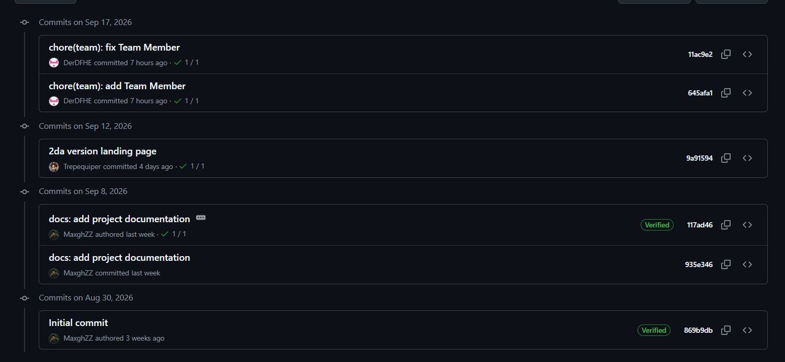

*Figura 5.2. Commits relacionados con la implementación del Landing Page durante el Sprint 1.*

#### 5.2.1.5. Execution Evidence for Sprint Review

La ejecución del Sprint produjo una primera versión funcional del Landing Page. La página presenta la propuesta de valor de VitalTrek, explica el problema de monitoreo en rutas remotas, muestra el funcionamiento por checkpoints, diferencia los beneficios para operadores y turistas, presenta las funcionalidades, planes, equipo, preguntas frecuentes y formulario de contacto.

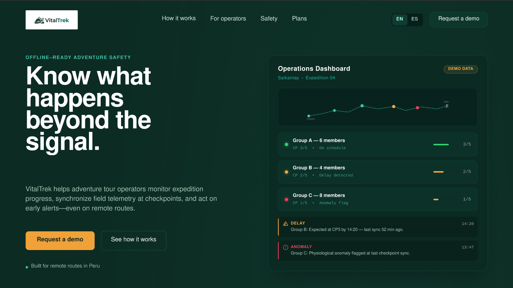

*Figura 5.3. Vista desktop del Landing Page implementado.*


*Figura 5.4. Secciones principales implementadas en el Sprint 1.*

La validación visual comprende la navegación entre secciones, el comportamiento responsive, el cambio de idioma, los call-to-action, el formulario de contacto y la legibilidad del contenido.

#### 5.2.1.6. Services Documentation Evidence for Sprint Review

El alcance del Sprint 1 se limita al Landing Page estático desarrollado con HTML5, CSS3 y JavaScript. No se implementaron endpoints RESTful ni una API en este Sprint; por ello, la documentación OpenAPI y Swagger no aplican a esta entrega. La implementación de Web Services se planifica para una entrega posterior.

| Producto             | Endpoint              | Método HTTP | Estado      |
| -------------------- | --------------------- | ----------- | ----------- |
| RESTful Web Services | No aplica en Sprint 1 | No aplica   | Planificado |

#### 5.2.1.7. Software Deployment Evidence for Sprint Review

La primera versión del Landing Page se publica desde el repositorio de GitHub hacia la plataforma de despliegue configurada.

| Elemento             | Información                                                     |
| -------------------- | --------------------------------------------------------------- |
| Producto             | Landing Page                                                    |
| Plataforma           | Vercel                                                          |
| Repositorio          | https://github.com/1ASI0729-2620-16712-G4-Nexatech/landing-page |
| Rama desplegada      | main                                                            |
| Build command        | No aplica para HTML5, CSS3 y JavaScript estático                |
| Output directory     | Directorio raíz del repositorio                                 |
| Variables de entorno | No requeridas                                                   |
| URL pública          | https://landing-page-mrca1.vercel.app/                          |

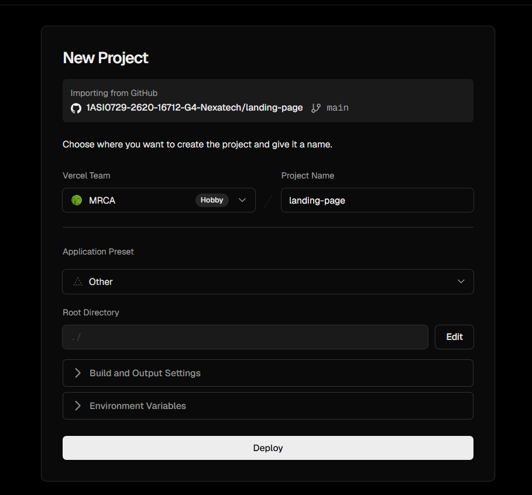

*Figura 5.5. Configuración del proyecto en la plataforma de despliegue.*

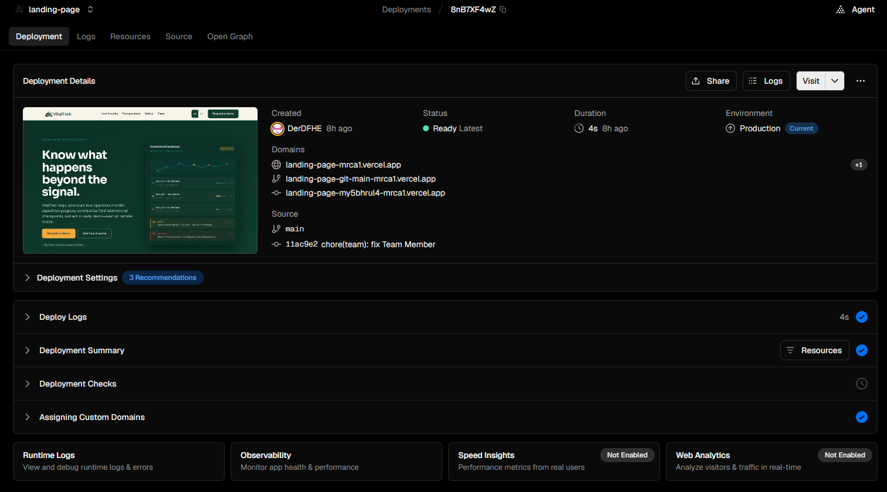

*Figura 5.6. Despliegue exitoso de la primera versión del Landing Page.*

**Landing Page desplegado:** [https://landing-page-mrca1.vercel.app/](https://landing-page-mrca1.vercel.app/)

#### 5.2.1.8. Team Collaboration Insights during Sprint

El trabajo colaborativo del Sprint 1 se realizó mediante GitHub, Jira/Trello y herramientas de diseño. Cada integrante participó en actividades de planificación, diseño, implementación, validación o documentación.

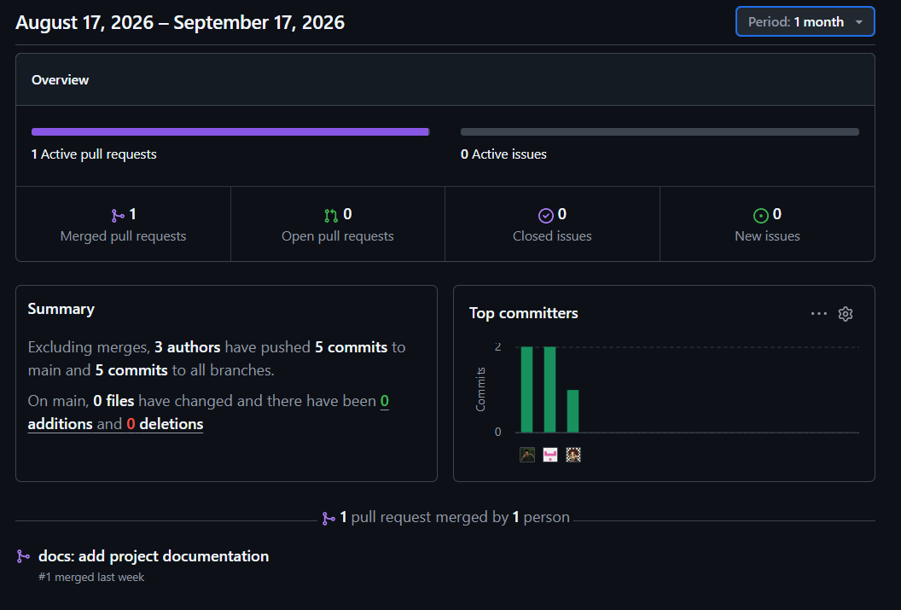

*Figura 5.7. Analítica de colaboración del repositorio durante el Sprint 1.*

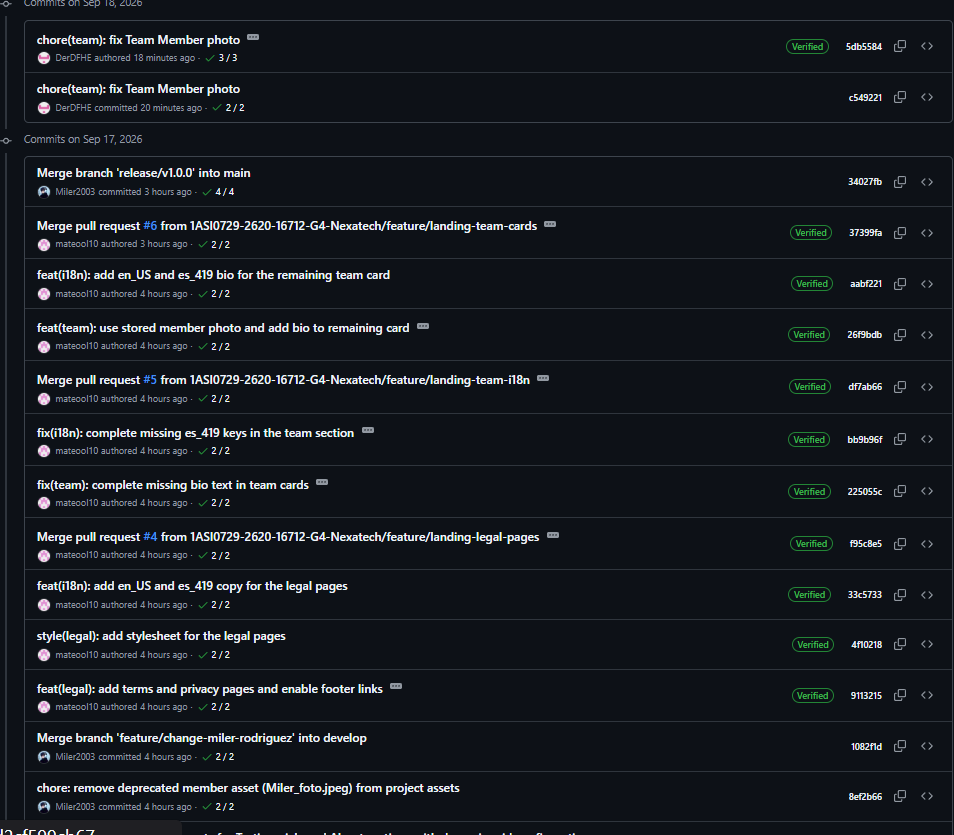

*Figura 5.8. Participación de los integrantes mediante commits.*

| Integrante                       | Actividad realizada                                                                                                                                                                                                   | Evidencia                                                                                                                    |
| -------------------------------- | --------------------------------------------------------------------------------------------------------------------------------------------------------------------------------------------------------------------- | ---------------------------------------------------------------------------------------------------------------------------- |
| Cayanchi Avila, Milenko Rubén    | Especificación de User Stories y Product Backlog; diagramas de arquitectura y base de datos.                                                                                                                          | Commits `ed4bec2`, `398d3e2`, `dabdd80` y `ba5ba04`.                                                                         |
| León Naupari, Jorge Mateo        | Modelado del Ubiquitous Language, User Task Matrix, diagramas C4 de contexto y contenedores, Design-Level Event Storming (4.6.1) y, en el Landing Page, meta tags de SEO, skip link de accesibilidad e i18n asociado. | 16 commits en report y 6 en landing-page; PRs #13, #15, #20 y #24 (report) y PR #2 (landing-page). Figuras 5.9, 5.10 y 5.11. |
| Mendoza Blanco, Ariel Roberto    | Registro de entrevistas y User Journey Maps del Chapter II.                                                                                                                                                           | Commits `cf441d0` y `fa74dfa`.                                                                                               |
| Rodriguez Rojas, Miler Alexander | Impact Mapping, perfil de colaboración, Student Outcome e integración de Chapters IV y V.                                                                                                                             | Commits `9610c3d`, `8519f14`, `7a1cc16` y `98b172a`.                                                                         |
| Herrera Enriquez, Diego Fernando | Style Guidelines y wireframes/mock-ups de Landing Page y Web Applications.                                                                                                                                            | Commits `708d7cc`, `737470f` y `027a2a1`.                                                                                    |

**Evidencia individual - León Naupari, Jorge Mateo (mateool10)**

Los siguientes registros corresponden a la participación verificable del integrante en los repositorios del equipo durante el Sprint 1.

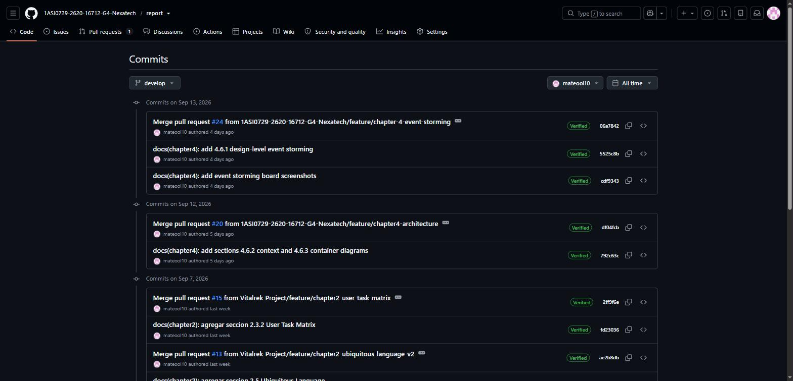

*Figura 5.9. Historial de commits de mateool10 en el repositorio report.*

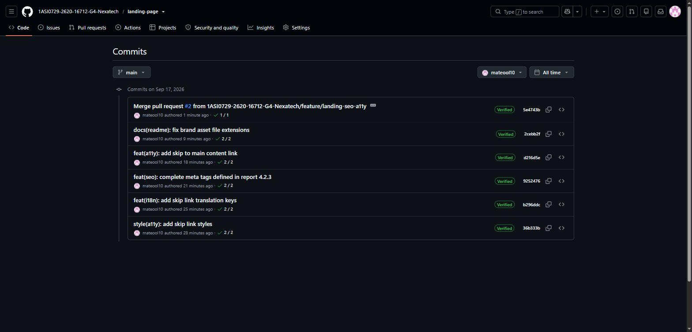

*Figura 5.10. Historial de commits de mateool10 en el repositorio landing-page (rama main).*

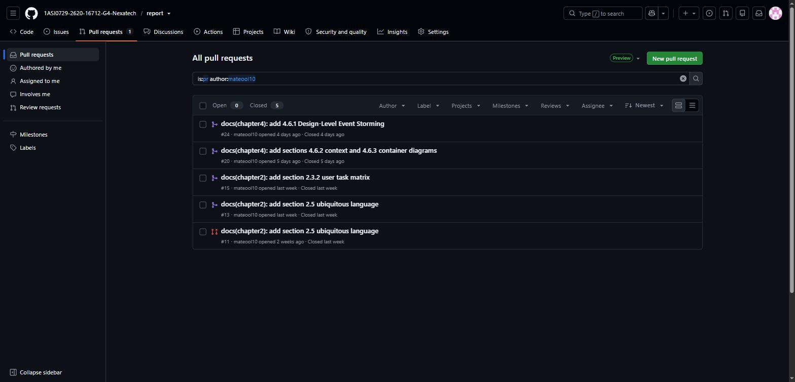

*Figura 5.11. Pull requests creados y fusionados por mateool10 en el repositorio report.*

### 5.2.2. Sprint 2

El Sprint 2 entrega la primera versión de las **Web Applications frontend** de VitalTrek para TB1. El alcance combina la configuración de rutas y expediciones dentro del bounded context `expedition-setup` con la consulta del progreso simulado en `field-tracking`. Se completaron US07, US08, US09, US11, US13, US12 y US20, con un total de **28 Story Points**, conforme al Product Backlog de la sección 3.3.

La aplicación está construida con Vue 3 y Vite; utiliza Pinia, Vue Router, Axios, PrimeVue y vue-i18n para el estado, navegación, componentes, consumo HTTP e internacionalización. json-server@0.17.4 proporciona los datos de prueba. Las capas `domain`, `application`, `infrastructure` y `presentation` separan las entidades, casos de uso/estado, acceso y mapeo de datos, e interfaz. El alcance no incluye autenticación real, backend productivo, persistencia real, Bluetooth, GPS, wearables, telemetría ni alertas reales.

| Campo | Valor |
| --- | --- |
| Sprint Goal | Completar el flujo frontend de preparación de expediciones y consulta de progreso estimado para Operations Administrators y Field Guides. |
| Historias incluidas | US07, US08, US09, US11, US13, US12 y US20 |
| Total de historias | 7 User Stories |
| Sprint Velocity / Total de Story Points | 28 Story Points |
| Contextos de dominio | `expedition-setup` y `field-tracking` |
| Resultado | Web Application frontend implementada; Fake API y telemetría de prueba. |

#### 5.2.2.1. Sprint Planning 2

La planificación del Sprint 2 definió como objetivo completar el flujo de preparación de una expedición —desde la configuración de la Route hasta el registro del Tourist Manifest— y agregar la consulta del progreso estimado del grupo. Las historias se seleccionaron del Product Backlog y se ordenaron según sus dependencias: primero la configuración de rutas, checkpoints y ventanas; luego la creación del grupo, la asignación del guía y el manifiesto; finalmente, el dashboard de seguimiento.

| **Sprint #** | **Sprint 2** |
| --- | --- |
| **Sprint Planning Background** | |
| Date | 2026-10-04 |
| Time | 08:00 PM |
| Location | Reunión virtual en Discord |
| Prepared By | Cayanchi Avila, Milenko Rubén |
| Attendees (to planning meeting) | Cayanchi Avila, Milenko Rubén / Herrera Enriquez, Diego Fernando / León Naupari, Jorge Mateo / Mendoza Blanco, Ariel Roberto / Rodriguez Rojas, Miler Alexander |
| Sprint 1 Review Summary | • Se presentó la primera versión del Landing Page de VitalTrek, desplegada en Vercel y entregada en AV1.<br>• Se completaron las 11 historias comprometidas (US01–US06, US33 y TS01–TS04), equivalentes a 30 Story Points: navegación, propuesta de valor, planes, equipo, solicitud de información, cambio de idioma ES/EN y publicación de términos de servicio y política de privacidad.<br>• El Landing Page se adapta a dispositivos desktop y mobile e incorpora internacionalización y atributos de accesibilidad.<br>• A partir de la revisión de AV1, el equipo corrigió la consistencia, los enlaces, la estructura y las evidencias del informe, y ajustó los roles, el flujo del frontend y la priorización del backlog, dejando los pagos fuera del MVP (versiones 1.6 y 1.7 del Registro de Versiones). |
| Sprint 1 Retrospective Summary | • **Aciertos:** el Sprint se desarrolló según lo planificado; todos los integrantes cumplieron sus tareas dentro del plazo y el incremento se entregó completo.<br>• **Aciertos:** la comunicación por Discord y la división del trabajo por secciones del Landing Page permitieron avanzar en paralelo sin bloqueos.<br>• **Oportunidad de mejora:** la integración del trabajo se concentró al final del Sprint, lo que dificultó revisar los cambios con anticipación.<br>• **Acciones para el Sprint 2:** descomponer cada User Story en tasks de 4 a 8 horas registradas en Jira, desarrollar cada funcionalidad en su propia feature branch e integrarla en `develop` mediante Pull Requests revisados. |
| **Sprint Goal & User Stories** | |
| Sprint 2 Goal | **Our focus is on** enabling the preparation of a complete expedition (route, checkpoints, expected time windows, expedition group, field guide assignment and tourist manifest) and the consultation of the estimated progress of a group.<br>**We believe it delivers** faster and more organized tour preparation **to** Operations Administrators, and a reliable way to register participants and follow the group progress **to** Field Guides.<br>**This will be confirmed when** an Operations Administrator can configure a route with its checkpoints and expected time windows, create an expedition group and assign a field guide, a Field Guide can register the tourist manifest, and both can view the estimated progress of the group in the deployed Web Application, in Spanish and English. |
| Sprint 2 Velocity | 28 Story Points |
| Sum of Story Points | 28 Story Points (US07, US08, US09, US11, US13, US12 y US20) |


#### 5.2.2.2. Aspect Leaders and Collaborators

Milenko Rubén Cayanchi Avila coordinó el trabajo general del Sprint. La matriz resume el liderazgo por aspecto a partir de los cambios de código y Pull Requests consultados en GitHub al 2026-10-05.

| Integrante | Usuario de GitHub | Coordinación | Rutas, checkpoints y ventanas | Grupos, guías, manifiesto y progreso | Espacios de trabajo, navegación e idioma |
| --- | --- | --- | --- | --- | --- |
| Cayanchi Avila, Milenko Rubén | `MaxghZZ` | L | L | C | L |
| León Naupari, Jorge Mateo | `mateool10` | C | C | C | C |
| Mendoza Blanco, Ariel Roberto | `Trepequiper` | C | C | C | L |
| Rodriguez Rojas, Miler Alexander | `Miler2003` | C | C | L | C |
| Herrera Enriquez, Diego Fernando | `DerDFHE` | C | C | C | C |

**Leyenda:** L = líder del aspecto; C = colaborador.

La autoría de los commits y el estado de integración de cada cambio se detallan en la sección 5.2.2.4.

#### 5.2.2.3. Sprint Backlog 2

El Sprint Backlog 2 comprende las siete User Stories seleccionadas para TB1. La tabla conserva las estimaciones del Product Backlog de la sección 3.3 y presenta la descomposición de cada historia en tareas, horas estimadas y responsables.

| Sprint # | Story Id | Story Title | Task Id | Task Title | Task Description | Estimation (Hours) | Assigned To | Status |
| --- | --- | --- | --- | --- | --- | ---: | --- | --- |
| Sprint 2 | US07 | Configuración de rutas | T-22 | Definición del modelo de Route y estado inicial | Implementar la entidad Route con los atributos geográficos y operativos de la historia, e inicializar cada ruta nueva en estado `draft`. | 5 | Cayanchi Avila, Milenko Rubén | Done |
| Sprint 2 | US07 | Configuración de rutas | T-23 | Formulario y listado de rutas | Construir las vistas para consultar las rutas existentes y registrar nombre, origen, destino, distancia, desnivel, dificultad y duración. | 6 | Herrera Enriquez, Diego Fernando | Done |
| Sprint 2 | US07 | Configuración de rutas | T-24 | Persistencia y validación de rutas | Integrar assembler, Fake API y store para crear rutas; validar campos obligatorios y nombres duplicados, y presentar los mensajes de error localizados. | 5 | Cayanchi Avila, Milenko Rubén | Done |
| Sprint 2 | US08 | Definición de checkpoints | T-25 | Modelo y asociación de Checkpoint | Implementar la entidad Checkpoint y asociarla a una Route mediante su identificador, ubicación y posición en la secuencia. | 5 | Cayanchi Avila, Milenko Rubén | Done |
| Sprint 2 | US08 | Definición de checkpoints | T-26 | Vista de configuración de checkpoints | Construir la vista para consultar los checkpoints de una ruta seleccionada y registrar nuevos puntos con su ubicación y orden. | 6 | Herrera Enriquez, Diego Fernando | Done |
| Sprint 2 | US08 | Definición de checkpoints | T-27 | Validación de secuencia y habilitación de ruta | Integrar la persistencia y las reglas del store para rechazar órdenes repetidos e impedir que una ruta sin checkpoints pase de `draft` a `enabled`. | 5 | Cayanchi Avila, Milenko Rubén | Done |
| Sprint 2 | US09 | Ventanas de tiempo esperadas | T-28 | Modelo y mapeo de Expected Time Window | Implementar la entidad y el assembler de ExpectedTimeWindow con ruta, checkpoints de inicio y fin, y límites mínimo y máximo en minutos. | 5 | Mendoza Blanco, Ariel Roberto | Done |
| Sprint 2 | US09 | Ventanas de tiempo esperadas | T-29 | Identificación y configuración de tramos | Construir la vista para ordenar los checkpoints, generar los tramos consecutivos y permitir configurar la ventana esperada de cada uno. | 6 | Rodriguez Rojas, Miler Alexander | Done |
| Sprint 2 | US09 | Ventanas de tiempo esperadas | T-30 | Reglas de validación de ventanas | Integrar Fake API y store para rechazar máximos menores o iguales a los mínimos, evitar ventanas duplicadas e identificar tramos pendientes de configuración. | 5 | Cayanchi Avila, Milenko Rubén | Done |
| Sprint 2 | US11 | Creación del grupo de expedición | T-31 | Modelo y recursos de Expedition Group | Implementar la entidad del grupo y agregar a la Fake API los datos necesarios para relacionarlo con una ruta habilitada, fecha de salida y capacidad máxima. | 6 | Rodriguez Rojas, Miler Alexander | Done |
| Sprint 2 | US11 | Creación del grupo de expedición | T-32 | Vista de creación y consulta de grupos | Construir el flujo para consultar grupos asociados a una ruta y registrar un nuevo grupo desde la gestión de rutas. | 6 | Herrera Enriquez, Diego Fernando | Done |
| Sprint 2 | US11 | Creación del grupo de expedición | T-33 | Validaciones y localización de grupos | Integrar la creación en el store y validar la ruta habilitada, la fecha no pasada y los datos obligatorios; agregar mensajes en español e inglés. | 5 | Mendoza Blanco, Ariel Roberto | Done |
| Sprint 2 | US13 | Asignación del guía | T-34 | Recurso y consulta de Field Guides | Incorporar guías de prueba a la Fake API y mapearlos a entidades de dominio consultables desde el contexto de configuración de expediciones. | 5 | León Naupari, Jorge Mateo | Done |
| Sprint 2 | US13 | Asignación del guía | T-35 | Asignación y control de cruce de fechas | Implementar la asignación de un guía al grupo, informar si ya tiene otro tour en la misma fecha y solicitar confirmación explícita ante el cruce. | 6 | Rodriguez Rojas, Miler Alexander | Done |
| Sprint 2 | US12 | Registro del manifiesto | T-36 | Modelo y endpoint de Manifest Entries | Implementar el modelo de entrada del manifiesto y conectar su consulta y registro con el recurso de prueba asociado al Expedition Group. | 5 | Mendoza Blanco, Ariel Roberto | Done |
| Sprint 2 | US12 | Registro del manifiesto | T-37 | Vista de registro del Tourist Manifest | Construir la vista del Field Guide para consultar los participantes del grupo y registrar turistas con los datos requeridos. | 6 | Herrera Enriquez, Diego Fernando | Done |
| Sprint 2 | US12 | Registro del manifiesto | T-38 | Validación de identidad y capacidad del grupo | Rechazar documentos de identidad duplicados y nuevos participantes que excedan la capacidad máxima; mostrar errores localizados. | 5 | León Naupari, Jorge Mateo | Done |
| Sprint 2 | US20 | Seguimiento del progreso | T-39 | Modelo y fuente de datos de seguimiento | Crear la estructura del bounded context `field-tracking` y mapear datos simulados de grupo, checkpoint, tramo, progreso, estado y sincronización. | 6 | León Naupari, Jorge Mateo | Done |
| Sprint 2 | US20 | Seguimiento del progreso | T-40 | Dashboard de progreso del grupo | Construir la vista para presentar el tramo actual, último checkpoint confirmado y porcentaje de progreso estimado del grupo. | 6 | Rodriguez Rojas, Miler Alexander | Done |
| Sprint 2 | US20 | Seguimiento del progreso | T-41 | Estados de seguimiento y mensajes bilingües | Presentar la antigüedad de la última sincronización y aclarar que el progreso es estimado; informar cuando el tour todavía no está activo. | 5 | Mendoza Blanco, Ariel Roberto | Done |

**Resumen del Sprint Backlog 2**

| Concepto | Valor |
| --- | ---: |
| User Stories asignadas | 7 |
| Work-items resultantes de la descomposición | 20 |
| Estimación mínima de una task | 5 horas |
| Estimación máxima de una task | 6 horas |
| Total de horas estimadas | 109 |
| Sum of Story Points | 28 |

**Distribución de la carga por integrante**

| Integrante | Tasks | Horas |
| --- | ---: | ---: |
| Cayanchi Avila, Milenko Rubén | 5 | 25 |
| León Naupari, Jorge Mateo | 3 | 16 |
| Mendoza Blanco, Ariel Roberto | 4 | 20 |
| Rodriguez Rojas, Miler Alexander | 4 | 24 |
| Herrera Enriquez, Diego Fernando | 4 | 24 |
| **Total** | **20** | **109** |

El Sprint se planificó con el orden de dependencias **US07 → US08 → US09 → US11 → US13 → US12 → US20**.

#### 5.2.2.4. Development Evidence for Sprint Review

La evidencia de desarrollo del Sprint 2 se encuentra en el repositorio [web-applications](https://github.com/1ASI0729-2620-16712-G4-Nexatech/web-applications). Los cambios de US07, US08 y US09 se integraron en `develop` mediante los PR #4, #5 y #6, y los de US11, US13, US12 y US20 mediante el PR #7.

| User Story | Rama | Commit de referencia | Evidencia de integración |
| --- | --- | --- | --- |
| US07 — Configuración de rutas | `feature/webapp-route-configuration` | [`77e6fda`](https://github.com/1ASI0729-2620-16712-G4-Nexatech/web-applications/commit/77e6fda005b45ac9347db60c9d6781675cb9313a) | [PR #4](https://github.com/1ASI0729-2620-16712-G4-Nexatech/web-applications/pull/4), integrado en `develop`. |
| US08 — Definición de checkpoints | `feature/webapp-checkpoints` | [`29b84cc`](https://github.com/1ASI0729-2620-16712-G4-Nexatech/web-applications/commit/29b84cca5935d0fcf8f9f20fc999c770368a6541) | [PR #5](https://github.com/1ASI0729-2620-16712-G4-Nexatech/web-applications/pull/5), integrado en `develop`. |
| US09 — Ventanas de tiempo esperadas | `feature/webapp-expected-time-windows` | [`f0af953`](https://github.com/1ASI0729-2620-16712-G4-Nexatech/web-applications/commit/f0af953046fc8ceefbca4bd305598fedea35648c) | [PR #6](https://github.com/1ASI0729-2620-16712-G4-Nexatech/web-applications/pull/6), integrado en `develop`. |
| US11 — Creación del grupo de expedición | `feature/webapp-expedition-group-creation` | [`e1cb43a`](https://github.com/1ASI0729-2620-16712-G4-Nexatech/web-applications/commit/e1cb43a792ddb626779e2d27d33acc15ed81cdea) | [PR #7](https://github.com/1ASI0729-2620-16712-G4-Nexatech/web-applications/pull/7), integrado en `develop`. |
| US13 — Asignación del guía | `feature/webapp-field-guide-assignment` | [`21aedcd`](https://github.com/1ASI0729-2620-16712-G4-Nexatech/web-applications/commit/21aedcd63b2b18f91487b86a2fce768c38644c8a) | [PR #7](https://github.com/1ASI0729-2620-16712-G4-Nexatech/web-applications/pull/7), integrado en `develop`. |
| US12 — Registro del manifiesto | `feature/webapp-tourist-manifest` | [`71bbcaca`](https://github.com/1ASI0729-2620-16712-G4-Nexatech/web-applications/commit/71bbcaca4648445471ce6b81c3f0431925fac282) | [PR #7](https://github.com/1ASI0729-2620-16712-G4-Nexatech/web-applications/pull/7), integrado en `develop`. |
| US20 — Seguimiento del progreso | `feature/webapp-group-progress-dashboard` | [`cef703d`](https://github.com/1ASI0729-2620-16712-G4-Nexatech/web-applications/commit/cef703d1c403cd0ff50717a9f5bebd45b2bfdad1) | [PR #7](https://github.com/1ASI0729-2620-16712-G4-Nexatech/web-applications/pull/7), integrado en `develop`. |

El PR #7 agrupó la creación de Expedition Groups, la asignación de Field Guides, el Tourist Manifest y el Group Progress Dashboard. Fue integrado en `develop` el 2026-10-05 y contiene 37 commits con cambios en 22 archivos. Sus commits de funcionalidad fueron realizados principalmente por `Miler2003`; el PR fue creado e integrado por `MaxghZZ`.

**Cambios colaborativos complementarios del frontend**

| Cambio | Autor / rama | Commit | Estado en GitHub |
| --- | --- | --- | --- |
| Espacios de trabajo por rol y vistas de Operations Administrator y Field Guide | `MaxghZZ` / `field-guide-views` | [`207f528`](https://github.com/1ASI0729-2620-16712-G4-Nexatech/web-applications/commit/207f52815862f5dc284f9400c26e97d9fed70025) | Integrado en `develop` mediante commit directo. |
| Corrección de visualización del selector de rol | `DerDFHE` / `develop` | [`2c66861`](https://github.com/1ASI0729-2620-16712-G4-Nexatech/web-applications/commit/2c66861a26154775d1e1336fd3e13b7ef9bedf82) | Integrado en `develop` el 2026-10-05. |
| Cambio del selector de idioma a botones ES/EN con etiquetas accesibles y documentación | `Trepequiper` / `feature/button-update` | [`bc74c80`](https://github.com/1ASI0729-2620-16712-G4-Nexatech/web-applications/commit/bc74c80b990714031109cd7c9c01a537a6f39083) | [PR #9](https://github.com/1ASI0729-2620-16712-G4-Nexatech/web-applications/pull/9), 5 commits integrados en `develop` el 2026-10-05. |
| Ajuste de marca en la barra lateral del espacio de trabajo | `mateool10` / `feature/webapp-sidebar-brand` | [`91ebc19`](https://github.com/1ASI0729-2620-16712-G4-Nexatech/web-applications/commit/91ebc19b067eeb642804865f893534a555ed8016) | [PR #8](https://github.com/1ASI0729-2620-16712-G4-Nexatech/web-applications/pull/8), integrado en `develop`. |
| Ajuste de layout para pasar el espacio de trabajo desde la metadata de ruta | `mateool10` / `feature/webapp-workspace-layout-fix` | [`c3a1ae6`](https://github.com/1ASI0729-2620-16712-G4-Nexatech/web-applications/commit/c3a1ae61e7e53875dd213ec8b020cfd5d4ea47b0) | Disponible en la rama `feature/webapp-workspace-layout-fix`. |

#### 5.2.2.5. Execution Evidence for Sprint Review

La validación funcional del Sprint 2 cubre los escenarios principales de las User Stories implementadas. La telemetría y los datos de seguimiento utilizados en US20 son simulados; la aplicación no sustituye sistemas de comunicación o respuesta de emergencia.

| User Story | Escenario de validación | Resultado esperado |
| --- | --- | --- |
| US07 | Registrar una Route válida y probar un nombre duplicado o campos obligatorios incompletos. | La ruta se crea en estado `draft`; los datos inválidos o duplicados se rechazan y se informa el problema. |
| US08 | Registrar checkpoints con órdenes únicos; intentar duplicar un orden y habilitar una ruta sin checkpoints. | Se asocian los checkpoints a la ruta; se rechaza el orden duplicado y no se habilita la ruta vacía. Con al menos un checkpoint, la ruta puede habilitarse. |
| US09 | Guardar una ventana válida, invertir los límites mínimo/máximo y consultar tramos sin configuración. | Se guarda la ventana válida, se rechazan límites inconsistentes y se identifican los tramos pendientes. |
| US11 | Crear un Expedition Group para una ruta habilitada y probar una fecha anterior a la actual. | El grupo se asocia a la ruta; una fecha pasada se rechaza. |
| US13 | Asignar un guía disponible, seleccionar uno con cruce de fecha y comprobar el requisito de responsable. | La asignación se registra; el cruce requiere confirmación y el sistema identifica un grupo sin guía. |
| US12 | Registrar participantes, repetir un documento de identidad y superar la capacidad del grupo. | El manifiesto se actualiza; el documento duplicado y el participante que excede la capacidad se rechazan. |
| US20 | Consultar un tour activo con datos de seguimiento, uno sin sincronización reciente y uno no iniciado. | Se muestran último checkpoint, tramo y progreso estimado; se indica la antigüedad de la información y que es una estimación; un tour no iniciado informa que el seguimiento se habilita al comenzar. |

**Capturas de ejecución**

Las siguientes capturas documentan las vistas de la aplicación observadas durante la ejecución. Exec1 muestra la vista de seguimiento de progreso durante la carga de rutas; Exec2, el listado de rutas en estado de carga con un mensaje de error de creación; Exec3 y Exec5, la selección de espacio de trabajo y rol en español y en inglés; y Exec4, el formulario de registro de una nueva Route.

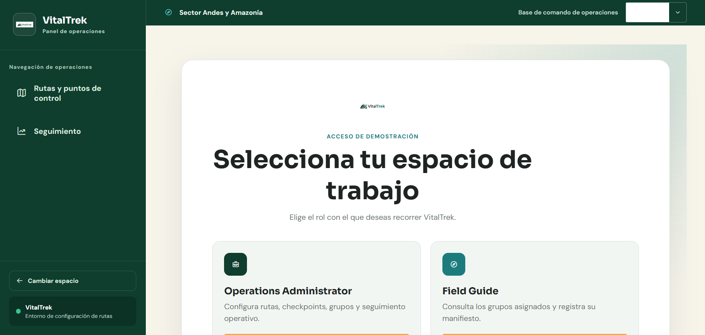

*Figura 5.12. Vista de seguimiento de progreso durante la carga de rutas.*

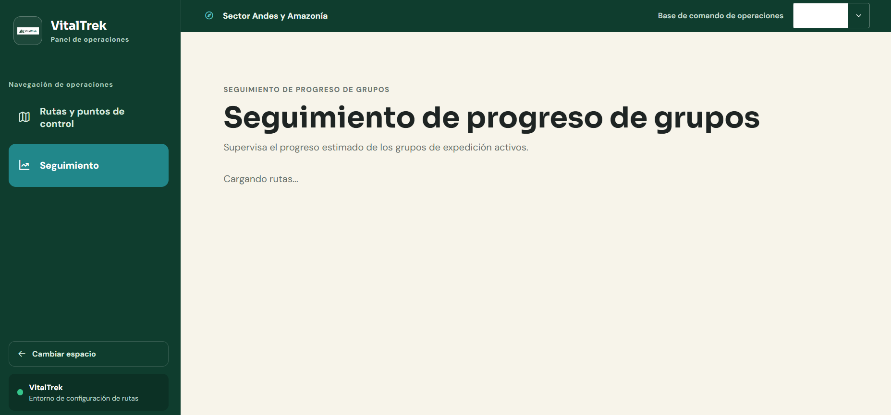

*Figura 5.13. Listado de rutas en estado de carga y mensaje de error de creación.*

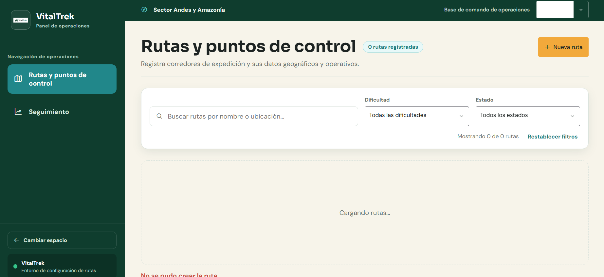

*Figura 5.14. Selección de espacio de trabajo para Operations Administrator o Field Guide.*

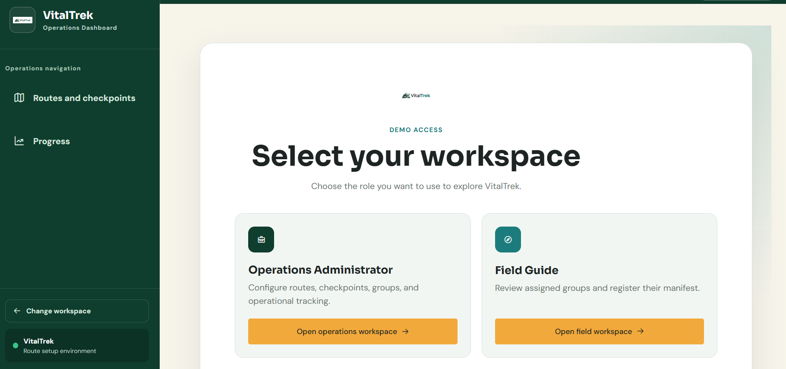

*Figura 5.15. Formulario de configuración de una nueva Route.*

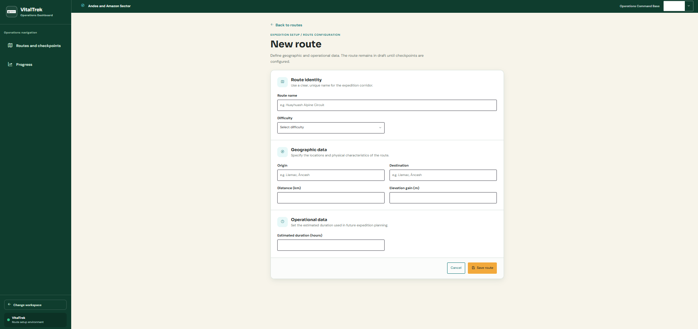

*Figura 5.16. Selector de espacio de trabajo en inglés.*


#### 5.2.2.6. Services Documentation Evidence for Sprint Review

El Sprint 2 no implementa el RESTful Web Services productivo. Para habilitar el frontend se utiliza una **Fake API** ejecutada con json-server@0.17.4 y recursos JSON de prueba. Los datos de US20 se simulan para presentar el estado de seguimiento. Por ello, no se genera una especificación OpenAPI/Swagger de servicios productivos en esta entrega.

| Recurso de prueba | Endpoint local | Métodos utilizados | Propósito |
| --- | --- | --- | --- |
| Routes | `/api/v1/routes` | GET, POST y actualización de estado | Consultar y registrar rutas; habilitar una ruta después de agregar checkpoints. |
| Checkpoints | `/api/v1/checkpoints` | GET, POST | Consultar y registrar puntos de control asociados a una ruta. |
| Expected Time Windows | `/api/v1/expected-time-windows` | GET, POST | Consultar y registrar ventanas esperadas entre checkpoints. |
| Expedition Groups | `/api/v1/expedition-groups` | GET, POST y actualización | Consultar y crear grupos vinculados a una ruta; actualizar su guía asignado. |
| Field Guides | `/api/v1/field-guides` | GET | Consultar guías de prueba disponibles para la asignación. |
| Manifest Entries | `/api/v1/manifest-entries` | GET, POST | Consultar y registrar participantes asociados a un Expedition Group. |
| Group Progress | `/api/v1/group-progress` | GET | Leer registros simulados de último checkpoint, tramo, progreso, estado y antigüedad de sincronización. |

La ruta `/api/v1/*` se resuelve mediante `server/routes.json`. La URL configurada en `.env.development` (`http://localhost:3000/api/v1`) corresponde al entorno de desarrollo local. Los manifiestos y el progreso se persisten en el archivo JSON atendido por json-server.

#### 5.2.2.7. Software Deployment Evidence for Sprint Review

La Web Application del Sprint 2 se encuentra desplegada para su revisión. El despliegue corresponde al frontend de TB1. La aplicación consume una Fake API con datos simulados.

| Elemento | Información |
| --- | --- |
| Producto | VitalTrek Web Applications — frontend TB1 |
| Plataforma de despliegue | Vercel |
| Repositorio | https://github.com/1ASI0729-2620-16712-G4-Nexatech/web-applications |
| Build command | `npm run build` |
| Output directory | `dist` |
| Variable de entorno de producción | `VITE_VITALTREK_API_URL`: URL de la Fake API consumida por el despliegue; la URL `localhost` corresponde al entorno de desarrollo local. |

#### 5.2.2.8. Team Collaboration Insights during Sprint

El equipo colaboró sobre el repositorio [web-applications](https://github.com/1ASI0729-2620-16712-G4-Nexatech/web-applications), utilizando `develop` como rama de integración, ramas de funcionalidad y Pull Requests. Los PR #4, #5 y #6 integraron US07, US08 y US09; el PR #7 integró US11, US13, US12 y US20. Después se incorporaron mejoras transversales de selección de espacio de trabajo y cambio de idioma mediante cambios de varios integrantes. El estado de cada contribución se reporta según la rama y el PR visibles en GitHub al 2026-10-05.

| Integrante | Contribución comprobable en TB1 | Evidencia de GitHub |
| --- | --- | --- |
| Cayanchi Avila, Milenko Rubén (`MaxghZZ`) | Liderazgo general; configuración de rutas, checkpoints y ventanas de tiempo; incorporación de los espacios de trabajo según rol y de las vistas para Operations Administrator y Field Guide. | PR #4, #5 y #6; commit [`207f528`](https://github.com/1ASI0729-2620-16712-G4-Nexatech/web-applications/commit/207f52815862f5dc284f9400c26e97d9fed70025). |
| León Naupari, Jorge Mateo (`mateool10`) | Ajustes de marca y layout para la selección de espacio de trabajo y la barra lateral. | Commit [`c3a1ae6`](https://github.com/1ASI0729-2620-16712-G4-Nexatech/web-applications/commit/c3a1ae61e7e53875dd213ec8b020cfd5d4ea47b0) en `feature/webapp-workspace-layout-fix`; [PR #8](https://github.com/1ASI0729-2620-16712-G4-Nexatech/web-applications/pull/8) con commit [`91ebc19`](https://github.com/1ASI0729-2620-16712-G4-Nexatech/web-applications/commit/91ebc19b067eeb642804865f893534a555ed8016), integrado en `develop`. |
| Mendoza Blanco, Ariel Roberto (`Trepequiper`) | Actualización del selector de idioma ES/EN a botones, incluyendo etiquetas accesibles y documentación del componente. | [PR #9](https://github.com/1ASI0729-2620-16712-G4-Nexatech/web-applications/pull/9), 5 commits; [`bc74c80`](https://github.com/1ASI0729-2620-16712-G4-Nexatech/web-applications/commit/bc74c80b990714031109cd7c9c01a537a6f39083). |
| Rodriguez Rojas, Miler Alexander (`Miler2003`) | Implementación de la creación de grupos, asignación de guías, registro del manifiesto y dashboard de progreso estimado mediante Fake API y datos simulados. | 37 commits integrados mediante [PR #7](https://github.com/1ASI0729-2620-16712-G4-Nexatech/web-applications/pull/7); commits representativos [`e1cb43a`](https://github.com/1ASI0729-2620-16712-G4-Nexatech/web-applications/commit/e1cb43a792ddb626779e2d27d33acc15ed81cdea), [`21aedcd`](https://github.com/1ASI0729-2620-16712-G4-Nexatech/web-applications/commit/21aedcd63b2b18f91487b86a2fce768c38644c8a), [`71bbcaca`](https://github.com/1ASI0729-2620-16712-G4-Nexatech/web-applications/commit/71bbcaca4648445471ce6b81c3f0431925fac282) y [`cef703d`](https://github.com/1ASI0729-2620-16712-G4-Nexatech/web-applications/commit/cef703d1c403cd0ff50717a9f5bebd45b2bfdad1). |
| Herrera Enriquez, Diego Fernando (`DerDFHE`) | Corrección de la vista de selección de rol para mejorar su visualización. | Commit [`2c66861`](https://github.com/1ASI0729-2620-16712-G4-Nexatech/web-applications/commit/2c66861a26154775d1e1336fd3e13b7ef9bedf82), integrado en `develop`. |

Al 2026-10-05, el historial mostraba `develop` actualizado hasta el commit `2c66861`. Posteriormente, el PR #8 fue integrado en `develop`.

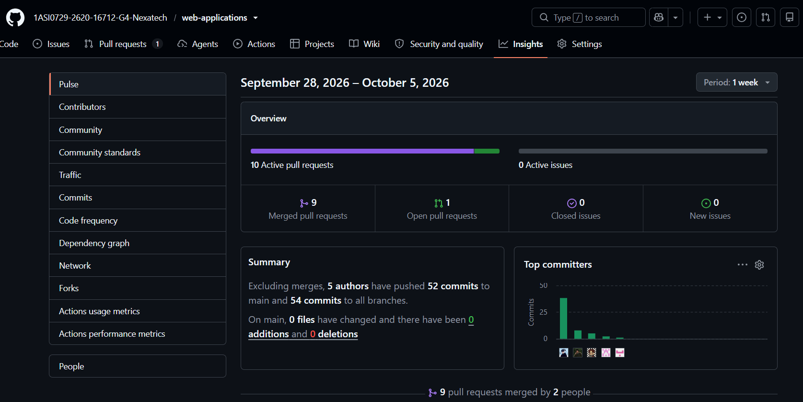

*Figura 5.17. Historial de commits del repositorio web-applications durante TB1.*

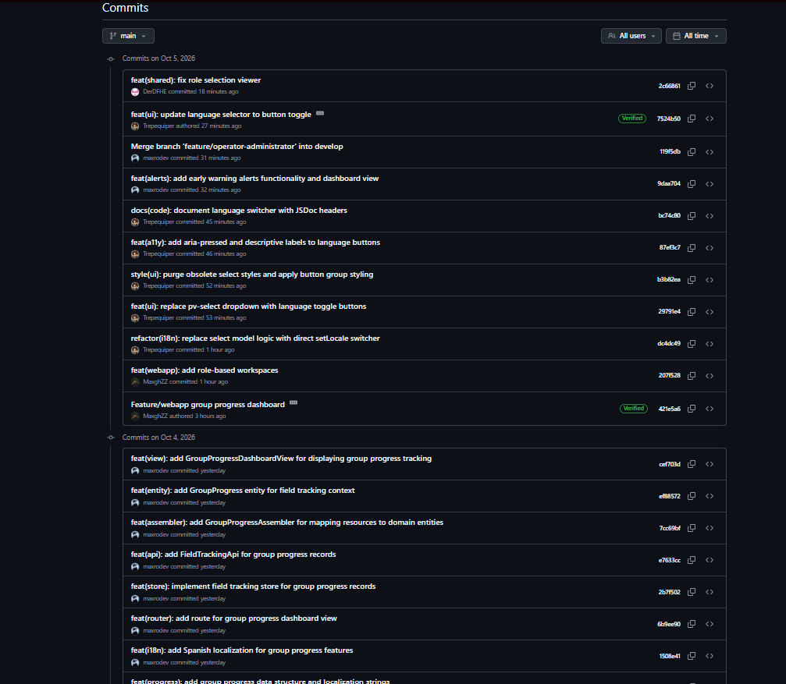

*Figura 5.18. GitHub Insights del repositorio web-applications para el período del 28 de septiembre al 5 de octubre de 2026.*

### 5.2.3. Sprint 3

El Sprint 3 tiene como objetivo implementar y desplegar la primera versión del **RESTful Web Services** de VitalTrek, desarrollado con ASP.NET Core y C# bajo el estilo arquitectónico REST, y documentado con OpenAPI Specification mediante Swagger. El servicio implementa la persistencia en PostgreSQL mediante Entity Framework Core y organiza su código según los bounded contexts definidos en la sección 4.6, aplicando las capas de dominio, aplicación, infraestructura e interfaces. Asimismo, el Sprint incluye una nueva versión del Landing Page y de las Web Applications, que sustituyen progresivamente la Fake API utilizada en el Sprint 2 por el consumo del RESTful API de elaboración interna.

<!-- COMPLETAR: confirmar en un párrafo qué bounded contexts y User Stories cubre el backend en este Sprint. -->

| Campo | Valor |
| --- | --- |
| Sprint Goal | <!-- COMPLETAR: Sprint Goal resumido en una línea --> |
| Historias incluidas | <!-- COMPLETAR: lista de US/TS --> |
| Total de historias | <!-- COMPLETAR --> |
| Sprint Velocity / Total de Story Points | <!-- COMPLETAR --> |
| Contextos de dominio | <!-- COMPLETAR: p. ej. `expedition-setup`, `field-tracking` --> |
| Resultado | <!-- COMPLETAR: llenar al cierre del Sprint --> |

#### 5.2.3.1. Sprint Planning 3

La reunión de planificación del Sprint 3 se centró en definir el alcance de la primera versión del RESTful Web Services y su integración con las Web Applications. El equipo revisó el incremento del Sprint 2 y la retroalimentación recibida en TB1, seleccionó del Product Backlog las User Stories y Technical Stories con mayor valor para el negocio cuya lógica debía trasladarse al backend, y acordó el Sprint Goal y la Velocity del Sprint.

| **Sprint #** | **Sprint 3** |
| --- | --- |
| **Sprint Planning Background** | |
| Date | <!-- COMPLETAR: YYYY-MM-DD --> |
| Time | <!-- COMPLETAR: HH:MM AM/PM --> |
| Location | Reunión virtual en Discord |
| Prepared By | <!-- COMPLETAR: Apellidos, Nombres --> |
| Attendees (to planning meeting) | Cayanchi Avila, Milenko Rubén / Herrera Enriquez, Diego Fernando / León Naupari, Jorge Mateo / Mendoza Blanco, Ariel Roberto / Rodriguez Rojas, Miler Alexander |
| Sprint 2 Review Summary | • Se presentó la primera versión de las Web Applications frontend de VitalTrek, desarrolladas con Vue 3, PrimeVue, Pinia, Vue Router y vue-i18n, desplegadas en Vercel e integradas con una Fake API.<br>• Se completaron las 7 User Stories comprometidas (US07, US08, US09, US11, US13, US12 y US20), equivalentes a 28 Story Points, correspondientes a los bounded contexts `expedition-setup` y `field-tracking`.<br>• La retroalimentación de TB1 señaló como oportunidades de mejora la aplicación parcial de Responsive Web Design en el Landing Page y la ausencia de algunas de sus secciones, la necesidad de evidenciar la participación de todos los integrantes en la implementación, la evidencia de mejora continua entre entregas y la calidad de la comunicación escrita del informe.<br>• En respuesta, el equipo corrigió el informe (versión 1.9 del Registro de Versiones) e incorporó al Sprint 3 las mejoras pendientes del Landing Page. |
| Sprint 2 Retrospective Summary | <!-- COMPLETAR: 3-4 puntos (aciertos, oportunidades de mejora y acciones para el Sprint 3). Sugerencia de mejora real según TB1: distribuir la implementación para que todos los integrantes tengan commits propios en cada producto. --> |
| **Sprint Goal & User Stories** | |
| Sprint 3 Goal | **Our focus is on** <!-- COMPLETAR: outcome -->.<br>**We believe it delivers** <!-- COMPLETAR: impact --> **to** <!-- COMPLETAR: customers -->.<br>**This will be confirmed when** <!-- COMPLETAR: event medible -->. |
| Sprint 3 Velocity | <!-- COMPLETAR --> Story Points |
| Sum of Story Points | <!-- COMPLETAR --> Story Points (<!-- COMPLETAR: lista de historias -->) |

#### 5.2.3.2. Aspect Leaders and Collaborators

Para el Sprint 3, el equipo organizó el trabajo en aspectos que corresponden a los bounded contexts implementados en el RESTful Web Services, a la documentación de los servicios, a las pruebas, a la integración con las Web Applications y al despliegue. La Leadership-and-Collaboration Matrix (LACX) indica, para cada aspecto, al integrante que lo lidera (L) y a quienes colaboran en él (C). Esta organización se refleja en la asignación de tasks del Sprint Backlog 3.

| Integrante                       | Usuario de GitHub | Landing Page structure | Responsive UI | i18n y a11y | QA y deployment | Documentación |
| -------------------------------- | ----------------- | ---------------------- | ------------- | ----------- | --------------- | ------------- |
| Cayanchi Avila, Milenko Rubén    | `MaxghZZ`         | L                      | C             | C           | C               | L             |
| León Naupari, Jorge Mateo        | `mateool10`       | C                      | L             | C           | C               | C             |
| Mendoza Blanco, Ariel Roberto    | `Trepequiper`     | C                      | C             | L           | C               | C             |
| Rodriguez Rojas, Miler Alexander | `Miler2003`       | C                      | C             | C           | L               | L             |
| Herrera Enriquez, Diego Fernando | `DerDFHE`         | C                      | C             | C           | C               | C             |


**Leyenda:** L = Leader; C = Collaborator.

#### 5.2.3.3. Sprint Backlog 3

El Sprint Backlog 3 se enfoca en la primera versión del RESTful Web Services de VitalTrek y en su integración con las Web Applications. Las User Stories y Technical Stories seleccionadas se descompusieron en tasks estimadas entre 4 y 8 horas, cuyo avance se registró en Jira Software con los estados To-do, In-Process, To-Review y Done.

<!-- COMPLETAR: captura del board del Sprint 3 en Jira -->


*Figura 5.X. Board del Sprint 3 en Jira Software.*

**Enlace público del board:** [Jira — VitalTrek](https://milenkorvu.atlassian.net/jira/software/projects/SCRUM/boards/1/backlog)

| **Sprint #** | **Sprint 3** | | | | | | |
| --- | --- | --- | --- | --- | --- | --- | --- |
| **User Story Id** | **User Story Title** | **Work-Item / Task Id** | **Title** | **Description** | **Estimation (Hours)** | **Assigned To** | **Status (To-do / In-Process / To-Review / Done)** |
| <!-- COMPLETAR --> | | | | | | | |

<!-- COMPLETAR: si se mantiene el formato del Sprint 2, agregar debajo el resumen (tasks, horas mínimas y máximas, total de horas) y la distribución de carga por integrante. -->

#### 5.2.3.4. Development Evidence for Sprint Review

En el Sprint 3 se implementó la primera versión del RESTful Web Services de VitalTrek en el repositorio [web-services](https://github.com/1ASI0729-2620-16712-G4-Nexatech/web-services), desarrollado con ASP.NET Core y C# en JetBrains Rider. El proyecto aplica los bounded contexts definidos en el diseño de la sección 4.6, implementa la persistencia en PostgreSQL mediante Entity Framework Core e incluye pruebas unitarias y de integración en el mismo repositorio. Asimismo, se registran los cambios realizados en el Landing Page y en las Web Applications durante el Sprint. Todas las contribuciones se integraron siguiendo GitFlow, con feature branches, Pull Requests hacia `develop` y mensajes de commit según Conventional Commits.

<!-- COMPLETAR: resumir en 2-3 frases los principales avances reales. -->

| Repository | Branch | Commit Id | Commit Message | Commit Message Body | Committed on (Date) |
| --- | --- | --- | --- | --- | --- |
| 1ASI0729-2620-16712-G4-Nexatech/web-services | <!-- COMPLETAR --> | | | | |
| 1ASI0729-2620-16712-G4-Nexatech/web-applications | <!-- COMPLETAR --> | | | | |
| 1ASI0729-2620-16712-G4-Nexatech/landing-page | <!-- COMPLETAR --> | | | | |

<!-- TIP: lista de commits por repo con:
git log develop --since=YYYY-MM-DD --pretty=format:"| %h | %s | %b | %ad |" --date=short -->

#### 5.2.3.5. Execution Evidence for Sprint Review

Al cierre del Sprint 3, el RESTful Web Services de VitalTrek expone los recursos necesarios para las funcionalidades seleccionadas, y las Web Applications consumen dichos servicios en lugar de la Fake API. A continuación se presentan capturas de las principales vistas implementadas y de la ejecución de los servicios, junto con el video que ilustra la visualización y navegación logradas en este Sprint.

<!-- COMPLETAR: capturas con datos cargados desde el backend real (no estados de carga ni errores). -->


*Figura 5.X. <!-- COMPLETAR -->*

**Video de navegación del Sprint 3:** [upc-pre-202620-1asi0730-16712-nexatech-productnavigation-sprint-3](<!-- COMPLETAR: URL de Microsoft Stream -->)

#### 5.2.3.6. Services Documentation Evidence for Sprint Review

En el Sprint 3 se documentaron con OpenAPI Specification, mediante Swagger, los endpoints implementados en el RESTful Web Services. La documentación se genera a partir del proyecto ASP.NET Core y describe, para cada endpoint, el verbo HTTP, la ruta, los parámetros, el cuerpo de la solicitud y los posibles responses. El idioma por defecto de la interfaz de documentación y de los mensajes del API es inglés.

**Repositorio:** [web-services](https://github.com/1ASI0729-2620-16712-G4-Nexatech/web-services)
**Documentación desplegada (Swagger UI):** <!-- COMPLETAR: URL pública de /swagger -->

| Endpoint | HTTP Verb | Call Syntax | Parameters | Response Example | Response Explanation |
| --- | --- | --- | --- | --- | --- |
| <!-- COMPLETAR: p. ej. /api/v1/routes --> | GET | <!-- p. ej. `GET /api/v1/routes` --> | | | |
| | POST | | | | |

<!-- COMPLETAR: una fila por acción. Incluir códigos de respuesta (200, 201, 400, 404). -->

A continuación se muestran capturas de la interacción con la documentación en Swagger UI usando datos de muestra.


*Figura 5.X. <!-- COMPLETAR: endpoint y acción ejecutada con datos de muestra -->*

**Commits relacionados con la documentación de servicios:**

| Commit Id | Commit Message | Committed on (Date) |
| --- | --- | --- |
| <!-- COMPLETAR --> | | |

#### 5.2.3.7. Software Deployment Evidence for Sprint Review

En el Sprint 3 se realizó el primer despliegue del RESTful Web Services de VitalTrek y se publicaron nuevas versiones del Landing Page y de las Web Applications. Las actividades comprendieron la configuración de los recursos en el proveedor cloud para el servicio y la base de datos, la configuración de las variables de entorno con la cadena de conexión y la URL base del API, y la actualización de la variable `VITE_VITALTREK_API_URL` de las Web Applications para consumir el API desplegado. A continuación se describen los pasos realizados y se presentan capturas de cada uno.

| Producto | Plataforma | Repositorio | URL pública |
| --- | --- | --- | --- |
| Landing Page | Vercel | [landing-page](https://github.com/1ASI0729-2620-16712-G4-Nexatech/landing-page) | https://landing-page-mrca1.vercel.app/ |
| Web Applications | Vercel | [web-applications](https://github.com/1ASI0729-2620-16712-G4-Nexatech/web-applications) | <!-- COMPLETAR --> |
| RESTful Web Services | <!-- COMPLETAR: Azure App Service u otro --> | [web-services](https://github.com/1ASI0729-2620-16712-G4-Nexatech/web-services) | <!-- COMPLETAR --> |
| Base de datos | <!-- COMPLETAR: servicio de PostgreSQL --> | — | — |

**Pasos del despliegue del RESTful Web Services**

<!-- COMPLETAR: un paso por captura; ajustar al proceso real. -->
1. Creación del recurso del servicio en <!-- COMPLETAR --> y selección del runtime .NET.
2. Creación de la base de datos PostgreSQL y configuración de la cadena de conexión como variable de entorno.
3. Publicación del proyecto desde el repositorio <!-- COMPLETAR: GitHub Actions / publicación desde Rider -->.
4. Verificación del servicio desplegado mediante Swagger UI.


*Figura 5.X. <!-- COMPLETAR -->*

#### 5.2.3.8. Team Collaboration Insights during Sprint

Durante el Sprint 3, el equipo trabajó sobre los repositorios [web-services](https://github.com/1ASI0729-2620-16712-G4-Nexatech/web-services), [web-applications](https://github.com/1ASI0729-2620-16712-G4-Nexatech/web-applications) y [landing-page](https://github.com/1ASI0729-2620-16712-G4-Nexatech/landing-page), aplicando GitFlow: `develop` como rama de integración, feature branches por funcionalidad y Pull Requests revisados por otro integrante antes de su integración. Todos los integrantes participaron en la implementación del RESTful Web Services. A continuación se resume la contribución de cada integrante y se presentan los analíticos de colaboración de GitHub.

| Integrante | Contribución en el Sprint 3 | Evidencia de GitHub |
| --- | --- | --- |
| Cayanchi Avila, Milenko Rubén (`MaxghZZ`) | <!-- COMPLETAR --> | <!-- PRs / commits --> |
| Herrera Enriquez, Diego Fernando (`DerDFHE`) | <!-- COMPLETAR --> | |
| León Naupari, Jorge Mateo (`mateool10`) | <!-- COMPLETAR --> | |
| Mendoza Blanco, Ariel Roberto (`Trepequiper`) | <!-- COMPLETAR --> | |
| Rodriguez Rojas, Miler Alexander (`Miler2003`) | <!-- COMPLETAR --> | |


*Figura 5.X. Commits del repositorio web-services durante el Sprint 3.*


*Figura 5.X. GitHub Insights (Contributors) del repositorio web-services para el periodo del Sprint 3.*

## 5.3. Validation Interviews

En esta sección se registran y explican las entrevistas de validación realizadas con representantes de los dos segmentos objetivo de VitalTrek: los **dueños o responsables de agencias de turismo de aventura** y los **turistas de aventura**. A diferencia de las entrevistas de las entrevistas anteriores, que tuvieron un enfoque de descubrimiento, estas sesiones tienen un enfoque de **validación**: los participantes interactúan con el Landing Page y con las Web Applications desplegadas, realizan tareas concretas y manifiestan sus observaciones. Los resultados se evalúan según heurísticas de usabilidad, diseño inclusivo y arquitectura de información, con el formato indicado para el proyecto.

### 5.3.1. Diseño de Entrevistas

Las sesiones de validación buscan comprobar si la solución implementada resuelve los problemas identificados en el Needfinding y si los usuarios pueden completar los flujos principales sin ayuda. Para ello, cada participante recibe un conjunto de tareas sobre los productos desplegados y el entrevistador observa su comportamiento, registra las dificultades y, al finalizar, recoge sus apreciaciones.

### Objetivos Generales del Proceso de Validación

1. Verificar que los visitantes de cada segmento comprendan la propuesta de valor de VitalTrek a partir del Landing Page y encuentren la información y los Call-To-Action dirigidos a su segmento.
2. Comprobar que los usuarios puedan completar los user flows principales de las Web Applications definidos en la sección 4.4.4, sin asistencia del entrevistador.
3. Identificar problemas de usabilidad, diseño inclusivo y arquitectura de información, y clasificarlos según su severidad.
4. Contrastar los Lean UX Hypothesis Statements y los assumptions de la sección 1.2.2 con el comportamiento real observado en los usuarios.
5. Recoger testimonios de los participantes que sustenten la propuesta de valor y que puedan incluirse en el Video About-the-Product.

### Principios aplicados a la conducción de las sesiones

- Se pide al participante **pensar en voz alta** (think-aloud) mientras realiza cada tarea.
- El entrevistador **no explica la interfaz ni indica dónde hacer clic**; solo lee la tarea y observa.
- Las tareas se formulan como **objetivos del usuario**, no como instrucciones de interfaz: "registre a los participantes de su grupo" en lugar de "haga clic en el botón Manifiesto".
- Ante una dificultad, se repregunta de forma neutra: "¿qué esperaba encontrar?", "¿qué haría ahora?".
- Las preguntas de opinión se realizan **al finalizar todas las tareas**, para no influir en el comportamiento observado.

---

### Segmento 1: Dueños o Responsables de Agencias de Turismo de Aventura

**Perfil del participante:** propietarios, jefes de operaciones o guías principales de agencias de turismo de aventura que operen rutas en zonas con conectividad limitada.

**Elementos incluidos en la sesión:** Landing Page y Web Application (espacios de trabajo de Operations Administrator y Field Guide).

**Tareas en el Landing Page**

1. Identifique qué problema resuelve VitalTrek para una agencia como la suya.
2. Encuentre los planes disponibles para agencias y su precio.
3. Cambie el idioma del sitio a inglés y luego regrese a español.
4. Solicite información o una demostración del producto.
5. Acceda a la aplicación desde la sección dirigida a agencias.

**Tareas en la Web Application (user flows de la sección 4.4.4)**

6. Registre una nueva ruta con sus datos principales.
7. Agregue los checkpoints de la ruta en el orden del recorrido.
8. Defina el tiempo esperado para cada tramo entre checkpoints.
9. Cree un grupo de expedición para esa ruta y asígnele un guía.
10. Como guía, registre a los participantes del grupo.
11. Consulte el progreso estimado de un grupo que se encuentra en ruta.

<!-- COMPLETAR: ajustar las tareas 6-11 a las funcionalidades realmente desplegadas al momento de la validación. -->

**Preguntas posteriores a las tareas**

1. ¿Qué tarea le resultó más difícil? ¿Por qué?
2. ¿Hubo algún momento en que no supo qué hacer a continuación?
3. ¿Qué información esperaba ver sobre sus grupos que no encontró?
4. ¿Cómo se compara esta forma de preparar un tour con la forma en que lo hace hoy?
5. ¿Qué cambiaría o agregaría para usarlo en su operación?
6. ¿Recomendaría VitalTrek a otra agencia? ¿Por qué?

---

### Segmento 2: Turistas de Aventura

**Perfil del participante:** personas que practican trekking, caminatas o rutas de montaña y que contratan agencias para recorridos de mayor dificultad, duración o riesgo, preferentemente en zonas sin cobertura móvil.

**Elementos incluidos en la sesión:** Landing Page y Web Application.

**Tareas en el Landing Page**

1. Identifique cómo VitalTrek protege a un turista durante un recorrido sin señal.
2. Encuentre qué beneficios ofrece VitalTrek a los turistas.
3. Consulte cómo se tratan sus datos personales y de salud.
4. Cambie el idioma del sitio a inglés y luego regrese a español.
5. Acceda a la aplicación desde la sección dirigida a turistas.

**Tareas en la Web Application**

<!-- COMPLETAR: tareas del turista según lo implementado (p. ej. US14 Registro de contacto de emergencia). Si no hay vistas para turistas, indicarlo y validar solo el Landing Page con este segmento. -->

**Preguntas posteriores a las tareas**

1. ¿Qué tarea le resultó más difícil? ¿Por qué?
2. ¿Entendió qué datos suyos registra VitalTrek y para qué los usa?
3. ¿Se sentiría más tranquilo si la agencia con la que viaja utilizara VitalTrek? ¿Por qué?
4. ¿Qué información esperaba encontrar que no encontró?
5. ¿Recomendaría a una agencia que utilice VitalTrek?

---

### Consideraciones de las Sesiones de Validación

**Cantidad de entrevistas:** mínimo 3 y máximo 5 por segmento, conforme al enunciado del proyecto.

**Entorno:** las sesiones se realizan sobre las versiones desplegadas del Landing Page y de las Web Applications, en desktop o mobile web browser según el dispositivo habitual del participante. Se registra el dispositivo y el navegador utilizados.

**Registro:** las sesiones se graban en video con consentimiento previo del participante, incluyendo la pantalla y la voz. Las grabaciones se consolidan en un único video de validación.

**Evaluación:** los problemas observados se clasifican según la escala de severidad y las heurísticas de usabilidad, diseño inclusivo y arquitectura de información de la sección 5.3.3.

**Ética:** antes de cada sesión se informa al participante sobre el propósito de la validación, la confidencialidad de sus respuestas y su derecho a retirarse en cualquier momento. Los datos utilizados en las tareas son ficticios.

### 5.3.2. Registro de Entrevistas

En esta sección se presentan los registros de las entrevistas de validación realizadas para cada segmento objetivo. Todas las sesiones se consolidan en el video [upc-pre-202620-1asi0730-16712-nexatech-validation-sprint-3](<!-- COMPLETAR: URL de Microsoft Stream -->).


<!-- COMPLETAR: captura representativa del video -->

#### Segmento 1: Dueños o Responsables de Agencias de Turismo de Aventura

| **Entrevista #1** | |
| --- | --- |
| **Nombre** | <!-- COMPLETAR --> |
| **Apellidos** | <!-- COMPLETAR --> |
| **Edad** | <!-- COMPLETAR --> |
| **Distrito** | <!-- COMPLETAR --> |
| **Rol** | <!-- COMPLETAR --> |
| **Dispositivo y navegador** | <!-- COMPLETAR --> |
| **Evidencias** |  |
| **Link** | [Ver Video](<!-- COMPLETAR -->) |
| **Timing donde inicia la entrevista** | <!-- COMPLETAR: mm:ss min --> |
| **Duración de la entrevista** | <!-- COMPLETAR: mm:ss min --> |
| **Resumen** | <!-- COMPLETAR: qué tareas completó sin ayuda, en cuáles tuvo dificultades y por qué, qué comentó al finalizar y cuál fue su apreciación general --> |

<!-- COMPLETAR: repetir la tabla para las entrevistas #2 y #3 (hasta #5) -->

#### Segmento 2: Turistas de Aventura

| **Entrevista #1** | |
| --- | --- |
| **Nombre** | <!-- COMPLETAR --> |
| **Apellidos** | <!-- COMPLETAR --> |
| **Edad** | <!-- COMPLETAR --> |
| **Distrito** | <!-- COMPLETAR --> |
| **Rol** | Turista de aventura |
| **Dispositivo y navegador** | <!-- COMPLETAR --> |
| **Evidencias** |  |
| **Link** | [Ver Video](<!-- COMPLETAR -->) |
| **Timing donde inicia la entrevista** | <!-- COMPLETAR --> |
| **Duración de la entrevista** | <!-- COMPLETAR --> |
| **Resumen** | <!-- COMPLETAR --> |

<!-- COMPLETAR: repetir la tabla para las entrevistas #2 y #3 (hasta #5) -->

#### Resultados de las tareas por segmento

Para cada segmento se consolida cuántos participantes completaron cada tarea sin ayuda, siguiendo el mismo criterio de la sección 2.2.3.

| Tarea | Segmento 1: completada sin ayuda | Segmento 2: completada sin ayuda | Observación principal |
| --- | --- | --- | --- |
| <!-- COMPLETAR: p. ej. Solicitar información desde el Landing Page --> | <!-- X de 3 (%) --> | <!-- X de 3 (%) --> | <!-- COMPLETAR --> |

<!-- COMPLETAR: 2-3 párrafos que contrasten los resultados con los problemas de la sección 2.2.3 y con las Hypothesis Statements de la sección 1.2.2.3: qué se confirmó, qué no y qué se debe cambiar. -->

> Los porcentajes corresponden a la muestra de participantes de las sesiones de validación y no representan a todas las agencias o turistas del Perú.

### 5.3.3. Evaluaciones según heurísticas

En esta sección se evalúan las sesiones de validación según heurísticas de usabilidad, diseño inclusivo y arquitectura de información, con el formato UX Heuristics & Principles Evaluation indicado para el proyecto. Cada problema se registra con su severidad, la heurística o principio que viola y una recomendación de corrección, que se incorpora al Product Backlog para los siguientes Sprints.

Las heurísticas aplicadas son:

- **Usability:** las 10 heurísticas de usabilidad de Jakob Nielsen.
- **Inclusive Design:** los Inclusive Design Principles (proporciona experiencias comparables, considera la situación, sé consistente, da el control, ofrece opciones, prioriza el contenido y agrega valor).
- **Information Architecture:** las heurísticas de arquitectura de información de Abby Covert (findable, accessible, clear, communicative, useful, credible, controllable, valuable, learnable y delightful).

**UX Heuristics & Principles Evaluation**
**Usability – Inclusive Design – Information Architecture**

| | |
| --- | --- |
| **CARRERA** | Ingeniería de Software |
| **CURSO** | Aplicaciones Web |
| **SECCIÓN** | 16712 |
| **PROFESORES** | Sánchez Seña, Alberto Wilmer |
| **AUDITOR** | NexaTech |
| **CLIENTE(S)** | <!-- COMPLETAR: nombres de los participantes de las sesiones --> |

**SITE o APP A EVALUAR:** VitalTrek: Landing Page y Web Applications.

**TAREAS A EVALUAR:**

El alcance de esta evaluación incluye la revisión de la usabilidad de las siguientes tareas:

1. Consulta de la propuesta de valor y de los planes en el Landing Page.
2. Cambio de idioma en el Landing Page y en la Web Application.
3. Solicitud de información o demostración desde el Landing Page.
4. Acceso a la Web Application desde los Call-To-Action de cada segmento.
5. Registro de una ruta con sus checkpoints y ventanas de tiempo esperadas.
6. Creación de un grupo de expedición y asignación de un guía.
7. Registro del manifiesto de turistas.
8. Consulta del progreso estimado de un grupo.

<!-- COMPLETAR: ajustar a las tareas realmente evaluadas (agregar las del turista si las hay). -->

No están incluidas en esta versión de la evaluación las siguientes tareas:

1. Asignación y activación de wearables.
2. Captura offline y sincronización de telemetría en checkpoints.
3. Evaluación de riesgo y generación de alertas.
4. Gestión de incidentes, emergencias y evacuaciones.
5. Cierre del tour y generación del Tour Summary.

<!-- COMPLETAR: quitar de esta lista lo que sí se haya implementado y evaluado. -->

**ESCALA DE SEVERIDAD:**

Los errores serán puntuados tomando en cuenta la siguiente escala de severidad:

| Nivel | Descripción |
| :---: | --- |
| 1 | Problema superficial: puede ser fácilmente superado por el usuario u ocurre con muy poca frecuencia. No necesita ser arreglado a no ser que exista disponibilidad de tiempo. |
| 2 | Problema menor: puede ocurrir un poco más frecuentemente o es un poco más difícil de superar para el usuario. Se le debería asignar una prioridad baja para resolverlo de cara al siguiente release. |
| 3 | Problema mayor: ocurre frecuentemente o los usuarios no son capaces de resolverlo. Es importante que sea corregido y se le debe asignar una prioridad alta. |
| 4 | Problema muy grave: un error de gran impacto que impide al usuario continuar con el uso de la herramienta. Es imperativo que sea corregido antes del lanzamiento. |

**TABLA RESUMEN:**

| # | Problema | Escala de severidad | Heurística/Principio violada(o) |
| :---: | --- | :---: | --- |
| 1 | <!-- COMPLETAR --> | <!-- 1-4 --> | <!-- p. ej. Usability: Visibilidad del estado del sistema --> |

**DESCRIPCIÓN DE PROBLEMAS:**

**PROBLEMA #1:** <!-- COMPLETAR: título del problema -->

**Severidad:** <!-- COMPLETAR -->
**Heurística violada:** <!-- COMPLETAR -->

**Problema:**

<!-- COMPLETAR: qué ocurrió, en qué tarea, cuántos participantes lo experimentaron -->


**Recomendación:**

<!-- COMPLETAR: corrección propuesta y User Story o task del Product Backlog donde se registra -->

<!-- COMPLETAR: repetir el bloque por cada problema de la tabla resumen -->

